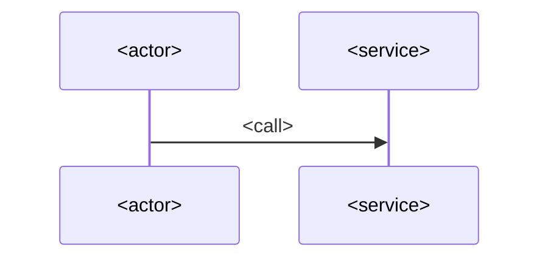

# <Flow name>

> **TL;DR:** <Who starts it, what triggers it, what the outcome is, and which repos take part — in two to four lines.>

## Summary

| Actor | Trigger | Outcome |
|---|---|---|
| <who> | <`POST /orders`, a message on `orders.created`…> | <what changes> |

## Sequence

## Steps

| # | Step | Repo | Entrypoint | Evidence |
|---|---|---|---|---|
| 1 | <what happens> | `<repo>` | `<POST /path or listener>` | `<repo>:<path>#L<a>-L<b>` |

## Rules and branches <!-- optional -->

<Business rules that change the path, with a flowchart if there are branches.>

## Failure handling

<Retries, idempotency, compensations, timeouts — or `TODO(question): …` when the code does not say.>

## Data touched

| Store | Table / topic | Read or write |
|---|---|---|
| <db or broker> | `<name>` | <read/write> |

## Open questions <!-- optional -->

- `TODO(question): …`
