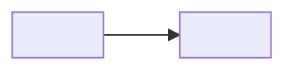

# <Bounded contexts>

> **TL;DR:** <The contexts, which repos implement them, and the main relationships (customer/supplier, shared kernel…).>

## Contexts

| Context | Responsibility | Repos |
|---|---|---|
| <name> | <what it owns> | `<repo>` |

## Context map

