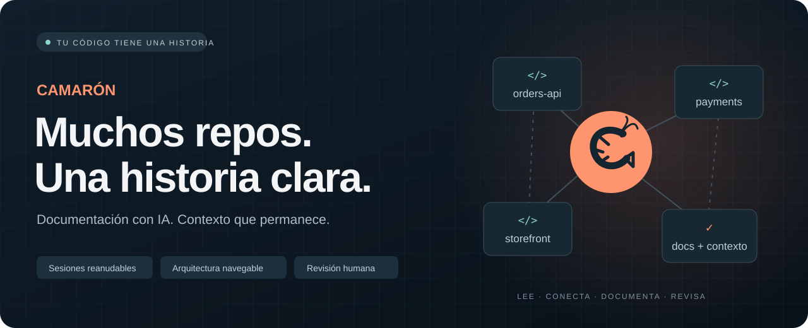
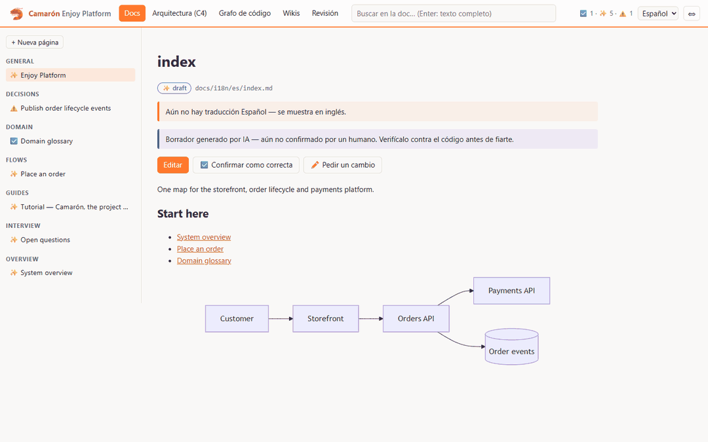
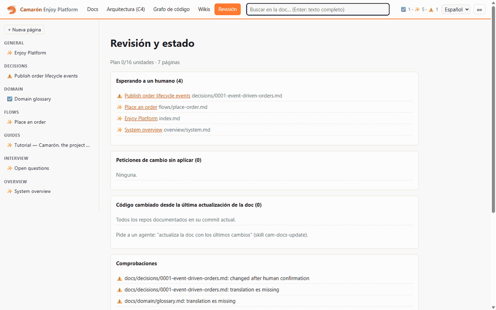
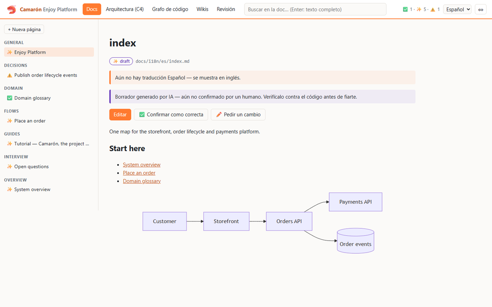
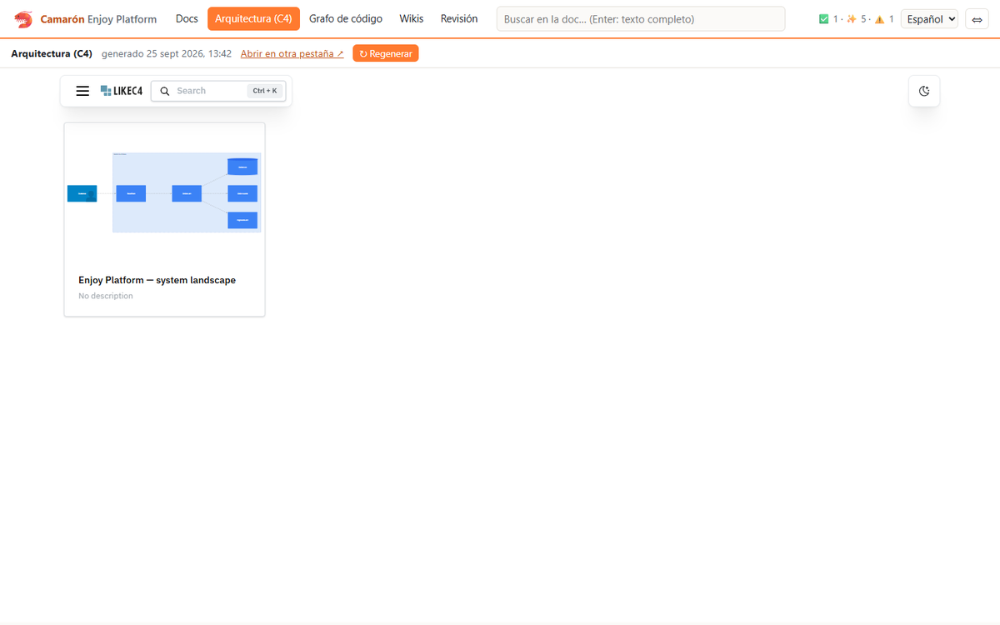
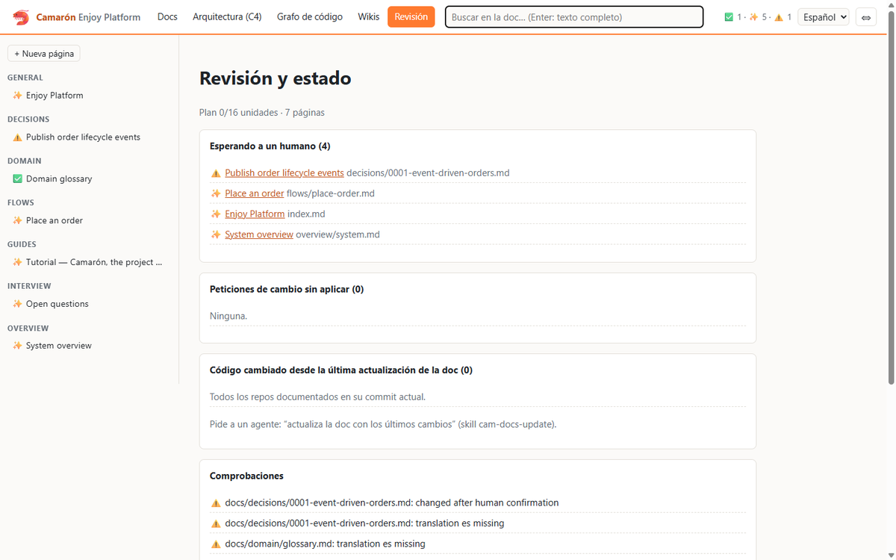

<p align="center">
  
</p>

<p align="center">
  <strong>Convierte un proyecto multi-repo en documentación que puedes explorar, revisar y mantener.</strong><br>
  Tu agente de IA lee el código. Camarón organiza el trabajo. Tú validas el resultado.
</p>

<p align="center">
  
  
  
  
  <a href="https://github.com/iandelu/camarones-documenter/actions/workflows/tests.yml"></a>
</p>

<p align="center">
  <a href="#empieza-aquí">Empezar</a> ·
  <a href="#del-código-al-mapa-del-proyecto">Cómo funciona</a> ·
  <a href="#una-sesión-una-unidad-de-trabajo">Sesiones</a> ·
  <a href=".camarones/TUTORIAL.md">Tutorial ES / EN</a>
</p>

---

## El código está repartido. La explicación no debería estarlo.

Un servicio recibe la petición, otro publica un evento y un tercero guarda el resultado. Entender el sistema exige cruzar repositorios, conversaciones y decisiones que quizá nadie escribió.

**Camarón** es un wizard local con CLI que coordina ese trabajo con Claude Code o Codex. Divide la documentación en unidades manejables, guarda el progreso entre sesiones y reúne el resultado en un portal web.

Está pensado para equipos que necesitan incorporar personas, entender sistemas heredados o documentar la arquitectura y los flujos de un proyecto con varios repositorios.

### Un cerebro de proyecto, primero sin IA

El objetivo de Camarón es **mejorar, automatizar y estandarizar cómo la IA documenta un proyecto**. El resultado es un cerebro del proyecto: un único sitio versionado donde el código, la arquitectura, el dominio y las decisiones quedan explicados para personas y agentes.

1. **Instalar ya da valor, casi sin IA.** La instalación deja las herramientas de documentación listas y genera una base lógica solo con análisis estático: repos detectados, grafo de código, borrador C4, plan de trabajo y portal. Sin llamar a ningún modelo ni necesitar una cuenta de pago.
2. **Después, la IA la completa.** Entrevistas, redacción, depuración del modelo, mejoras de arquitectura y mantenimiento cuando cambia el código.
3. **Todo lo que añade la IA se puede revisar y rastrear**: borrador → confirmado, con las fuentes (`x-sources`) de cada afirmación.

Camarón te habla como tu becario gamba al que has mandado a documentar: con ganas, con chispa y consciente de que es pequeño. Las bromas se quedan en las esperas y los éxitos; los errores y las decisiones van al grano.

### Qué hace, en seis puntos

1. **Instala e integra las herramientas de IA** (Claude Code, Codex, graphify, LikeC4, OpenWiki, MCP, mermaid-cli, gitleaks) con un asistente.
2. **Estandariza la documentación** con un plan de unidades, un playbook, convenciones y skills para los agentes.
3. **Las personas consultan, editan y verifican** la documentación en el portal vivo (`camaron up`) o con la CLI.
4. **La IA tiene la documentación a mano al implementar**: servidor MCP `camarones` (`ask` con citas, `search_docs` con ranking, que dice en qué sección está cada resultado; `read_doc` de una página entera o solo de una sección, con su TL;DR; `repo_graph`…), servidor MCP `likec4` para preguntar al modelo de arquitectura, ambos en Claude Code y en Codex, y skills `cam-docs-lookup` / `cam-docs-update`. Funciona también con Claude Code abierto dentro de un solo repo: `setup` registra el MCP `camarones` en el ámbito local de Claude Code para la carpeta de cada repo (en tu `~/.claude.json`, nunca en el repo), `doctor` avisa si falta, `repair` lo vuelve a poner y `uninstall` lo quita.
5. **Documentación viva y revisada**: el código y la doc cambian juntos; `changes`, `check` y la trazabilidad `x-sources` señalan lo que quedó atrás, y `check` además detecta enlaces rotos, diagramas que no se dibujan, secretos copiados y términos que el glosario pide evitar.
6. **Todo vive en `cam-docs/`**, una carpeta junto a tus repos que es su propio repo Git: docs, `.camarones`, `.claude`, `.codex`, `.agents`, `.mcp.json`. Los repos de servicio no reciben archivos del kit, y la configuración de agentes que llega del equipo solo se carga cuando la apruebas en tu máquina.

## Mira cómo funciona

<p align="center">
  
</p>

<p align="center"><em>Navega, busca y abre documentación sin salir del portal.</em></p>

<p align="center">
  
</p>

<p align="center"><em>Revisa borradores, confirma páginas y deja correcciones para la siguiente sesión.</em></p>

<details>
<summary><strong>Más capturas del portal</strong></summary>

| Documentación | Arquitectura C4 | Revisión |
|---|---|---|
|  |  |  |

</details>

## Del código al mapa del proyecto

1. **Conecta tus repositorios.** Detecta carpetas Git locales o configura repositorios de GitHub y GitLab.
2. **Descubre el sistema.** El agente examina código, contratos, configuración e integraciones; las entrevistas recogen el contexto que falta. Las entrevistas no frenan la redacción: las fichas de repo, el dominio, los datos, las decisiones y el catálogo de flujos empiezan desde el código como borradores (`✎ draft` en `camaron plan`), dejan sus preguntas en `docs/interview/open-questions.md` y se reabren para afinarlas cuando termina la entrevista. Las traducciones y la confirmación sí esperan a las entrevistas.
3. **Documenta por sesiones.** Wikis por repositorio, arquitectura C4, dominio, modelos de datos, flujos de negocio y decisiones.
4. **Revisa y publica.** Valida los borradores y construye un portal con navegación, diagramas y traducciones.
5. **Vuelve cuando cambie el código.** Compara commits desde la última documentación y usa las fuentes para orientar la actualización.

### Lo que lo hace útil

- **Una visión de todo el proyecto.** Une la documentación de cada repositorio con sus relaciones, actores y flujos de negocio.
- **Sesiones que puedes retomar.** Plan, notas de progreso y contexto de relevo guardados en archivos del proyecto.
- **Documentación con fuentes.** Referencias `x-sources` al código y detección de fuentes que ya no existen.
- **Revisión humana visible.** Distingue borradores, páginas confirmadas y páginas que necesitan otra revisión.
- **Arquitectura navegable.** LikeC4 para las vistas del sistema y Mermaid para secuencias, estados y modelos de datos. El modelo C4 se reparte en ficheros: cada repo en `repos/<repo>.c4` y cada flujo en `flows/<slug>.c4`, de modo que las unidades que trabajan a la vez no editan el mismo fichero.
- **Documentación para personas y agentes.** Portal para leer; `AGENTS.md`, `CLAUDE.md`, `llms.txt` (índice) y `llms-full.txt` (todas las páginas en un fichero) para orientar el trabajo con IA.
- **Inglés y español.** Documentación canónica en inglés, traducciones al español y seguimiento de traducciones pendientes o desactualizadas.
- **Un primer mapa sin IA.** `arch-draft` realiza un análisis estático y propone un borrador C4 que después hay que verificar. Entiende proyectos Firebase: una sola Firestore y un solo Storage por proyecto (el de `.firebaserc`), compartidos por las apps que los usan, la carpeta `functions/` como un contenedor «Cloud Functions» al que llaman las apps (`httpsCallable`, `cloud_functions`) y Firebase Auth como sistema externo.
- **Datos del código, sin IA.** Cada repo tiene `docs/repos/<repo>/reference.md` con sus comandos (Maven, Gradle, `package.json`, Makefile, Docker Compose), variables de entorno (placeholders `${VAR:valor}` de Spring, `.env.example`, `environment.ts` de Angular), endpoints HTTP (OpenAPI o anotaciones de Spring) y topics de mensajería, cada fila con el fichero y la línea de donde sale. Los valores por defecto que parecen secretos se ocultan. Son bloques `<!-- generated:… -->` que se pueden poner en cualquier página; `camaron blocks` y `camaron sync` los actualizan. Si alguien edita uno a mano, se conserva y `check` lo avisa (`blocks --force` toma la versión del código).
- **Historial de git, sin IA.** `camaron history [--months 12]` escribe `docs/overview/history.md` (y su traducción): los ficheros con más commits, quién tiene más commits en cada repo y en qué carpeta trabaja (solo nombres, sin correos), los ficheros que cambian juntos, los tickets que aparecen en commits de varios repos y qué parte de los commits sigue Conventional Commits. Deja fuera bots y lockfiles. Sirve para saber a quién entrevistar y por dónde empezar.
- **Aprovecha lo que ya usáis.** `radar` detecta el stack de cada repo y sus herramientas (Backstage, Sonar, librería de componentes, linters, contratos, CI) y lo deja en `docs/overview/tooling.md`; `stack` corrige un stack mal detectado. `inventory` (que también corre con el escaneo inicial) lista las dependencias directas de cada repo desde sus manifiestos y lockfiles (Maven, Gradle, npm, Python, Go, .NET, Composer, Cargo y Flutter/Dart), con su versión, su ámbito (runtime, test, dev) y su categoría (framework, datos, caché, seguridad, mensajería, observabilidad, API, HTTP, SDK de nube, UI, tests, build), y marca la misma librería con versiones distintas entre repos; lo deja en `docs/overview/libraries.md` sin IA. Las categorías salen de `.camarones/lib/dep_categories.yaml`. Con `inventory --cves` añade las **vulnerabilidades conocidas** de cada librería (CVE, gravedad y versión que la corrige) con OSV-Scanner, un binario fijado y comprobado por SHA-256 que se descarga una vez en `~/.camarones/bin`. Usa su base de datos **offline** (se descarga una vez en `~/.camarones/osv-db`, unos 220 MB para Maven y npm), y sin resolver dependencias transitivas (eso pediría a Maven Central los poms padre, también los internos), así que ningún nombre de paquete sale de tu máquina; la API online solo se usa si pones `"osv": {"online": true}` en `~/.camarones.json`. Sale con código 1 si hay alguna alta o crítica, para usarlo en CI.
- **Esquemas de datos sin IA.** `schemas` (que también corre con el escaneo inicial y el primer vistazo) lee las tablas y colecciones de cada repo desde el código: SQL de las migraciones (Flyway en orden de versión, Liquibase XML/YAML), ficheros `schema.sql` y clases de entidad (JPA, SQLAlchemy, Django, TypeORM, Prisma), y NoSQL de Mongo (`@Document`, Mongoose) y Firestore (las rutas de `firestore.rules`, las llamadas a `collection(…)` y las claves que se escriben en ellas, también en Dart/Flutter). Cada campo lleva su tipo, clave y referencia. Deja `docs/data/<repo>.md` con un diagrama ER y la lista de tablas en un bloque generado que el kit mantiene al día con el código (si alguien lo edita a mano, se respeta y `check` lo dice); la unidad `data` de IA parte de ahí para explicar qué significa cada tabla y de quién es. Una página que ya existía nunca se sobrescribe.
- **Control de calidad en cada unidad.** Enlaces rotos y diagramas Mermaid inválidos son errores; un posible secreto bloquea el commit de checkpoint, la exportación del portal y la rama de CI, sin mostrar nunca su valor.
- **Nada se ejecuta a ciegas.** Los hooks, servidores MCP, ajustes y skills que llegan con el `cam-docs` del equipo y que no ha escrito el kit se te enseñan antes de que los carguen Claude Code o Codex; las aprobaciones son de tu máquina y ningún push puede darlas por ti.

## Empieza aquí

### Requisitos

- **Git** y **Node.js 22 o superior** para el conjunto de herramientas.
- **uv**, que gestiona Python 3.10+ y las dependencias del CLI. El lanzador puede instalarlo con WinGet en Windows o Homebrew en macOS; en otros casos indica cómo continuar.
- **Claude Code o Codex**, instalado y autenticado, para las sesiones de documentación con IA. También sirven OpenCode y Gemini CLI (ver [Agentes y modelos locales](#agentes-y-modelos-locales)). El asistente también permite copiar el prompt.
- **Docker es opcional**: el portal también se puede servir con Python.

El asistente comprueba los requisitos y permite elegir componentes. La primera instalación descarga herramientas y dependencias. El acceso a modelos de IA depende de la configuración y cuenta de tu agente.

### 1. Instala el kit

**Instalación global (recomendada).** Una sola copia del kit, compartida por todos tus proyectos: actualizarla una vez actualiza el comportamiento en todos a la vez, y cada proyecto solo guarda su propia configuración. Una línea, sin clonar nada antes:

```sh
# macOS / Linux
curl -fsSL https://raw.githubusercontent.com/iandelu/camarones-documenter/main/install-global.sh | sh
```

```powershell
# Windows · PowerShell
$f="$env:TEMP\camaron-install.cmd"; (irm https://raw.githubusercontent.com/iandelu/camarones-documenter/main/install-global.cmd) -replace "`r?`n","`r`n" | Set-Content -NoNewline -Encoding ascii $f; & $f
```

Si ya tienes el repo clonado, `sh install-global.sh` o `.\install-global.cmd` hacen lo mismo.

Esto clona el kit oficial de GitHub a una ruta fija (`%LOCALAPPDATA%\camarones-documenter\kit` en Windows, `~/.camarones/kit` en macOS/Linux) y deja el comando `camaron` en tu PATH. El antiguo `camarones` continúa como alias compatible durante la transición. Para instalar desde un fork o desde tu copia local mientras desarrollas el kit, define `CAMARONES_KIT_URL` antes de lanzar el instalador.

**Actualizar.** En el asistente, **⚙️ Ajustes › ⬆️ Actualizar Camarón** comprueba si hay versión nueva, te la ofrece y reinicia el asistente ya actualizado. Desde la terminal es `camaron self-update`. Las instalaciones anteriores a la 3.8, que seguían la carpeta desde la que se instalaron, pasan solas a seguir el kit oficial. Desde ahí:

```sh
cd ~/Documents/mi-proyecto   # la carpeta que agrupa (o agrupará) los repos
camaron                    # crea ./cam-docs/, lo registra y abre el asistente
camaron new enjoy          # alternativa: crea ./enjoy/cam-docs/
camaron join <url>         # únete al cam-docs de tu equipo: lo clona aquí o reutiliza el que ya tienes
camaron share              # trae lo último del equipo y publica tu trabajo (solo cuando lo pides)
camaron share --auto on    # o publica solo tras cada checkpoint (en este equipo)
camaron trust              # revisa y aprueba los hooks, MCP y skills del equipo antes de que los carguen tus agentes
camaron repair             # devuelve a su sitio los ficheros y enlaces del kit si alguien los editó o borró
camaron switch             # cambia entre tus proyectos
camaron self-update        # trae el kit oficial al día — actualiza todos los proyectos a la vez (en el asistente: ⚙️ Ajustes › ⬆️ Actualizar Camarón)
camaron migrate            # pasa un proyecto de la estructura anterior (≤2.5) a cam-docs/
camaron uninstall           # lo deshace todo: borra cam-docs/ (con copia .zip) y los rastros en los repos
```

Cada proyecto guarda **todo lo que genera el kit en `cam-docs/`**, un repositorio Git propio (versionado aparte del kit y de los repos que documenta, pensado para compartirlo con el equipo). La carpeta del workspace enlaza a él la configuración de los agentes, así que al abrir Claude Code o Codex en ella ven todos los repos y la documentación:

```text
mi-proyecto/
├── cam-docs/             # Repo Git: la documentación viva y la config de la herramienta
│   ├── .camarones/       # workspace.yaml, PLAYBOOK.md, CONVENTIONS.md (y .cache/, ignorada)
│   ├── .claude/ .codex/ .agents/ .mcp.json   # skills, MCP y reglas para los agentes
│   ├── AGENTS.md CLAUDE.md
│   ├── docs/             # Arquitectura, dominio, flujos, fichas por repo, plan de trabajo…
│   ├── wikis/<repo>/     # Wikis de OpenWiki (el repo ve un enlace openwiki/ sin versionar)
│   └── graph/<repo>/     # Grafo de código de graphify (ignorado)
├── .claude → cam-docs/.claude   .mcp.json → cam-docs/.mcp.json   AGENTS.md → …   CLAUDE.md → …
├── orders-api/           # Repositorio Git, sin archivos del kit
├── payments-api/
└── storefront/
```

Si lo pides, el asistente añade al `CLAUDE.md` de cada repo un bloque corto que apunta a `../cam-docs` (se añade al final; nunca borra lo que había).

#### En equipo: un solo `cam-docs` para todos

Camarón está pensado para que lo use un equipo. Al crear un proyecto, el asistente pregunta si el equipo ya tiene un repo de `cam-docs` (GitHub, GitLab…), y la CLI hace lo mismo con `camaron join <url>` o `camaron new <nombre> --from <url>`. Nunca hace el trabajo dos veces:

- **Si el repo ya tiene un proyecto Camarón**, lo clona y el asistente solo prepara tu máquina (herramientas, repos de servicio y grafo local). Repos, stack, arquitectura y plan ya los decidió el equipo, y las sesiones siguen donde se quedaron.
- **Si ya lo tienes en esta máquina** (registrado o en `./cam-docs` con ese remoto), lo reutiliza y trae lo último, sin volver a clonar.
- **Si el repo está vacío**, crea el proyecto en local con esa URL como `origin`. Tu primer «Compartir con el equipo» lo publica.
- **Sin URL**, crea un repo Git local, igual que antes. Puedes añadir el remoto más tarde con `camaron remote <url>`.

Lo que trae el repo del equipo no se ejecuta a ciegas. Si `cam-docs` incluye hooks, servidores MCP, ajustes o skills que no ha escrito el kit, el asistente te enseña qué ejecutan al abrirlo y Claude Code / Codex solo los cargan cuando los apruebas en tu máquina (`camaron trust`). Las aprobaciones se guardan en `~/.camarones/trust/`, fuera del repo. Lo que el kit instaló en tu máquina (sus skills y los de graphify y OpenWiki, anotados en `~/.camarones/install/`) lo reconoce sin preguntar, así que un proyecto recién creado no pide aprobar nada. `camaron doctor` enseña si un fichero del kit se editó o falta un enlace, y `camaron repair` lo devuelve a su sitio sin tocar las páginas del equipo.

Por defecto los checkpoints se guardan solo en local y publicar es un paso explícito: «🤝 Compartir con el equipo» en el menú o `camaron share`, que guarda un checkpoint, rebasa sobre el trabajo del equipo y hace push. Con `camaron share --auto on` (o diciendo que sí tras el primer share en el wizard) cada checkpoint hace ese share solo; es por máquina, así que no activa nada a tus compañeros, y si falla lo avisa sin perder el commit local. Si hay un conflicto, lo deshace y no toca nada; si hay algo que parece un secreto, no publica.

**Copia local por proyecto (modo clásico).** Descarga este repositorio desde **Code → Download ZIP** o clónalo. Copia **`.camarones/`**, **`camaron.cmd`** y **`camaron.command`** a la carpeta que agrupa el proyecto. Los launchers antiguos `camarones.*` son aliases compatibles. Activa la visualización de archivos ocultos para ver `.camarones/`. Si ya tienes un proyecto así y quieres pasarlo a instalación global sin perder su configuración, corre `camaron unlink` dentro de él.

```text
mi-proyecto/
├── .camarones/           # El kit y su configuración
├── camaron.cmd          # Windows
├── camaron.command      # macOS / Linux
├── orders-api/          # Repositorio Git
├── payments-api/        # Repositorio Git
└── storefront/          # Repositorio Git
```

También puedes empezar con la carpeta vacía y añadir repositorios desde el asistente. La carpeta contenedora será el centro de documentación; los repositorios de servicio conservan su propio historial Git.

### 2. Abre el asistente

**Instalación global** — desde la carpeta del workspace o cualquier carpeta dentro de ella (o corre `camaron switch` para elegir un proyecto):

```sh
camaron
```

**Copia local (modo clásico)**

**Windows · PowerShell**

```powershell
.\camaron.cmd
```

**macOS / Linux**

```sh
sh camaron.command
```

En Windows también puedes abrir `camaron.cmd` con doble clic. En macOS, si el sistema bloquea el lanzador descargado, ejecútalo una primera vez desde Terminal con el comando anterior.

### 3. Sigue el plan

Configura el proyecto, selecciona repositorios y componentes, prepara el entorno y elige el siguiente paso. Camarones prepara las instrucciones de cada unidad para el agente. Revisa los resultados antes de confirmarlos.

> **Si estás desarrollando el kit:** utiliza `uv run --script .camarones/camarones.py wizard` para abrir el asistente explícitamente. Al ejecutar sin argumentos desde una carpeta llamada `camarones-documenter*` o `camarones-kit*`, el lanzador contempla instalar el kit en la carpeta superior. Prueba los flujos de instalación en una carpeta de ejemplo separada.

## Una sesión, una unidad de trabajo

La documentación profunda de un sistema no suele caber en una sola conversación. Camarones mantiene un plan con dependencias y unidades como `discovery:orders-api`, `arch-system` o `flow:checkout`.

Cada sesión lee el contexto necesario, trabaja en una unidad y guarda notas. Si se interrumpe, el siguiente agente puede continuar desde el último checkpoint. Al cerrar o bloquear una unidad, el CLI intenta crear un commit local del progreso cuando la carpeta contenedora ya tiene Git configurado.

```powershell
# Ver el trabajo disponible
.\camaron.cmd plan next

# Empezar una unidad existente y guardar una nota
.\camaron.cmd plan start discovery:orders-api
.\camaron.cmd plan note discovery:orders-api "Revisados endpoints; falta mensajería"

# Obtener instrucciones para una sesión de actualización
.\camaron.cmd prompt update --lang es
```

En macOS / Linux, sustituye `.\camaron.cmd` por `sh camaron.command` en los ejemplos.

## La IA propone. Tú confirmas.

La revisión se aplica al contenido exacto de cada página:

- **`draft`**: todavía no tiene validación humana.
- **`confirmed`**: una persona confirmó ese contenido; la confirmación queda asociada a su hash.
- **`needs-reconfirm`**: la página fue confirmada, pero su contenido cambió después.

Las convenciones instruyen a los agentes para conservar los bloques `<!-- human -->` y respetar los archivos con `x-owner: human`. Son reglas de trabajo para el agente; la calidad final sigue requiriendo revisión.

**Mejor sin información que con información equivocada.** Cuando se escribe una página, el kit guarda una huella del código que cita en sus `x-sources` (las líneas, sin espacios ni comentarios). Si ese código cambia, la página pasa a **sospechosa**; si desaparece, a **obsoleta**. Si el código solo se movió dentro del fichero, sigue siendo **fresca**. Una fuente puede nombrar un símbolo en lugar de líneas (`orders:src/…/OrderService.java#OrderService.place`, en Java, Kotlin, TypeScript, Go, C#, Python…): el kit lo vuelve a encontrar aunque se mueva y solo cuenta un cambio en su cuerpo. Una página que se apoya en otras páginas o en elementos C4 los cita (`docs/flows/checkout.md`, `c4:shop.orders`) y pasa a sospechosa cuando alguno de ellos lo es. Los agentes no reciben las páginas sospechosas ni obsoletas: el MCP y `llms.txt` las retienen y les indican qué código leer en su lugar. Tampoco reciben las páginas sin fuentes que nadie ha revisado. Las personas siguen viéndolas en el portal, con un aviso.

```sh
camaron fresh                          # qué páginas citan código que cambió o ya no existe
camaron fresh --plan                   # añade una unidad para que un agente las actualice
camaron fresh --ack <página> --by ana  # la página sigue siendo válida con el código de hoy
```

Si el equipo prefiere avisar en lugar de bloquear, `freshness: {ai_policy: warn}` en `workspace.yaml` entrega esas páginas a los agentes con una advertencia. `check` avisa de las páginas desactualizadas.

```powershell
.\camaron.cmd status
.\camaron.cmd check
.\camaron.cmd confirm docs/overview/system.md --by "Tu nombre"
.\camaron.cmd feedback docs/overview/system.md "Falta describir los reintentos" --by "Tu nombre"
```

`check` es la puerta de calidad que se pasa al cerrar cada unidad y en CI:

| Comprobación | Gravedad | Herramienta |
|---|---|---|
| Frontmatter ausente, fuentes `x-sources` que ya no existen | ERROR | — |
| Enlace roto a otra página, resuelto igual que en el portal | ERROR | Python (sin dependencias) |
| `#ancla` que no corresponde a ningún título de la página de destino | aviso (ERROR con `--strict`) | Python (sin dependencias) |
| Diagrama Mermaid que no se dibuja | ERROR | mermaid-cli |
| Posible secreto en `docs/` o en una wiki | ERROR; bloquea checkpoint y `portal` | gitleaks |
| Palabra de la columna **Avoid** del glosario | aviso (ERROR con `--strict`) | Python (sin dependencias) |
| Página confirmada que cambió · traducción pendiente | aviso | — |
| Bloque generado editado a mano o desfasado respecto al código | aviso (ERROR con `--strict`) | Python (sin dependencias) |
| Estructura de la página: tipo, título y descripción, un solo H1, TL;DR, las secciones de su plantilla, tamaño máximo, referencias vagas («ver arriba») | aviso (ERROR con `--strict`) | Python (sin dependencias) |

mermaid-cli y gitleaks forman el componente `quality` del perfil completo; si faltan, `check` lo avisa una vez y sigue con el resto. `check --secrets` ejecuta solo el escaneo de secretos.

## Todo termina en archivos que puedes versionar

```text
mi-proyecto/cam-docs/
├── docs/
│   ├── overview/        # Visión general del sistema
│   ├── architecture/    # Modelo C4 y vistas
│   ├── domain/          # Contextos, actores y glosario
│   ├── flows/           # Flujos de negocio y secuencias
│   ├── data/            # Modelos y propiedad de los datos
│   ├── deployment/      # Entornos y despliegue
│   ├── decisions/       # Decisiones de arquitectura
│   ├── quality/         # SLAs y deuda técnica
│   ├── interview/       # Respuestas y preguntas abiertas
│   ├── i18n/es/         # Traducciones al español
│   ├── .work/           # Plan, checkpoints y relevo entre sesiones
│   ├── llms.txt         # Índice para agentes
│   └── llms-full.txt    # Todas las páginas que pueden leer, en un fichero
├── wikis/orders-api/    # Wiki del repositorio, si se eligió OpenWiki
├── AGENTS.md
└── CLAUDE.md
```

### Explora y edita en el portal

```sh
camaron up          # portal local: leer, editar, confirmar, pedir cambios, generar wikis y hacer commit en cam-docs
camaron wiki orders-api   # generar o actualizar la wiki OpenWiki de un repo (lo mismo que la pestaña Wikis)
camaron down
```

El portal es blanco y negro, con el color reservado al estado (confirmada, pendiente, error), modo claro y oscuro, y animaciones discretas solo cuando algo cambia (la página que entra, las tarjetas, la pestaña activa). Quien tenga activado «reducir movimiento» en el sistema no ve ninguna.

**Pipeline:** la pestaña Pipeline muestra el plan en vivo:

- **Grafo:** las unidades por fase, con sus dependencias y su estado.
- **Tablero:** columnas por hacer, en curso, bloqueadas, hechas y descartadas.
- **Panel de cada unidad:** agente, resultado, tiempo, tokens, coste, si trabaja en su propia copia y el log de lo que hace el agente, línea a línea.

Si lanzas `camaron run` con el portal abierto, lo detecta solo y sigue la ejecución en directo. Desde la propia pestaña puedes **lanzar** una ejecución (eligiendo cuántas unidades a la vez), **cancelarla** (se paran los agentes y sus unidades vuelven a la cola, sin perder lo que haya en su copia) y **reintentar** una unidad bloqueada. Solo puede haber una ejecución a la vez, se lance desde el portal o desde la terminal.

Abre **http://localhost:8080**. Es un único portal 🦐 con pestañas, en español o inglés (el mismo selector cambia la interfaz y las traducciones de la documentación):

- **Docs**: lee `cam-docs/docs` en el momento (sin build, sin Docker). Portada con una tarjeta por sección y el contexto C4, menú lateral por secciones, índice de la página, anterior/siguiente y búsqueda con <kbd>⌘K</kbd>/<kbd>Ctrl K</kbd>. Las páginas de flujo muestran arriba su vista dinámica C4 interactiva. Las notas de discovery y entrevistas quedan plegadas en «Notas de trabajo». Cada página muestra su estado (`draft`, `confirmed`, `needs-reconfirm`), y desde ahí puedes editarla, confirmarla, crear páginas o dejar un comentario para la siguiente sesión de IA.
- **Arquitectura**: galería de las vistas C4 (sistema, contenedores, flujos, despliegue) interactivas y el explorador LikeC4 completo, con botón para reconstruirlo. Bajo cada vista están sus elementos, con su tipo, tecnología, descripción, relaciones y si son borrador de IA o están confirmados (y por quién y cuándo). Desde ahí se corrige un elemento, se añade o quita una relación y se confirma un elemento o la vista entera: confirmar cambia `#ai-draft` por `#confirmed` y anota `confirmed-by` y `confirmed-at` en su `metadata`. Cada cambio toca solo ese bloque del fichero `.c4`, se comprueba con LikeC4 (si rompe el modelo, no se guarda) y el diagrama se regenera solo.
- **Código**: el grafo de graphify convertido en un mapa legible: los módulos de cada repo y sus dependencias, los ficheros más usados, sus paquetes y, por fichero, qué usa y quién lo usa, con buscador. El grafo completo de graphify sigue a un clic.
- **Wikis**: cada repo se abre en el visor de OpenWiki (grafo de páginas conectadas y lector; se regenera solo si la wiki cambió). «Leer las páginas» la muestra dentro del portal, con menú propio y «Enlazada desde». Cada wiki aspira a ser completa (arquitectura del repo, una página por API y área de lógica, configuración, tests, operación y deuda); si una se escribió con el alcance antiguo, más escueto, el asistente, el portal y `check` avisan, y actualizarla la amplía. También está el botón para generarla o actualizarla con un log en vivo, en todos los repos: si el repo aún no estaba elegido, lo elige, y si todavía no tiene brief (`wikis/<repo>/INSTRUCTIONS.md`), escribe antes uno inicial sin IA con el análisis estático (stack, herramientas, con quién habla y qué páginas debe cubrir), marcado para que la unidad repo-brief lo sustituya. Si no hay motor, el aviso dice exactamente qué falta (OpenWiki fuera de los componentes, sin instalar o sin clave). Sin clave de proveedor de OpenWiki, la genera Claude Code o Codex a través del MCP de OpenWiki; si el proyecto aún no tiene ese MCP conectado al agente, la propia generación lo conecta antes, igual que `camaron setup`.
- **Review**: lo pendiente de revisar, las revisiones que espera un agente (aprobar o pedir cambios), las peticiones de cambio y los repos cuyo código cambió.
- **Preguntar**: escribe una pregunta y te devuelve las secciones que mejor la responden, con su cita y su confianza, igual que se las daría a un agente (sin IA). Busca por sentido, no solo por palabras exactas: «base de datos» o «database» encuentran las páginas que nombran PostgreSQL, MySQL o Firestore, las preguntas en español encuentran páginas en inglés (los equivalentes están en `.camarones/lib/search_terms.yaml`) y las guías del propio kit solo aparecen antes que las del proyecto si la pregunta es sobre Camarón. Si hay un agente configurado, el botón «Answer with AI» le pide una respuesta redactada solo con esas secciones (las que los agentes pueden leer), con citas que enlazan a ellas; usa el agente del trabajo acotado (`bounded`), que puede ser un modelo local, sin herramientas y en una carpeta vacía (no carga los hooks ni los MCP del proyecto), con el modelo barato del agente (Haiku en Claude Code) salvo que `ask: {model: …}` diga otro; si no responde en 90 s, lo dice. Bajo la respuesta se ve el modelo, el tiempo y el coste, y `ask: {ai: false}` en `workspace.yaml` lo quita.
- **Pestañas vacías**: un proyecto recién instalado no enseña pestañas en blanco. Docs y Arquitectura ofrecen el **primer vistazo desde el código (sin IA)**: el borrador C4 con su página, el stack y las herramientas y `llms.txt`, con el explorador C4 si LikeC4 está instalado; Código ofrece construir el grafo (o dice cómo instalar graphify); Preguntar avisa de que aún no hay nada que buscar. Las guías del propio kit no cuentan como documentación del proyecto.
- **Librerías**: las dependencias directas de cada repo como una matriz librería × servicio, con su versión en cada uno, filtros por categoría (framework, datos, caché, seguridad, mensajería, tests…), lenguaje, repo y ámbito, y un buscador. Las que tienen **vulnerabilidades conocidas** van primero y en rojo (ámbar si solo son medias), con la gravedad escrita; al pulsarlas se ven las CVE, su nota y la versión que las corrige. Los botones releen los manifiestos o buscan vulnerabilidades (OSV-Scanner con su base de datos offline).
- **Datos**: las tablas y colecciones de cada repo, leídas del código sin IA, con su diagrama ER (claves y referencias) y la lista de campos y de dónde sale cada tabla; enlaza a la página de datos del repo o la escribe si aún no existe.
- **KPIs**: ¿funciona la documentación? Las cifras de `camaron kpis` y `camaron stats` en una pantalla: páginas y elementos C4 confirmados, páginas desactualizadas, búsquedas sin respuesta, avance del plan, coste de IA del mes y la nota de las preguntas de control; la confianza por repo (confirmadas, borrador, por reconfirmar); las ejecuciones de IA por mes y las páginas más leídas. También lista las **preguntas que nadie encontró** (en el portal o desde los agentes): se guardan solo en tu máquina, sin correos ni números largos, y con un clic pasan a `docs/interview/open-questions.md` para la próxima entrevista o se descartan.
- **Pizarras**: pizarras de Excalidraw guardadas en `cam-docs/docs/boards/`, en blanco o empezando desde una vista C4 para anotarla en equipo. El boceto se ordena como un diagrama: personas arriba, luego apps, servicios y almacenes (bases de datos, colas, buckets) y sistemas externos, cada fila ordenada para cruzar lo menos posible; las cajas miden lo que su título, las flechas rodean las cajas en vez de atravesarlas, hay una sola flecha por par de elementos (con las etiquetas de sus relaciones juntas y doble punta si va en los dos sentidos) y la pizarra se abre ajustada a la pantalla. Al elegir la vista, el nombre se rellena como `<vista>-draft` (`-2`, `-3`… si ya existe), salvo que hayas escrito uno.
- **Pipeline**: el plan en vivo (abajo).

Las páginas también son más interactivas: las tablas se ordenan pulsando una columna (y las largas se filtran), los bloques `:::tabs`, `:::steps`, `:::details` y `:::cards` se ven como pestañas, pasos numerados, desplegables y tarjetas, un interruptor «Todo / Negocio» (en cada página y arriba del menú) oculta los detalles técnicos (`:::tech`) y, en Negocio, deja en el menú y en la portada solo las páginas de qué hace el sistema y por qué (visión general, dominio, glosario, flujos y decisiones), la portada tiene una caja «¿Cómo funciona…?» que lleva la pregunta a Preguntar, y en los diagramas Mermaid los nombres que coinciden con una página o un repo se pueden pulsar para ir a ella. Los agentes leen esos bloques como Markdown normal.

**Reglas de negocio comprobables.** Un bloque `:::rule ORD-1 Pedidos no vacíos` explica la regla y la ancla al código con líneas `enforced:` y `test:` (`repo:ruta#Símbolo`). `camaron check` busca cada símbolo aunque se haya movido dentro del fichero: falla si ya no existe, avisa si nadie aplica la regla o si un ID se repite. El portal la muestra como una tarjeta con su ID y los agentes la leen como texto (`**Rule ORD-1 — …**`, `Enforced by: …`).

Para publicarlo (CI / hosting), `camaron portal` exporta la misma aplicación en modo solo lectura (HTML + JSON, sin npm) a `.camarones/.cache/site`. Se sirve con `camaron up --static`, con `camaron up --docker` o desde cualquier hosting estático; los enlaces «Editar» llevan al fichero en GitLab/GitHub.

### Revisión en vivo

Un agente que necesita la respuesta de una persona sobre una página ejecuta `camaron review request <página>` y después `camaron review wait <id>`: espera hasta que alguien la aprueba o pide cambios en la pestaña Revisión del portal y recibe la decisión en JSON. Los comentarios de revisión pueden apuntar a una sección (guardan su slug y una cita corta), así que siguen encontrándola aunque cambie el título.

**Lo que se quitó a propósito.** `camaron removed add "endpoint SOAP de facturación" --why "lo sustituye la API REST" --decision decisions/0007-drop-soap.md` añade una fila a `docs/overview/removed.md` (qué, cuándo, por qué y la decisión). El `AGENTS.md` del proyecto manda leer esa página antes de volver a crear algo, junto con una tabla de dónde mirar para cada tarea (brief y `reference.md` del repo, flujos, glosario, decisiones, C4). Al terminar cada sesión, el agente deja en `docs/.work/handoff.md` qué comprobó con pruebas, qué no comprobó, los comandos que ejecutó y la siguiente acción, separados, para que la siguiente sesión sepa de qué fiarse.

### Exporta la documentación

`camaron export pdf` junta en una sola página lista para imprimir todo lo que pueden leer los agentes y la convierte en PDF con Chrome, Chromium o Edge sin ventana si hay alguno. `camaron export tour flows/<flujo>.md` hace un recorrido guiado de un flujo de negocio, una diapositiva por paso, y `camaron export codetour flows/<flujo>.md` lo convierte en un [CodeTour](https://marketplace.visualstudio.com/items?itemName=vsls-contrib.codetour) de VS Code (`.tours/<flujo>.tour`, enlazado en la carpeta del proyecto): cada paso abre el código de su columna Evidencia en la línea o el método que cita. `camaron export confluence` y `export notion` publican en esas herramientas; como sacan la documentación de tu máquina, no funcionan hasta `camaron plugins enable confluence` (o `notion`) y su URL y token. Nunca se exporta una página retenida por la puerta de frescura.

### Mide si le sirve al equipo

**👥 Equipo › 📊 Estadísticas de uso del equipo** en el menú (o `camaron stats`, con `--json` o `--months N`) resume, mes a mes, cuántas personas lo usan, las consultas de agentes (MCP) y de personas (portal), las búsquedas sin resultado, los cambios en la documentación y sus autores, las páginas más leídas y las que nadie lee, las funciones más usadas y la salud de los docs. Solo guarda contadores, nunca el texto de las búsquedas, con el usuario cifrado, en `docs/.work/usage/` (un fichero por persona y máquina, así que no hay conflictos). Viajan con `cam-docs` al compartir, así que el informe junta a todo el equipo. El setup pregunta si activarlas. En proyectos que ya existían quedan activadas al actualizar y se avisa una vez. Cada máquina decide con `camaron stats --record on|off`.

### Mantenlo al día

```powershell
.\camaron.cmd changes
.\camaron.cmd prompt update --lang es
.\camaron.cmd check
```

`changes` compara los commits con el estado registrado en la última documentación. `prompt update` **imprime instrucciones**: entrégaselas a tu agente o inicia la actualización desde el asistente. Después del trabajo y la revisión, `mark-documented` registra el nuevo punto de referencia.

Se incluyen [plantillas de CI para GitHub y GitLab](.camarones/ci/) para automatizar actualizaciones y construir el portal. Además, `camaron ci` genera un job para cada repo de servicio que, en cada PR/MR y **sin IA**, comenta qué páginas deja desactualizadas el cambio y cuáles ya lo estaban: un solo comentario por PR, que se actualiza con cada push y nunca bloquea el merge. En local es `camaron pr fresh <repo> --base main`. Los jobs de GitHub y GitLab salen de una misma definición, y `ci: {target: self-hosted, runner_labels: […], runner_tags: […]}` en `workspace.yaml` los lleva a vuestros runners. Las PR del propio `cam-docs` solo pasan `check`. La pestaña **CI** del portal lo reúne: qué ficheros de pipeline hay en `cam-docs` y si siguen igual que la definición del kit, un botón para generarlos (GitHub o GitLab; el commit y el push los haces tú), los errores de `check` y las páginas desactualizadas de ahora, los ficheros que se copian en cada repo de servicio y el último pipeline si tienes `gh` o `glab` instalado y con sesión (con tu propio login; si no, no se muestra).

**Propuesta con IA para una PR.** `camaron pr propose <url de la PR>` trae la PR sin tocar tu checkout, y un agente actualiza las páginas que deja desactualizadas en la rama `docs/pr-<repo>-<n>` de `cam-docs`, en su propio worktree. El kit hace el commit, la sube y abre la PR de documentación (`--comment` la enlaza en la PR del servicio, `--preview` exporta esa rama como portal estático para revisarla); `--dry-run` enseña antes qué haría. Con `ci.target: self-hosted`, `camaron ci` genera también el job `docs-propose`, que hace lo mismo en vuestro runner cuando alguien del proyecto etiqueta una PR con `docs:update` (otra etiqueta con `ci: {propose_label: …}` en `workspace.yaml`) y nunca corre para forks. La guía para montar el runner se instala en `docs/guides/self-hosted-runner.md` (es + en). Antes de abrir la PR/MR ejecutan `check --secrets`: si la IA copió un secreto en la documentación, el job falla y la rama no se publica. Requieren configurar accesos, secretos y despliegue según el proyecto; no se activan al descargar este repositorio.

### Deshazlo todo

El menú del asistente tiene **⚙️ Ajustes › 🧹 Deshacer todo** (o `camaron uninstall`, con `--dry-run` para ver la lista sin tocar nada). Detiene el portal, guarda una copia `.zip` de `cam-docs/` en la carpeta temporal, quita de cada repo lo que añadió el kit (el enlace `openwiki`, su línea en `.git/info/exclude`, el bloque en `CLAUDE.md` y restos de versiones antiguas), elimina los enlaces de la carpeta del workspace y borra `cam-docs/`, su entrada del registro y las aprobaciones de su configuración de agentes en `~/.camarones/trust/`. Los repos quedan como en su último commit: un fichero versionado vuelve a su contenido de HEAD y nunca se toca el historial. Pide escribir el nombre del proyecto para confirmar. Con la casilla de usuario (o `--global`) limpia también `~/.camarones.json`, `~/.camarones/` y los tokens guardados; no desinstala herramientas globales ni el propio kit.

## Las piezas del kit

**Python + Rich + Questionary** construyen el asistente y la CLI. **uv** resuelve su entorno. **OpenWiki** se encarga de las wikis por repositorio, **graphify** del grafo de código y **LikeC4** del modelo de arquitectura (también como servidor MCP para los agentes). **mermaid-cli** valida los diagramas y **gitleaks** busca secretos antes de cada commit y de publicar; gitleaks se descarga de su release oficial con la suma SHA-256 verificada. El portal es una aplicación propia sin build (**marked**, **DOMPurify**, **Mermaid**, **highlight.js** y **vis-network**, servidos en local). El despliegue con contenedor utiliza **nginx**.

Las versiones de las herramientas están fijadas en [common.py](.camarones/lib/common.py) y las librerías del portal en [serve.py](.camarones/lib/serve.py). Puedes consultarlas con:

```powershell
.\camaron.cmd version
.\camaron.cmd doctor
```

## Herramientas que evaluamos y descartamos

Una herramienta solo entra si es un **quick win**, es decir, si cumple los cuatro criterios:

1. **Aporta valor real y no se pisa** con otra ya integrada: cubre un hueco que el kit tiene hoy.
2. **Se instala en macOS, Windows y Linux** con `uv`, npm o un binario con versión fija, sin permisos de administrador ni pasos manuales.
3. **Cuesta poco integrarla**: cabe en una sesión con sus tests, es opcional y, si falla, el kit sigue funcionando.
4. **Funciona en local y su licencia lo permite**: el código no sale de la máquina y la licencia permite el uso interno.

Además, no deja archivos en los repos de servicio y sirve igual con Claude Code y con Codex. Las que no pasan quedan anotadas con el motivo. El análisis completo, con un identificador por candidata, está en [tooling-candidates.md](docs/research/tooling-candidates.md).

**Sustituidas al implementar** (el hueco se cubrió de forma más ligera):

| Herramienta | Por qué no |
|---|---|
| lychee | La comprobación de enlaces está escrita en Python estándar: resuelve los enlaces igual que el portal y no añade ningún binario. |
| Vale | Su valor dependía de una lista de sinónimos prohibidos; con la columna **Avoid** del glosario basta una búsqueda en Python. Además no trae diccionario en español. |
| SQLite FTS5 | Un índice incremental tendría que leer todos los ficheros en cada consulta para saber qué cambió. La búsqueda BM25 en memoria da el mismo ranking sin caché ni problemas de concurrencia. |
| mermaid-cli 12 | Usa mermaid 12 y el portal dibuja con mermaid 11: se fija mermaid-cli 11.x para validar con el mismo motor. |
| `npx skills add` (skill de LikeC4) | Canal de distribución sin versión fija. El servidor MCP de LikeC4 sí está integrado; la skill queda pendiente hasta poder guardar una copia revisada. |

**Descartadas en el análisis:**

| Herramientas | Por qué no |
|---|---|
| DeepWiki, Google Code Wiki, Swimm, Mintlify, GitBook, DeepDocs, NotebookLM, Context7, DeepL, IcePanel | Servicios en la nube: el código o la documentación salen de la máquina. |
| Structurizr, D2, Kroki | Otra notación u otro motor de diagramas además de LikeC4 y Mermaid; cambiar tiene un coste alto. |
| Zensical, Astro Starlight, Docusaurus, VitePress, Quartz | El portal propio ya cubre esto sin paso de build ni npm; quien prefiera Obsidian puede abrir `cam-docs/docs` como vault sin integración del kit. |
| log4brains | Duplicaría el visor de ADR que ya tiene el portal. |
| CodeGraphContext, Zoekt, indexadores SCIP | Necesitan un servidor, una base de datos de grafos o que los repos compilen: demasiado para un kit local. |
| RepoWiki | Proyecto pequeño y de madurez desconocida. |
| jQAssistant, Spring Modulith Documenter, dependency-cruiser, Madge | Solo sirven para un lenguaje o framework concreto. |
| SchemaSpy, Atlas | tbls cubre lo mismo con salida en Markdown y Mermaid. |
| KubeDiagrams | Genera imágenes, no un modelo LikeC4. |
| Spectral, AsyncAPI CLI | Solo tienen sentido si antes se generan contratos OpenAPI/AsyncAPI desde el código. |
| sqlite-vec | Exige un modelo de embeddings para una mejora pequeña sobre la búsqueda actual. |
| Egon.io, OWASP Threat Dragon | Herramientas manuales de taller; un agente no puede conducirlas. |
| po4a, mdpo | Flujo de traducción pensado para traductores humanos; excesivo para dos idiomas. |
| mani, gita | `workspace.yaml` y `sync` ya gestionan los repos. |
| GitHub Spec Kit, Task Master | Otro objetivo: construir funcionalidades, no documentar. |

**Ideas de otros kits.** [ecc-comparison.md](docs/research/ecc-comparison.md) compara Camarón con [ECC](https://ecc.tools) (Everything Claude Code): en qué ya es mejor Camarón, doce ideas que merece la pena tomar (X1–X12) y lo que no conviene copiar. La primera, aprobar la configuración de agentes del equipo antes de enlazarla (`camaron trust`), ya está en el kit 3.13.0.

**Aplazadas, no descartadas:** codebase-memory-mcp o GitNexus (grafo de código con impacto entre repos), tbls (esquema real de las bases de datos), el service graph de OpenTelemetry (relaciones observadas en producción) y CodeWiki (wikis de repos muy grandes). Merecen una prueba en un proyecto real antes de decidir. El resto de candidatas marcadas como «worth a look» siguen en el análisis sin decisión.

## Documentación pensada primero para agentes

Las páginas que escriben las unidades del plan están pensadas primero para que las lea un agente de IA y después para las personas. Cada página empieza con un resumen breve (`> **TL;DR:** …`) bajo el título, tiene secciones que se entienden sin leer el resto, nombres exactos de endpoints, tablas y topics, la evidencia junto a cada afirmación y un tamaño máximo (unas 1500 palabras por página y 400 por sección). Las reglas están en `CONVENTIONS.md` §11.

Cada tipo de página tiene su plantilla en `cam-docs/.camarones/skeletons/` (flujo, modelo de datos, decisión, glosario, contextos, despliegue, deuda técnica, visión general y ficha de repo). El agente parte de ella, y `check` la usa para saber qué secciones `##` necesita la página. Si el equipo edita una plantilla, su copia se conserva al actualizar el kit. `check` avisa de lo que no cumpla, y con `--strict` es un error. Las entrevistas, las guías, las wikis y las páginas con `x-owner: human` no se revisan. Las páginas que el kit genera sin IA (`tooling.md`, `first-look.md`) ya cumplen, y citan en `x-sources` los ficheros de los que salen (manifiestos, configuración donde se vio cada base de datos, cola o llamada), así que los agentes y la respuesta con IA de Preguntar pueden usarlas desde la instalación, y se marcan como sospechosas si ese código cambia.

El MCP ya lee por secciones: cada resultado de `search_docs` dice en qué sección está y cuál es su confianza y frescura, y `read_doc(path, section)` devuelve el TL;DR y esa sección. El servidor también ofrece cada página como recurso (`camdocs://<ruta>`), dos prompts (`implement-feature` y `update-docs`) y la herramienta `ask`, que devuelve las secciones que mejor responden a una pregunta, cada una con su cita `[ruta#sección]`, sin llamar a ningún modelo. `llms.txt` sigue [llmstxt.org](https://llmstxt.org) (las entrevistas van en `## Optional`) y `llms-full.txt` reúne en un fichero todas las páginas que los agentes pueden leer. Todo pasa por la misma puerta de frescura: nada sospechoso, obsoleto o sin revisar.

El MCP también escribe, pero solo borradores: `propose_edit` cambia un borrador de IA y nunca toca una página que una persona confirmó o es suya (deja la propuesta en `docs/.work/proposals/` y en Revisión), `add_feedback` deja un comentario de revisión y `mark_suspect` retiene una página que ya no cuadra con el código. Nada de lo que hace confirma una página. `pipeline_status`, `run_events` y `kpis` informan del plan, y `run_node` lanza una unidad solo si `mcp: {pipeline_control: true}` está en `workspace.yaml`. `camaron mcp --http` sirve lo mismo en `http://127.0.0.1:8765/mcp` (Streamable HTTP) con el token de tu máquina (`~/.camarones/mcp-token`).

## Agentes y modelos locales

**Hooks del método (opcionales).** `camaron hooks on` añade tres hooks de Claude Code que son del kit, así que `trust` no pregunta por ellos: al empezar la sesión, el agente recibe el estado del plan, el último relevo y las revisiones pendientes; justo después de editar una página de la doc, esa página se revisa y los problemas vuelven al agente; antes de terminar, si los repos han cambiado desde la doc, se le recuerda una vez actualizarla. `camaron hooks off` los quita.

**¿Se cumple el método?** `camaron eval comply <unidad>` ejecuta de verdad una unidad y puntúa lo que ha escrito (estructura, enlaces, fuentes que existen), sin IA. Sirve para comparar un cambio del playbook o de un prompt antes y después; se usa en el sandbox, no en CI.

**Gemini y un servidor para todo el equipo.** Gemini CLI sigue con la plantilla de comando genérica: no ha hecho falta un adaptador propio. Un servidor MCP central para el equipo está propuesto en [team-server.md](docs/research/team-server.md), sin construir.

El asistente, el piloto automático (`camaron autopilot`) y la generación de wikis lanzan los agentes a través de un adaptador común, así que no dependen de uno concreto:

| Agente | Cómo entra |
|---|---|
| Claude Code, Codex | Como siempre; es el orden por defecto. |
| OpenCode | Aparece en el asistente si está instalado. Es la única vía para modelos locales (Ollama, LM Studio). |
| Gemini CLI | Aparece en el asistente si está instalado. |
| Cualquier otro CLI | Se declara con una plantilla de comando en `~/.camarones.json` (`runners`). Solo en tu máquina: el repo del equipo puede elegir agentes, pero nunca definir comandos. |

**Qué agente hace cada trabajo.** Hay tres tipos de trabajo: `agentic-heavy` (unidades largas como discovery o flujos), `bounded` (tareas acotadas como traducir o resumir) y `judge` (puntuar evaluaciones). Cada uno tiene una lista ordenada y se usa el primer agente instalado. `runner:modelo` elige además el modelo. El equipo lo fija en `workspace.yaml` y cada máquina puede cambiarlo en `~/.camarones.json`, que manda:

```yaml
# cam-docs/.camarones/workspace.yaml
agents:
  routing:
    agentic-heavy: [claude, codex:gpt-5.6-terra]
```

Los modelos locales solo se usan a través de OpenCode (`opencode:ollama/qwen3-coder:30b`) y nunca para trabajo `agentic-heavy`, donde un modelo pequeño falla más de lo que ahorra. El piloto automático y `camaron run` leen esta tabla unidad a unidad: las traducciones (`i18n`) son trabajo `bounded`, así que un modelo local puede hacerlas. `judge` se usará cuando lleguen las evaluaciones. Cada ejecución del piloto queda registrada (unidades, agente, duración, tokens y coste) en `.camarones/.cache/runs/`.

**Documentar en paralelo.** `camaron run` hace varias unidades a la vez. Cada descubrimiento, ficha de repo y flujo trabaja en su propia copia de `cam-docs` (un worktree de git en `.cw/<n>/`). Al terminar, el kit la integra solo: primero trae lo último de `cam-docs` a esa copia, comprueba que no aparezcan errores nuevos (`check`, `arch-validate`) y después la fusiona. Las demás unidades van de una en una, y una unidad no empieza hasta que se ha integrado lo que necesita. Si una copia choca con lo que escribió otra unidad, la unidad queda bloqueada, `cam-docs` no se toca y se crea una unidad `integrate:<unidad>` para resolverlo. Los cambios sin commitear en `cam-docs` nunca se sobrescriben. Por defecto van dos a la vez y una sesión por agente, porque el límite real suele ser la cuota de la suscripción:

```sh
camaron run --parallel 3 --per-runner claude=2,codex=1
camaron runs                 # qué hizo cada ejecución: unidades, fusiones, tiempo, tokens y coste
camaron pipeline show        # el plan como unidades: dónde trabaja cada una y con qué agente
```

`camaron autopilot` sigue igual, de una unidad en una y sin worktrees.

Mientras dura una ejecución (`run` o `autopilot`), el kit impide que el ordenador se suspenda: con `caffeinate` en macOS, con la API de energía en Windows y con `systemd-inhibit` en Linux. Un portátil que se duerme corta la sesión del agente. Si aun así una sesión se corta por algo pasajero (suspensión, red, API saturada), la unidad vuelve a la cola una vez. Si solo tienes un agente instalado, `run` te avisa de que hace una sesión a la vez y de cómo permitir más (`--per-runner claude=2`).

**¿Está funcionando?** `camaron kpis` reúne cuatro familias de indicadores:

- **Coste y velocidad:** las ejecuciones de todo el equipo por mes, con tiempo, tokens, coste, coste por unidad, paralelismo conseguido, límites y fallos.
- **Cobertura y calidad:** repos con ficha, flujos, ficheros C4, errores y avisos de `check`.
- **Confianza y frescura:** páginas confirmadas, borradores, pendientes de reconfirmar y repos que cambiaron desde que se documentaron. También cuánto cambian las personas lo que escribió la IA antes de confirmarlo: al cerrar una unidad el kit guarda su versión de cada página, y al confirmarla mide qué parte de las palabras cambió (0 % significa que se confirmó tal cual). Es una señal barata y honesta de la calidad de los borradores.
- **Utilidad:** consultas de agentes y personas, y búsquedas sin resultado.

Cada máquina acumula sus ejecuciones en `docs/.work/kpis/` (se commitea y `share` suma las del equipo), con el mismo interruptor que las estadísticas de uso. `camaron kpis --compare <run-a> <run-b>` pone dos ejecuciones lado a lado para ver si un cambio de prompt, de modelo o de versión del kit ayudó.

**Preguntas de oro.** Son un examen con solucionario para la documentación. `evals/questions.yaml` lista preguntas reales sobre el sistema («¿cómo se procesa un reembolso?»), las páginas que deberían citarse y los identificadores exactos que una buena respuesta tiene que nombrar (`POST /refunds`).

- `camaron eval draft` añade una unidad para que un agente las proponga; es trabajo `bounded`, así que puede hacerlo un modelo local.
- `camaron eval confirm <id> --by <nombre>` las aprueba; solo cuentan las confirmadas.
- `camaron eval run` se las pregunta a un agente que solo puede leer la documentación (las herramientas MCP de `camarones`, sin editar nada) y puntúa sin IA: páginas citadas e identificadores mencionados. `--judge` añade la nota de un modelo, que también puede ser local.

**¿Ayuda cam-docs?** `camaron ab --qa "¿cómo se procesa un reembolso?"` hace la misma pregunta dos veces. La primera, con la documentación; la segunda, solo con el código, en una carpeta temporal fuera del proyecto que enlaza los repos y nada más (sin `cam-docs`, sin `AGENTS.md` y sin MCP). Compara el contexto leído (tokens de entrada más los que pasan por la caché, porque Claude no cuenta estos últimos como entrada), el tiempo, el coste, las herramientas usadas y los identificadores exactos que nombra cada respuesta. En el sandbox de PetClinic, una pregunta sobre puertos y URL se respondió leyendo un 55 % menos de contexto, en 18 s frente a 52 s y con 4 herramientas frente a 11; el coste fue parecido. `camaron ab --golden` hace lo mismo con las preguntas de oro. Los repos no se tocan y el resultado queda para el equipo; `kpis` muestra la última comparación. Si el equipo no quiere que se use, `ab: {enabled: false}` en `workspace.yaml` lo desactiva.

Con una tarea de código: `camaron ab --task "añade un endpoint de reembolsos" --check "./mvnw test"` la hace dos veces, cada una en worktrees desechables de los repos (con un worktree de `cam-docs` y la configuración de agentes, y sin ellos), y compara tokens, tiempo, herramientas, ficheros cambiados, el diff y si pasan los tests en cada una. Tus checkouts no se tocan. Para medir con trabajo real, `camaron ab sampling on` guarda en tu máquina una muestra de los prompts que das a Claude Code (solo si el proyecto también lo activa con `ab: {sampling: {enabled: true, rate: 0.05}}`; nunca va al repo) y `camaron ab --replay` los repite como tareas.

El resultado de las preguntas de oro se guarda para el equipo y `kpis` muestra la última nota. El kit trae su propio examen para el sandbox de PetClinic (`scripts/evals/petclinic.yaml`, `uv run pytest -m eval`).

**Tu propio plan.** El plan ya no está escrito en el código: sale de un pipeline en YAML (`full` o `quick`), y cada proyecto puede ajustarlo en `cam-docs/.camarones/pipeline.yaml` sin tocar el kit. Puede quitar unidades (`disable`), cambiar de qué dependen (`needs`), añadir otras o decidir qué agente o tipo de trabajo hace cada una (`set`). Con `approval: true`, una unidad espera a que una persona la apruebe (`camaron plan approve <unidad>` o el botón «Approve» en Pipeline) antes de que empiecen las que dependen de ella; su trabajo ya está en `cam-docs` para revisarlo. Tras editarlo, `camaron plan sync` lo aplica. Si el fichero tiene un error, el plan se queda como estaba y `camaron plan` dice exactamente dónde. Hay ejemplos en la guía de comandos.

**Plugins.** Lo que se enchufa al kit (agentes, checks, prompts, tipos de unidad) va en carpetas con un `plugin.yaml`. El propio kit trae así Gemini CLI, y cada proyecto puede añadir los suyos en `cam-docs/.camarones/plugins/`. El kit calcula si un plugin ejecuta código (comandos de agente, hooks, servidores MCP, scripts) en lugar de fiarse de lo que diga el manifiesto. Un plugin que ejecuta código, o que guía a los agentes con prompts o skills, no se carga hasta que se aprueba en tu máquina, porque llega a todo el equipo a través del repo: el asistente lo pregunta junto al resto de la configuración de agentes, o `camaron trust`. La aprobación cubre todos los ficheros de la carpeta, así que cualquier cambio vuelve a preguntar, y vive en `~/.camarones/trust/`, fuera del repo. `camaron plugins` muestra qué hay, qué aporta cada uno y en qué estado está. Los agentes que aporta un plugin aprobado ya se pueden usar en `routing`; el resto de lo que aportan (checks, hooks, prompts) se irá conectando.

Los plugins del equipo se copian en `cam-docs` y se fijan, sin registro ni descargas al ejecutar: `camaron plugins add <carpeta | git:<url>@<tag>>` lo copia en `.camarones/plugins/` y apunta versión, origen y huella en `.camarones/plugins.lock`. Si su rango `kit` no incluye tu kit, se rechaza. `plugins outdated` dice si hay versiones nuevas, `plugins update [nombre] [--to <tag>]` lo actualiza y lista los ficheros que cambian (si cambian, `trust` vuelve a preguntar) y `plugins remove` lo quita. `check` avisa si alguien edita a mano la carpeta de un plugin, y un nodo del pipeline puede seguir un plugin fijado a una versión mayor (`uses: adr-style@1`, también con `patch: set` en `pipeline.yaml`): el prompt de esa unidad lleva los prompts del plugin y le indica sus skills.

**Qué modelo local usar.** `camaron doctor --local` mira la memoria de tu equipo y propone un modelo libre y de pesos abiertos de la familia Qwen. Te dice qué falta (OpenCode, Ollama o el modelo) y qué línea de `routing` añadir. No instala nada.

**Cuánto contexto gasta cada sesión.** `camaron doctor --context` suma los tokens que cada sesión de un agente carga antes de leer una página: `AGENTS.md`, la descripción de cada skill y los esquemas de las herramientas MCP (el cuerpo de un skill solo cuenta cuando se usa). Avisa si pasa de 6000 (`context: {budget: N}` en `workspace.yaml` lo cambia); `--json` da el detalle. La parte del kit ronda los 2000 tokens y un test impide que crezca. `llms.txt` indica también cuántos tokens cuesta leer cada página.

## Un harness enchufable (4.0)

Desde la versión 4.0 el kit es un *harness*: un pipeline declarativo en YAML que el proyecto puede ampliar. Cada paso usa un adaptador intercambiable (Claude Code, Codex, OpenCode o cualquier comando, motores de diagramas, wikis, checks y publicadores). Las unidades independientes corren en paralelo, cada una en su propio worktree, y luego se consolidan. Los modelos locales se encargan de las tareas acotadas. Además mide KPIs de coste, calidad, frescura y utilidad, con una comparación «con cam-docs frente a sin cam-docs», y trae un portal nuevo con vista de pipeline en vivo. La decisión y el diseño están en [harness-refactor.md](docs/research/harness-refactor.md), y el orden de trabajo, PR a PR, en [roadmap.md](docs/research/roadmap.md). **Ya están** los agentes intercambiables, los modelos locales, el plan en YAML, los plugins, la documentación en paralelo, los KPIs, las evaluaciones, la comparación A/B, el portal único con Pipeline, Preguntar y Pizarras, la frescura y las páginas pensadas para agentes. Lo que falta del roadmap está en [roadmap.md](docs/research/roadmap.md).

## Desarrollo

Cada cambio en el kit sigue estas reglas (la versión completa para agentes está en [AGENTS.md](AGENTS.md), que también lee `CLAUDE.md`):

- **macOS, Windows y Linux, siempre.** La [CI](.github/workflows/tests.yml) pasa los tests en los tres sistemas; si uno falla, falla el cambio. Los lanzadores van por parejas (`.cmd` ↔ `.command`, `install-global.cmd` ↔ `.sh`) y se cambian juntos.
- **TDD.** Primero el test que falla y después el código. Un bug se corrige con un test que lo reproduce, y el comportamiento sin tests se fija antes de tocarlo.
- **Retrocompatible desde 3.0.** Un proyecto creado con cualquier versión 3.x o 4.x sigue abriendo sin pasos manuales. Si cambia un formato, el kit lee el antiguo, lo convierte solo y hay un test que parte de él. Los nombres antiguos se quedan como alias y nunca se reescribe lo que ha escrito o confirmado una persona. Lo anterior a 3.0 pasa por `camaron migrate`.
- **README y tutorial al día.** Todo cambio que note el usuario actualiza en el mismo commit este README y el tutorial en español e inglés: las páginas del asistente (`lib/tutorial.py`, de donde sale `TUTORIAL.md`) y la guía de comandos que se instala en cada proyecto.
- **Herramientas nuevas, solo si son un quick win** (ver [los criterios](#herramientas-que-evaluamos-y-descartamos)).
- **Fácil y con la voz del becario gamba.** Un paso claro por pantalla, valores por defecto sensatos y cada texto en español e inglés. Humor blanco y natural, como mucho una broma por pantalla y ninguna en errores, decisiones, `uninstall` o salida para CI.

Los tests fijan el comportamiento del kit sobre un workspace sintético de tres repos, con un `HOME` temporal (nunca tocan tu `~/.camarones`):

```sh
uv run pytest            # suite rápida, sin red
uv run pytest -m e2e     # ciclo completo sobre Spring PetClinic (REST + Angular) fijado a un commit
```

Para probar a mano, [scripts/sandbox.py](scripts/sandbox.py) mantiene un proyecto de pruebas con esos dos repos reales en `~/projects/camarones-sandbox` y lanza el kit de este checkout sobre él:

```sh
uv run scripts/sandbox.py reset      # deshace la documentación y vuelve a clonar los repos
uv run scripts/sandbox.py open       # abre el asistente sobre el sandbox
uv run scripts/sandbox.py traces     # lista lo que el kit dejó (también aprobaciones en ~/.camarones/trust/); 0 si no queda nada
```

## Sigue explorando

- [Tutorial en español e inglés](.camarones/TUTORIAL.md): qué hace cada herramienta y cómo encajan.
- [Guía de comandos en español](.camarones/templates/docs/i18n/es/guides/tutorial.md): referencia de uso que el kit instala en cada proyecto.
- [Playbook de los agentes](.camarones/PLAYBOOK.md): trabajo y entregables de cada sesión.
- [Convenciones de documentación](.camarones/CONVENTIONS.md): fuentes, revisión, diagramas y traducciones.
- [CLI principal](.camarones/camarones.py): comandos disponibles y punto de entrada.

¿Has encontrado un problema o tienes una idea? Abre un issue con el contexto, tu sistema operativo, la salida de `version` y los pasos para reproducirlo, sin incluir tokens ni datos privados.

---

<p align="center"><em>🦐 Camarón que se duerme, se lo lleva la corriente.<br>Guarda el contexto. Retoma el trabajo. Entiende el sistema.</em></p>
