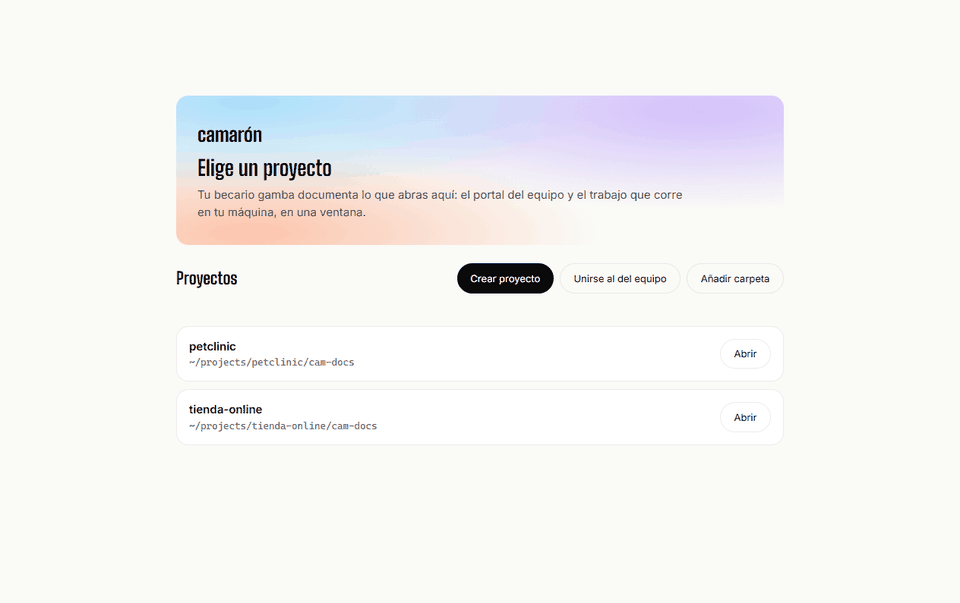
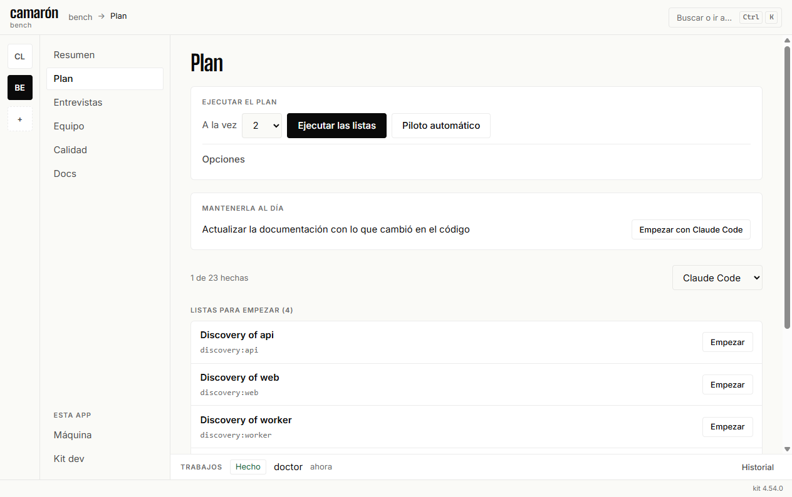
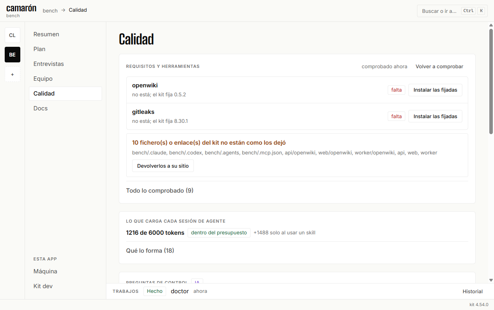

<p align="center">
  
</p>

<p align="center">
  <strong>Convierte un proyecto multi-repo en documentación que puedes explorar, revisar y mantener.</strong><br>
  Tu agente de IA lee el código. Camarón organiza el trabajo. Tú validas el resultado.
</p>

<p align="center">
  
  
  
  
  <a href="https://github.com/iandelu/camarones-documenter/actions/workflows/tests.yml"></a>
</p>

<p align="center">
  <a href="#empieza-aquí">Empezar</a> ·
  <a href="#cómo-encajan-las-piezas">Cómo encaja</a> ·
  <a href="#la-app-de-escritorio">App</a> ·
  <a href="#el-portal">Portal</a> ·
  <a href="#las-guías">Guías</a> ·
  <a href="#referencia">Referencia</a>
</p>

---

## Qué es Camarón

Un servicio recibe la petición, otro publica un evento y un tercero guarda el resultado. Entender el sistema exige
cruzar repositorios, conversaciones y decisiones que quizá nadie escribió.

**Camarón** es un kit local (CLI, asistente de terminal, app de escritorio y portal web) que coordina ese trabajo con
Claude Code o Codex. Divide la documentación en unidades manejables, guarda el progreso entre sesiones y reúne el
resultado en `cam-docs/`: un **cerebro del proyecto**, un único sitio versionado donde el código, la arquitectura, el
dominio y las decisiones quedan explicados para personas y para agentes. Está pensado para equipos que necesitan
incorporar personas, entender sistemas heredados o documentar la arquitectura y los flujos de un proyecto con varios
repositorios.

1. **Instalar ya da valor, casi sin IA.** Repos detectados, grafo de código, la página de inicio del proyecto y una
   página por repo, librerías y vulnerabilidades, borrador C4, plan de trabajo y portal, solo con análisis estático.
2. **Después, la IA lo completa.** Entrevistas, redacción, arquitectura, dominio, flujos y mantenimiento cuando cambia
   el código, una unidad de trabajo por sesión.
3. **Todo lo que añade la IA se puede revisar y rastrear**: borrador → confirmado, con las fuentes (`x-sources`) de cada
   afirmación, y sospechoso en cuanto ese código cambia.

Camarón te habla como tu becario gamba al que has mandado a documentar: con ganas, con chispa y consciente de que es
pequeño. Las bromas se quedan en las esperas y los éxitos; los errores y las decisiones van al grano.

## Cómo encajan las piezas

```text
  tus repos (sin ficheros del kit)                       cam-docs/ (su propio repo git)
  orders-api/  payments-api/  web/                       docs/  wikis/  backlog/  .camarones/
        |  lee                                                 ^  escribe        |  lee
        v                                                      |                 v
  +------------------------------- camaron (CLI de Python) ---------------------------+
  |  asistente (terminal)   catálogo de comandos   harness: plan, ejecuciones, KPIs     |
  +-----------+--------------------+--------------------------+-----------------------+
              |                    |                          |
     servidor del proyecto    agentes: Claude Code,      servidor MCP "camarones"
     portal · /desktop/ · API Codex, OpenCode…           para tus sesiones de IA
        |          |
   navegador    app de escritorio (una ventana por proyecto)
```

| Pieza | Para qué |
|---|---|
| **CLI** (`camaron`) | Hace todo el trabajo; el resto son caras de ella. Cada función es un comando, con `--json` para scripts |
| **Asistente de terminal** (`camaron`) | Los mismos pasos en menús, con el siguiente paso siempre arriba |
| **App de escritorio** (`camaron app`) | Donde se **opera**: el plan, las entrevistas, el equipo, la calidad, las librerías, las wikis, la máquina |
| **Portal** (`camaron up`, o **Ver portal** en la app) | Donde se **lee**: documentación, arquitectura, tablero, historias, plan en vivo, calidad y revisión |
| **`cam-docs/`** | Todo lo que escribe el kit, junto a tus repos y compartido con el equipo |
| **MCP `camarones`** | La documentación al alcance de Claude Code o Codex mientras implementas, también dentro de un solo repo |

Cómo funciona por dentro (servidor, tokens, la API, el harness, el MCP), en la guía
[Cómo funciona Camarón](.camarones/templates/docs/i18n/es/guides/internals.md).

## Mira cómo funciona

<p align="center">
  
</p>

<p align="center"><em>Navega, busca y abre documentación sin salir del portal.</em></p>

<p align="center">
  
</p>

<p align="center"><em>Revisa borradores, confirma páginas y deja correcciones para la siguiente sesión.</em></p>

<p align="center">
  
</p>

<p align="center"><em>Y en la app de escritorio, lo que corre en tu máquina, por tareas, también solo con el teclado.</em></p>

<details>
<summary><strong>Más capturas del portal</strong></summary>

| Documentación | Arquitectura C4 | Revisión |
|---|---|---|
|  |  |  |

</details>

## Empieza aquí

### Requisitos

- **Git** y **Node.js 22 o superior**.
- **uv**, que gestiona Python 3.10+ y las dependencias de la CLI. El lanzador puede instalarlo con WinGet en Windows o
  Homebrew en macOS; en otros casos indica cómo seguir.
- **Claude Code o Codex**, instalado y con sesión, para las sesiones con IA. También sirven OpenCode (la vía para
  modelos locales) y Gemini CLI. Sin ninguno, el asistente te deja copiar el prompt.
- **Docker es opcional**: el portal también se sirve con Python.

El asistente comprueba los requisitos y permite elegir componentes; la primera instalación descarga las herramientas.

### 1. Instala el kit

**Instalación global (recomendada).** Una sola copia del kit para todos tus proyectos, en una línea y sin clonar nada:

```sh
# macOS / Linux
curl -fsSL https://raw.githubusercontent.com/iandelu/camarones-documenter/main/install-global.sh | sh
```

```powershell
# Windows · PowerShell
$f="$env:TEMP\camaron-install.cmd"; (irm https://raw.githubusercontent.com/iandelu/camarones-documenter/main/install-global.cmd) -replace "`r?`n","`r`n" | Set-Content -NoNewline -Encoding ascii $f; & $f
```

Clona el kit oficial en una ruta fija (`~/.camarones/kit`; en Windows `%LOCALAPPDATA%\camarones-documenter\kit`) y deja
el comando `camaron` en tu PATH (`camarones` sigue como alias). Con el repo ya clonado, `sh install-global.sh` o
`.\install-global.cmd` hacen lo mismo; `CAMARONES_KIT_URL` instala desde un fork o una copia local.

**Actualizar:** en la app, **Máquina › Actualizar el kit**; en el asistente, **⚙️ Ajustes › ⬆️ Actualizar Camarón**; en la
terminal, `camaron self-update`. Actualiza a la vez todos los proyectos de la máquina.

<details>
<summary><strong>Copia local por proyecto (modo clásico)</strong></summary>

Descarga este repositorio (**Code → Download ZIP** o un clon) y copia **`.camarones/`**, **`camaron.cmd`** y
**`camaron.command`** a la carpeta que agrupa el proyecto (los `camarones.*` son alias). Ábrelo con `.\camaron.cmd` en
Windows (o doble clic) o `sh camaron.command` en macOS/Linux; si macOS bloquea el lanzador descargado, ejecútalo una vez
desde Terminal. Para pasar un proyecto así a la instalación global sin perder su configuración: `camaron unlink`.

Para actualizar una copia local, `camaron upgrade <carpeta-del-kit-nuevo>` (`--dry-run` primero, si quieres ver la
lista): sustituye los ficheros del kit y borra los que la versión nueva ya no trae, salvo los que alguien editó (se
avisan); de todo lo que cambia queda copia en `.camarones/.cache/install-backups/`.

```text
mi-proyecto/
├── .camarones/           # El kit y su configuración
├── camaron.cmd           # Windows
├── camaron.command       # macOS / Linux
├── orders-api/           # Repositorio Git
└── storefront/           # Repositorio Git
```

</details>

### 2. Abre la app…

```sh
camaron app
```

Dentro de un proyecto abre ese proyecto; en cualquier otra carpeta, la pantalla de inicio: **¿Qué quieres documentar?**
Eliges la carpeta de tu código (o una vacía) o te unes a la documentación de tu equipo, y un asistente de primer
arranque te acompaña: repos, herramientas, instalar, stack, un primer borrador de arquitectura y listo. La primera vez
descarga Electron (unos 100 MB) en `~/.camarones/desktop`; necesita Node.js 22.

### 3. …o el asistente de la terminal

```sh
cd ~/Documents/mi-proyecto   # la carpeta que agrupa (o agrupará) los repos
camaron                      # crea ./cam-docs/, lo registra y abre el asistente
```

Los dos comparten el mismo estado: puedes empezar en uno y seguir en el otro. Todo lo que genera el kit va a
`cam-docs/`, un repositorio Git propio, y la carpeta del workspace enlaza la configuración de los agentes para que
Claude Code o Codex, abiertos ahí, vean todos los repos y la documentación:

```text
mi-proyecto/
├── cam-docs/             # Repo Git: la documentación viva y la config de la herramienta
│   ├── .camarones/       # workspace.yaml, PLAYBOOK.md, CONVENTIONS.md, pipeline.yaml (y .cache/, ignorada)
│   ├── .claude/ .codex/ .agents/ .mcp.json AGENTS.md CLAUDE.md   # skills, MCP y reglas para los agentes
│   ├── docs/             # Arquitectura, dominio, flujos, fichas por repo, guías, plan de trabajo…
│   ├── wikis/<repo>/     # Wikis de OpenWiki (el repo ve un enlace openwiki/ sin versionar)
│   ├── backlog/          # El tablero (formato Backlog.md)
│   └── graph/<repo>/     # Grafo de código de graphify (ignorado)
├── .claude → cam-docs/.claude   .mcp.json → …   AGENTS.md → …   CLAUDE.md → …
├── orders-api/           # Repositorio Git, sin archivos del kit
└── storefront/
```

Un proyecto nuevo **sin código aún** (una carpeta vacía) también vale: se documenta el diseño antes de programar. Si lo
pides, el asistente añade al `CLAUDE.md` de cada repo un bloque corto que apunta a `../cam-docs` (al final; nunca borra
lo que había).

### 4. En equipo: un solo `cam-docs` para todos

Al crear un proyecto puedes darle la URL del repo `cam-docs` del equipo (en la app, **Unirme a la documentación de mi
equipo**; en la terminal, `camaron join <url>` o `camaron new <nombre> --from <url>`). Si el repo ya tiene un proyecto,
lo clona (o reutiliza el que ya tienes) y solo prepara tu máquina: repos, stack, arquitectura y plan ya los decidió el
equipo. Si está vacío, tu primer «Compartir» lo publica. Sin URL, el repo es local y el remoto se añade después con
`camaron remote <url>`. Si git no tiene acceso, la app pide un token y lo guarda en el llavero del sistema, nunca en el
proyecto.

Lo que llega con el repo del equipo no se ejecuta a ciegas: los hooks, servidores MCP, ajustes, skills y plugins que no
escribió el kit solo se cargan cuando los apruebas en tu máquina (**Equipo** en la app, o `camaron trust`); las
aprobaciones viven en `~/.camarones/trust/`, fuera del repo. Publicar es un paso explícito: **Equipo › Compartir
ahora**, **Plan › Sincronizar** en el portal o `camaron share` (checkpoint, rebase sobre el trabajo del equipo y push);
con `camaron share --auto on` cada checkpoint se comparte solo, en esta máquina. Un conflicto se deshace sin tocar nada,
y algo que parece un secreto no se publica.

## El día a día en cinco pasos

| Paso | En la app | En la terminal |
|---|---|---|
| 1. Ver qué toca | **Resumen**: el siguiente paso con un botón | `camaron plan next` |
| 2. Documentar una unidad con tu agente | **Empezar con Claude Code** (se abre como una terminal en el lienzo del Plan, donde le escribes al agente; si la cierras, **Seguir** la retoma) | el asistente → 🦐 Siguiente paso |
| 3. O varias a la vez | **Plan › Ejecutar las listas**, o el **Piloto automático** | `camaron run --parallel 2`, `camaron autopilot` |
| 4. Revisar y confirmar | **Ver portal** → Revisión | `camaron confirm`, `camaron feedback` |
| 5. Compartir | **Equipo › Compartir ahora** | `camaron share` |

Cada unidad termina con un commit local en `cam-docs` y una nota de relevo (`docs/.work/handoff.md`): qué comprobó con
pruebas, qué no, los comandos que ejecutó y la siguiente acción. Si una sesión se interrumpe, la siguiente sigue desde
el último checkpoint. La guía [Usar Camarón](.camarones/templates/docs/i18n/es/guides/using.md) cuenta cada paso con
detalle.

## La app de escritorio

<p align="center">
  
  
</p>

Cada proyecto se abre en su ventana: a la izquierda el raíl con tus proyectos y las secciones, en medio la tarea y,
abajo, el panel de **trabajos** con lo que corre, su salida y **Parar**. Cada botón ejecuta el mismo comando que
escribirías en la terminal.

| Sección | Qué haces ahí |
|---|---|
| 🏠 **Resumen** (`g s`) | El siguiente paso con un solo botón, avisos de la máquina y cómo van el plan, la revisión y los trabajos |
| 📋 **Tablero** (`g b`) | El Kanban del proyecto: seis columnas de Backlog a Bloqueado, mover con ratón o teclado, abrir, añadir, eliminar |
| 🗺️ **Plan** (`g p`) | Ejecutar las unidades listas en paralelo o con el piloto automático (se saltan una unidad con su sesión abierta), cada unidad con su botón (aprobar, reintentar, seguir, rehacer), por estado, por fases o en el **lienzo**: el grafo del plan, donde cada unidad que trabaja una ejecución es una terminal en vivo, y **Empezar** o **Seguir** una unidad y la actualización de la doc (**Mantenerla al día**) abren una terminal en la que le escribes al agente (<kbd>F6</kbd> sale de ella; **Cerrar** deja la unidad en pausa, **Quitar** retira una que acabó con error y la actualización va en **Sesiones sueltas**; `camaron config set sessions window` las abre en una ventana); lo que lleva costado el plan (debajo de las unidades) y empezar la documentación otra vez |
| 🎙️ **Entrevistas** (`g i`) | Cuestionario del equipo o en vivo, exportar e importar respuestas, cerrar la ronda |
| 🤝 **Equipo** (`g t`) | El repo del equipo y compartir, aprobar lo que llegó con él, hooks y plugins |
| ✅ **Calidad** (`g q`) | La salud del proyecto sin IA: máquina, documentación y código, repo a repo (SonarQube, cobertura, vulnerabilidades, deuda) |
| 📦 **Librerías** (`g l`) | Las dependencias de cada repo y sus vulnerabilidades (el escaneo va repo a repo con su barra, se puede parar y acaba con un tick con lo que encontró) y **Actualizar** en una rama nueva, sin commit |
| 📖 **Docs** (`g d`) | Abrir el portal, construir el explorador C4, generar la wiki de cada repo y preguntar con IA |
| 🧰 **Máquina** (`g m`) | Preparar la máquina, idioma y modelos, dónde se abren las sesiones (en el lienzo del plan o en una ventana de terminal), tokens, repos, el kit y desinstalar |
| 📘 **Guía** (`g h`) | Toda la documentación de Camarón dentro de la app, con botones que te llevan a cada sitio y un **recorrido guiado** |

<kbd>⌘K</kbd>/<kbd>Ctrl K</kbd> va a una sección, a otro proyecto, a cualquier comando o a un capítulo de la guía. Plan,
Equipo, Calidad y Máquina terminan con **Todos los comandos**: el resto de comandos de su zona, cada uno con un
formulario que sale del propio parser; lo que borra o mueve datos va aparte y pregunta antes. Cada pantalla, botón a
botón, en la guía [La app de escritorio](.camarones/templates/docs/i18n/es/guides/app.md), que también está en la app,
en **Máquina › Guía**.

<details>
<summary><strong>🛟 Instalación y problemas de la app</strong></summary>

- Comprueba Node: `node --version` (22 o superior). Si falta, `camaron doctor --install node` (winget en Windows,
  Homebrew en macOS).
- **Linux:** en Ubuntu 24.04 o posterior el sistema limita los *user namespaces*; Camarón lo detecta y abre la app con
  `--no-sandbox` (sus ventanas solo cargan el servidor local de tu proyecto).
- **Electron fijado** (`VERSIONS["electron"]`) en `~/.camarones/desktop`, sin permisos de administrador; al actualizar el
  kit, si cambia, la siguiente `camaron app` descarga la nueva. Borrar esa carpeta lo vuelve a descargar.
  `camaron uninstall --global` la borra también.

| Lo que ves | Qué hacer |
|---|---|
| `the desktop app needs Node.js >= 22` | Instala Node 22 y vuelve a lanzar `camaron app` |
| Se abre la pantalla de inicio en vez de tu proyecto | Estabas fuera de su carpeta: ábrelo desde **Recientes** o **Elegir carpeta** |
| «Este código no está en un repositorio git» | **Inicializar git aquí** (sin commits ni push) |
| «Aquí no puedo crear el proyecto» | Elegiste tu carpeta personal o la raíz de un disco |
| «No he podido arrancar el servidor del proyecto» | El cuadro trae el error; `camaron doctor` en esa carpeta suele decir qué falta |
| En el portal del navegador no está el botón que esperabas | Es a propósito: el portal no ejecuta nada en tu máquina. Hazlo en la app |

</details>

## El portal

| Cómo | Comando | Qué puede hacer |
|---|---|---|
| Desde la app | **Ver portal**, **Docs**, cualquier «Abrir en el portal» | Todo lo del portal en vivo, y además escribir en el Tablero y guardar historias (la app le da al navegador un token para esa sesión) |
| En vivo | `camaron up` (y `camaron down`) | Leer, buscar, editar y crear páginas, confirmar, pedir cambios, revisar, editar el modelo C4, responder la entrevista, sincronizar, aprobar o reintentar unidades. Imprime una dirección con `#cam-token=…` para escribir también en el Tablero e Historias |
| Exportado | `camaron portal`; verlo con `camaron up --static` o `--docker` | Solo leer y buscar, en HTML y JSON estáticos, sin npm y sin conexión; «Editar en el repositorio» lleva al fichero en GitLab o GitHub |

El menú lateral tiene siete zonas (el exportado, Docs, Arquitectura y Revisión):

| Zona | Vistas |
|---|---|
| **Docs** | Portada, cada página con su confianza, su frescura y sus fuentes (que se abren en tu editor), editar, confirmar, pedir un cambio; las wikis de OpenWiki |
| **Tablero** | El Kanban con filtros, oleadas, tarjetas bloqueadas y la puerta de salida |
| **Historias** | Escribir una historia (*Como / quiero / para* y lo que toca), el veredicto INVEST y subtareas en oleadas que no chocan, sin IA; **✨ Sugerir con IA** opcional |
| **Arquitectura** | El modelo C4 con sus elementos para corregir, eliminar y confirmar; el grafo de código; Datos (diagramas ER); Librerías |
| **Plan** | El Pipeline en vivo (aprobar, reintentar), la Entrevista del equipo y Sincronizar |
| **Calidad** | Salud (de solo lectura), KPIs (con lo que costó el plan y las preguntas que nadie encontró) y CI |
| **Revisión** | Lo pendiente de revisar, confirmar varias a la vez, las revisiones que espera un agente |

Inicio pregunta primero: **Preguntar** devuelve las secciones que mejor responden, con su cita y sin IA (busca por
sentido: «base de datos» encuentra PostgreSQL). El interruptor **Todo / Negocio** deja solo las páginas de qué hace el
sistema y por qué. Sigue el sistema de diseño de Cofundo con la marca Camarón, en claro u oscuro, y sirve sus propias
fuentes: no pide nada a terceros. El portal nunca ejecuta nada en tu máquina: lanzar el plan, generar wikis, construir el explorador
C4 o responder con IA se hace en la app. Cada vista, a fondo, en la guía
[El portal](.camarones/templates/docs/i18n/es/guides/portal.md).

## La IA propone. Tú confirmas.

- **`draft`**: todavía no tiene validación humana.
- **`confirmed`**: una persona confirmó ese contenido; la confirmación queda atada a su hash.
- **`needs-reconfirm`**: la página fue confirmada, pero su contenido cambió después.

Los agentes conservan los bloques `<!-- human -->` y respetan los archivos con `x-owner: human`.

**Mejor sin información que con información equivocada.** Al escribir una página, el kit guarda una huella del código
que cita en sus `x-sources`. Si ese código cambia, la página pasa a **sospechosa**; si desaparece, a **obsoleta**; si solo
se movió, sigue **fresca**. Una fuente puede nombrar un símbolo (`orders:src/…/OrderService.java#OrderService.place`)
que se vuelve a encontrar aunque se mueva, y una página que cita otras páginas o elementos C4 se vuelve sospechosa con
ellos. Los agentes no reciben páginas sospechosas, obsoletas ni sin revisar y sin fuentes (el MCP y `llms.txt` las
retienen y dicen qué código leer); las personas las siguen viendo, con un aviso. `freshness: {ai_policy: warn}` en
`workspace.yaml` se las entrega con una advertencia.

```sh
camaron fresh                          # qué páginas citan código que cambió o ya no existe
camaron fresh --plan                   # añade una unidad para que un agente las actualice
camaron fresh --ack <página> --by ana  # la página sigue siendo válida con el código de hoy
camaron confirm docs/overview/system.md --by "Tu nombre"
camaron feedback docs/overview/system.md "Falta describir los reintentos" --by "Tu nombre"
```

`check` es la puerta de calidad que se pasa al cerrar cada unidad y en CI:

| Comprobación | Gravedad | Herramienta |
|---|---|---|
| Frontmatter ausente, fuentes `x-sources` que ya no existen, bloques `:::rule` cuyo código desapareció | ERROR | — |
| Enlace roto a otra página, resuelto igual que en el portal | ERROR | Python |
| `#ancla` que no corresponde a ningún título | aviso (ERROR con `--strict`) | Python |
| Diagrama Mermaid que no se dibuja | ERROR | mermaid-cli |
| Posible secreto en `docs/` o en una wiki | ERROR; bloquea checkpoint y `portal` | gitleaks |
| Palabra de la columna **Avoid** del glosario | aviso (ERROR con `--strict`) | Python |
| Página confirmada que cambió · traducción pendiente | aviso | — |
| Bloque generado editado a mano o desfasado | aviso (ERROR con `--strict`) | Python |
| Estructura: tipo, título y descripción, un solo H1, TL;DR, las secciones de su plantilla, tamaño máximo, referencias vagas | aviso (ERROR con `--strict`) | Python |

mermaid-cli y gitleaks forman el componente `quality`; si faltan, `check` lo avisa una vez y sigue. `check --secrets`
ejecuta solo el escaneo de secretos.

## Las guías

La documentación completa de Camarón vive en cuatro guías, en español e inglés. Se leen en la app (**Máquina ›
Guía**, con buscador, botones a cada sección y un recorrido guiado), en el portal de cada proyecto (se copian en
`docs/guides/`) y aquí:

| Guía | Español | English |
|---|---|---|
| Usar Camarón: el recorrido y el día a día | [using.md](.camarones/templates/docs/i18n/es/guides/using.md) | [using.md](.camarones/templates/docs/guides/using.md) |
| La app de escritorio, pantalla a pantalla | [app.md](.camarones/templates/docs/i18n/es/guides/app.md) | [app.md](.camarones/templates/docs/guides/app.md) |
| El portal, zona a zona | [portal.md](.camarones/templates/docs/i18n/es/guides/portal.md) | [portal.md](.camarones/templates/docs/guides/portal.md) |
| Cómo funciona: servidor, API, harness, MCP | [internals.md](.camarones/templates/docs/i18n/es/guides/internals.md) | [internals.md](.camarones/templates/docs/guides/internals.md) |
| Comandos, para scripts y agentes | [tutorial.md](.camarones/templates/docs/i18n/es/guides/tutorial.md) | [tutorial.md](.camarones/templates/docs/guides/tutorial.md) |

Y el [tutorial del asistente](.camarones/TUTORIAL.md): qué es cada herramienta, con dibujos.

## Mapa de comandos

Cada función es un comando `camaron`; `camaron catalog` dice dónde vive cada uno (portal, app o solo CLI) y
`camaron help` los lista. Casi todos aceptan `--json`.

| Para… | Comandos |
|---|---|
| Proyectos y equipo | `app`, `new`, `join`, `switch`, `projects`, `remote`, `share`, `trust`, `repair`, `migrate`, `unlink`, `uninstall` |
| Preparar la máquina | `setup`, `doctor`, `config`, `sync`, `detect`, `stack`, `profile`, `self-update`, `upgrade`, `version` |
| El plan | `plan` (`next`, `start`, `note`, `done`, `redo`, `approve`, `sync`, `cost`), `run`, `autopilot`, `runs`, `pipeline`, `prompt`, `interview`, `docs reset` |
| Leer y revisar | `up`, `down`, `portal`, `status`, `confirm`, `feedback`, `review`, `fresh`, `translated`, `llms` |
| Documentación sin IA | `pages` (alias `diagrams`), `blocks`, `schemas`, `inventory`, `bump`, `radar`, `history`, `arch-draft`, `arch-validate`, `graph`, `wiki` |
| Calidad y medida | `check`, `health`, `kpis`, `stats`, `eval`, `ab`, `changes`, `mark-documented` |
| Tablero | `board` (`init`, `add`, `list`, `show`, `move`, `assign`, `link`, `archive`, `repair`, `next`, `waves`, `story`) |
| CI y exportar | `ci`, `pr` (`fresh`, `propose`), `export` (`pdf`, `tour`, `codetour`, `confluence`, `notion`), `removed`, `checkpoint` |
| Agentes | `mcp`, `hooks`, `plugins`, `catalog` |

## Por dentro

- **El harness.** El plan sale de un pipeline en YAML (`full` o `quick`) que cada proyecto ajusta en
  `cam-docs/.camarones/pipeline.yaml` (quitar unidades, cambiar dependencias, añadir unidades, pedir aprobación) sin
  tocar el kit. `camaron run` hace varias unidades a la vez, cada descubrimiento, ficha de repo y flujo en su propia
  copia de `cam-docs` (un worktree en `.cw/<n>/`), y las integra comprobando que no aparezcan errores nuevos; si una
  choca, queda bloqueada con una unidad `integrate:<unidad>` y `cam-docs` no se toca.
- **Agentes intercambiables.** Claude Code, Codex, OpenCode (modelos locales) o cualquier CLI declarado en tu máquina,
  elegidos por tipo de trabajo (`agentic-heavy`, `bounded`, `judge`) en `agents.routing`.
- **La CLI es la API**: `catalog --json` describe cada comando y sus argumentos; la app los ejecuta a través del
  servidor del proyecto, validados contra el parser y sin shell.
- **El MCP `camarones`** da a los agentes la documentación por secciones (`search_docs`, `read_doc`, `ask` con citas,
  `repo_graph`, `board_next`…), solo escribe borradores (`propose_edit`, `add_feedback`, `mark_suspect`) y nunca
  confirma. `camaron mcp --http` lo sirve en `127.0.0.1:8765`.
- **Plugins** en carpetas con un `plugin.yaml`, fijados en `plugins.lock`; los que ejecutan código esperan a que los
  apruebes en tu máquina.

Todo, con los ficheros, los tokens y los endpoints, en
[Cómo funciona Camarón](.camarones/templates/docs/i18n/es/guides/internals.md). La decisión y el diseño del harness
están en [harness-refactor.md](docs/research/harness-refactor.md), el orden de trabajo en
[roadmap.md](docs/research/roadmap.md) y dónde vive cada comando en [cli-triage.md](docs/research/cli-triage.md).

## Referencia

<details>
<summary><strong>Páginas y diagramas sin IA</strong></summary>

La instalación (y `camaron pages [--json]`, alias `camaron diagrams`) escribe `docs/index.md` (qué es el proyecto, una
tarjeta por repo y el mapa de contexto) y, por cada repo de la máquina, `docs/repos/<repo>/index.md`: qué expone (mapa
de endpoints), qué datos guarda (diagrama ER), sus ciclos de vida (un diagrama de estados por cada enum de estado, solo
con los estados: las transiciones no se adivinan), sus mensajes y qué necesita para arrancar (variables de entorno y
comandos), cada fila con el fichero y la línea de donde sale; los valores que parecen secretos se ocultan. Con topics,
también `docs/architecture/messaging.md`. `camaron history` escribe `docs/overview/history.md` (ficheros con más
commits, quién trabaja dónde, ficheros que cambian juntos, tickets entre repos). `radar` deja el stack y las
herramientas en `docs/overview/tooling.md` y `stack` corrige uno mal detectado. `schemas` lee tablas y colecciones de
migraciones (Flyway, Liquibase), entidades (JPA, SQLAlchemy, Django, TypeORM, Prisma), Mongo y Firestore.
`arch-draft` propone un borrador C4 (entiende proyectos Firebase).

Son bloques `<!-- generated:… -->` que `pages`, `blocks` y `sync` mantienen al día. Si alguien edita uno a mano, se
conserva y `check` lo avisa (`blocks --force` toma la versión del código). Una persona confirma uno copiando el `sha=` en
`confirmed=` con su nombre en `by=` (`by="Ana López"` si lleva espacios); desde entonces un refresco no lo toca y `check`
avisa cuando el código cambió. El portal etiqueta cada diagrama: «Del código», «Editado a mano», «Confirmado por …» o
«El código cambió». Para los agentes, la skill `cam-docs-diagrams` enseña qué diagrama elegir.

**Proyectos anteriores a la 4.52** conservan sus páginas (`first-look.md`, `system-map.md`, `reference.md`,
`diagrams.md`, `data/<repo>.md`) hasta `camaron pages --adopt`, que mueve los bloques con sus confirmaciones a las
páginas nuevas, borra solo las páginas del kit que deja vacías, nunca escribe una página de una persona y lista lo que
no pudo tocar.

</details>

<details>
<summary><strong>Librerías, vulnerabilidades y SonarQube</strong></summary>

`camaron inventory` lista las dependencias directas de cada repo desde manifiestos y lockfiles (Maven, Gradle, npm,
Python, Go, .NET, Composer, Cargo y Flutter/Dart), con versión, ámbito y categoría (de
`.camarones/lib/dep_categories.yaml`), y marca la misma librería con versiones distintas entre repos; lo deja en
`docs/overview/libraries.md`. Con `--cves` añade las vulnerabilidades conocidas con OSV-Scanner (binario fijado y
comprobado por SHA-256 en `~/.camarones/bin`) y su base de datos **sin conexión** (`~/.camarones/osv-db`, unos 220 MB),
sin resolver transitivas: ningún nombre de paquete sale de tu máquina, salvo con `"osv": {"online": true}` en
`~/.camarones.json`. Encontrar vulnerabilidades sale con 0; en CI, `--fail-on high` (o `critical`) sale con 1. El escaneo cuenta los repos a
medida que entra en cada uno (`[2/5] <repo>: …`); con `--json` la salida estándar es solo el JSON y ese progreso va a
stderr.

`camaron bump <repo> <librería> <versión>` la actualiza en una rama nueva (`camaron/bump-<nombre>-<versión>`) con su
gestor de paquetes (npm, pnpm, yarn, uv, poetry, go) o reescribiendo el manifiesto (Maven, Gradle, requirements): sin
`--yes` solo dice lo que haría, no toca un repo con cambios sin commit, no hace commit ni push y, si falla, deja el repo
como estaba. Es lo único con lo que el kit escribe en un repo de servicio, y solo cuando se lo pides.

`camaron health [--refresh] [--json]` es la salud del proyecto (veredicto, máquina, documentación, código y la tabla
por repo). Con un token de SonarQube guardado (**Máquina › Tokens**, solo por https) lee de su servidor la cobertura,
bugs, vulnerabilidades, puntos críticos, code smells, deuda, las notas A–E y la puerta de calidad; si la lectura falla,
conserva los últimos valores con su fecha. El servidor sale del `sonar.host.url` del repo, de SonarCloud, o de
`sonar: {host: …}` en `workspace.yaml`.

</details>

<details>
<summary><strong>Tablero e historias</strong></summary>

Un Kanban en `cam-docs/backlog/`, compatible con [Backlog.md](https://github.com/MrLesk/Backlog.md) (probado con la
1.55.3): cada tarjeta es un Markdown (`backlog/tasks/wi-42 - Título.md`) y el orden y la columna viven en
`backlog/board.yaml`, una línea por tarjeta para que git fusione por tarjeta (`init` registra un *merge driver*).
Columnas: Backlog, Ready, In Progress, In Review, Done y Blocked; tipos epic, story, bug, spike y task, con prioridad
P0–P3.

```sh
camaron board init
camaron board add story "Reintentos idempotentes" --epic WI-3 --repo payments --doc FLOW-k3f9#retries
camaron board list --status Ready --repo payments    # también --epic, --label y --docs suspect|unconfirmed
camaron board move WI-42 "In Progress" --before WI-40
camaron board link WI-42 flows/payments.md#retries   # por x-id: sobrevive a mover o renombrar la página
camaron board story split WI-14 --touch api:src/pay.py --accept
camaron board next --n 3 [--story WI-14|--epic WI-1]  # una oleada de tareas que no chocan entre sí ni con lo en curso
camaron board waves                                   # el trabajo abierto en oleadas
camaron board repair                                  # también corre antes de cada checkpoint y de «Sincronizar»
```

Mover a *In Progress* comprueba dependencias y choques de ficheros (`x-touches`): una persona puede seguir con
`--force` o **Mover igualmente**; un agente nunca. Las historias se escriben en la zona **Historias** del portal, en
tres pasos (escribir con lo que toca, revisar el veredicto INVEST, subtareas en oleadas) y no se guarda nada hasta
aprobarlas. Mientras **✨ Sugerir con IA** piensa, el botón brilla, no se puede volver a pulsar y Escape cancela; lo que
propone se queda en tu navegador, por historia, hasta que lo aceptas o lo descartas. Ajustes opcionales en
`workspace.yaml`: `stories: {ai: false}` lo apaga,
`stories: {model: …}` y `stories: {small: {groups, files, repos}}`. El índice `.camarones/.cache/board.db` se reconstruye
solo. Al desinstalar, la CLI pregunta si conservas `backlog/` (`--keep-board` / `--drop-board`); la app lo conserva.

</details>

<details>
<summary><strong>Revisión en vivo, lo que se quitó y reglas de negocio</strong></summary>

Un agente que necesita la respuesta de una persona ejecuta `camaron review request <página>` y `camaron review wait
<id>`: espera a que alguien apruebe o pida cambios en la Revisión del portal y recibe la decisión en JSON.
`camaron removed add "endpoint SOAP" --why "…" --decision decisions/0007-drop-soap.md` añade una fila a
`docs/overview/removed.md`, que el `AGENTS.md` del proyecto manda leer antes de volver a crear algo. Un bloque
`:::rule ORD-1 Pedidos no vacíos` ancla una regla al código con líneas `enforced:` y `test:` (`repo:ruta#Símbolo`):
`check` falla si ya no existe.

</details>

<details>
<summary><strong>Exportar</strong></summary>

`camaron export pdf` junta lo que pueden leer los agentes en un PDF (con Chrome, Chromium o Edge sin ventana).
`camaron export tour flows/<flujo>.md` hace un recorrido guiado de un flujo, y `export codetour` lo convierte en un
[CodeTour](https://marketplace.visualstudio.com/items?itemName=vsls-contrib.codetour) de VS Code. `export confluence` y
`export notion` publican fuera, así que no funcionan hasta `camaron plugins enable confluence` (o `notion`) con su URL y
token. Nunca se exporta una página retenida por la puerta de frescura.

</details>

<details>
<summary><strong>Medir: estadísticas, KPIs, coste, preguntas de oro y A/B</strong></summary>

- `camaron stats [--json] [--months N]`: cuántas personas lo usan, consultas de agentes y personas, búsquedas sin
  resultado, cambios y autores, páginas más y menos leídas. Solo contadores, con el usuario cifrado, en
  `docs/.work/usage/`; cada máquina decide con `camaron stats --record on|off`.
- `camaron kpis [--compare <run-a> <run-b>]`: coste y velocidad de las ejecuciones, cobertura, confianza (y cuánto
  cambian las personas lo que escribió la IA antes de confirmarlo) y utilidad.
- `camaron plan cost`: tokens, horas y dólares equivalentes de la API desde que empezó el plan, para todo el equipo,
  por fase y por unidad (precios en `lib/pricing.yaml`, cambiables con `pricing:` en `workspace.yaml`). Lo que no se
  puede medir sale con su nombre, nunca como 0. La app lo enseña en el Plan, debajo del tablero de unidades, y el
  portal en Calidad › KPIs.
- `camaron eval draft | confirm <id> --by <nombre> | run [--judge]`: preguntas de oro que la documentación debe
  responder, aprobadas por una persona y puntuadas sin IA (páginas citadas e identificadores nombrados).
- `camaron ab --qa "…"` hace la misma pregunta con y sin `cam-docs` y compara contexto, tiempo, coste y herramientas
  (`--task "…" --check "./mvnw test"` con una tarea de código, en worktrees desechables). `ab sampling on` guarda en tu
  máquina una muestra de tus prompts reales (si el proyecto lo activa) y `ab --replay` los repite. `ab: {enabled:
  false}` lo apaga.

</details>

<details>
<summary><strong>Mantenerlo al día y CI</strong></summary>

`camaron changes` compara los commits con el estado de la última documentación; `prompt update` imprime las
instrucciones para la sesión que actualiza (o **Plan › Mantenerla al día** en la app); `mark-documented` registra el
nuevo punto de referencia. `camaron ci` genera un job por repo de servicio que, en cada PR/MR y **sin IA**, comenta qué
páginas deja desactualizadas (`camaron pr fresh <repo> --base main` en local); `ci: {target: self-hosted, …}` lo lleva a
vuestros runners. `camaron pr propose <url>` deja que un agente proponga la documentación en una PR de `cam-docs`
(`--comment`, `--preview`, `--dry-run`), y con `self-hosted` el job `docs-propose` lo hace cuando alguien etiqueta la PR
con `docs:update`. Antes de abrir nada ejecutan `check --secrets`. Plantillas en [.camarones/ci/](.camarones/ci/); guía
del runner en `docs/guides/self-hosted-runner.md`.

</details>

<details>
<summary><strong>Rehacer, borrar o desinstalar</strong></summary>

`camaron docs reset --redo` reabre todas las unidades terminadas para revisarlas con el PLAYBOOK de hoy (no borra nada;
una sola: `camaron plan redo UNIDAD`). `--wipe` hace commit de `cam-docs/` y lo etiqueta `camaron/pre-reset-<fecha>`
(sin git, además una copia `.zip`), borra las páginas generadas, el modelo C4, las wikis y el estado de las ejecuciones,
y el plan vuelve a empezar, conservando `workspace.yaml`, las entrevistas, las páginas que una persona escribió o
confirmó, el tablero y los comentarios. `--templates` devuelve PLAYBOOK, CONVENTIONS y las plantillas a las del kit
(guarda la vuestra como `<nombre>.before-reset-<fecha>`). Los dos aceptan `--dry-run`; en la app, al final de **Plan**.

`camaron uninstall` (o **Máquina › Desinstalar este proyecto**, que primero enseña qué borraría) detiene el portal,
guarda una copia `.zip` de `cam-docs/` en la carpeta temporal del sistema, quita de cada repo lo que añadió el kit,
elimina los enlaces de la carpeta del workspace y borra `cam-docs/`, su registro y sus aprobaciones. Los repos quedan
como en su último commit. La CLI pide escribir el nombre del proyecto; la app, confirmar en un diálogo. `--global`
limpia también `~/.camarones.json`, `~/.camarones/` y los tokens.

</details>

<details>
<summary><strong>Agentes, modelos locales y contexto</strong></summary>

```yaml
# cam-docs/.camarones/workspace.yaml (cada máquina lo cambia en ~/.camarones.json, que manda)
agents:
  routing:
    agentic-heavy: [claude, codex:gpt-5.6-terra]
    bounded: [opencode:ollama/qwen3-coder:30b, claude]
```

Las sesiones que abres tú (el siguiente paso del asistente, Empezar en la app) usan también esta tabla: con el agente
que elijas, el modelo que fije `pipeline.yaml` para la unidad (`{op: set, node: "flow:*", runner: "claude:opus"}`) o el
de su tipo de trabajo, y si no hay ninguno, el de Ajustes; el asistente y la app dicen con cuál la abren. En la app se
abren como terminales del lienzo que tiene el servidor del proyecto (el `pty` de Python en macOS y Linux, ConPTY con
pywinpty 3.1.0 en Windows; 8 a la vez como mucho), y cerrar la ventana del proyecto las termina: sus unidades quedan en
pausa. Cada una lee su prompt de un fichero propio, `.camarones/.cache/prompts/<unidad>.md`, así que dos sesiones
abiertas a la vez no se pisan.
Los modelos locales solo entran por OpenCode y nunca para trabajo `agentic-heavy`; `camaron doctor --local` propone uno
de pesos abiertos según la memoria de tu equipo. `camaron run --parallel 3 --per-runner claude=2,codex=1` reparte las
sesiones; mientras dura una ejecución el ordenador no se suspende. `camaron doctor --context` suma los tokens que carga
cada sesión de agente (avisa por encima de 6000; `context: {budget: N}`). `camaron hooks on` añade tres hooks de Claude
Code: el estado del plan al empezar, la revisión de cada página al editarla y un recordatorio si los repos cambiaron.
`camaron eval comply <unidad>` ejecuta una unidad de verdad y puntúa lo escrito, sin IA (para el sandbox).

</details>

<details>
<summary><strong>Plugins</strong></summary>

Lo que se enchufa al kit (agentes, checks, prompts, tipos de unidad) va en carpetas con un `plugin.yaml`. El kit trae
Gemini, Confluence y Notion; el equipo añade los suyos con `camaron plugins add <carpeta | git:<url>@<tag>>`, que los
copia en `.camarones/plugins/` y fija versión, origen y huella en `plugins.lock` (`outdated`, `update`, `remove`). El kit
calcula si un plugin ejecuta código; si lo hace, o guía a los agentes, no se carga hasta aprobarlo en tu máquina, y
cualquier cambio vuelve a preguntar. `camaron plugins disable gemini` lo apaga en tu máquina.

</details>

<details>
<summary><strong>Para scripts: proyectos y unirse sin preguntas</strong></summary>

- `camaron projects --inspect <carpeta> --json` solo lee e imprime `case` (`project`, `repo`, `umbrella`, `code` o
  `empty`), `kind`, `workspace`, `docs_root`, `name`, `repos`, `siblings` y `warning` (`home`, `no-git` o vacío).
- `--adopt <carpeta> [--name X]` crea y registra el `cam-docs/`; `--git-init <carpeta>` hace `git init` en el código
  (sin commits ni push).
- Un rechazo sale con 1 y `{"error": código, "detail": …}`: `taken`, `home`, `no-git` o `git-init`.
- `camaron join URL --no-open` (y `new NOMBRE --no-open`) imprime `{"path": …}`; sin acceso,
  `{"error", "host", "detail"}` con `auth`, `denied`, `not-found`, `network` o `unknown`. El token de un repo privado va
  en `CAMARONES_JOIN_TOKEN`, nunca en la línea de comandos.

</details>

<details>
<summary><strong>Documentación pensada primero para agentes</strong></summary>

Las páginas que escriben las unidades empiezan con un resumen (`> **TL;DR:** …`), tienen secciones que se entienden
solas, nombres exactos de endpoints, tablas y topics, la evidencia junto a cada afirmación y un tamaño máximo (unas
1500 palabras por página y 400 por sección; `CONVENTIONS.md` §11). Cada tipo de página tiene su plantilla en
`cam-docs/.camarones/skeletons/`, y `check` la usa para saber qué secciones necesita. `llms.txt` sigue
[llmstxt.org](https://llmstxt.org) y `llms-full.txt` reúne en un fichero todo lo que los agentes pueden leer. La
documentación canónica va en inglés y la traducción al español en `docs/i18n/es/`; el kit sabe qué traducciones faltan o
se quedaron atrás (`camaron translated`), y el portal enseña el inglés con un aviso mientras tanto.

```text
cam-docs/docs/
├── index.md         # El proyecto: qué es, una tarjeta por repo, el mapa de contexto
├── repos/<repo>/    # Ficha y página de cada repo
├── overview/        # Visión general, stack, librerías, historial, lo que se quitó
├── architecture/    # Modelo C4 (*.c4: cada repo y cada flujo en su fichero) y mensajería
├── domain/          # Contextos, actores y glosario
├── flows/           # Flujos de negocio y secuencias
├── data/            # Modelos y propiedad de los datos
├── deployment/      # Entornos y despliegue
├── decisions/       # Decisiones de arquitectura
├── quality/         # SLAs y deuda técnica
├── interview/       # Respuestas y preguntas abiertas
├── guides/          # Las guías de Camarón (y las vuestras)
├── i18n/es/         # Traducciones al español
├── .work/           # Plan, checkpoints, relevo, KPIs y uso
├── llms.txt         # Índice para agentes
└── llms-full.txt    # Todas las páginas que pueden leer, en un fichero
```

</details>

## Herramientas que evaluamos y descartamos

Una herramienta solo entra si es un **quick win**: aporta valor real sin pisarse con otra, se instala en macOS, Windows
y Linux sin permisos de administrador, cuesta poco integrarla (opcional y, si falla, el kit sigue) y funciona en local
con una licencia que lo permite. El análisis completo, con un identificador por candidata, está en
[tooling-candidates.md](docs/research/tooling-candidates.md).

<details>
<summary><strong>Sustituidas, descartadas y aplazadas</strong></summary>

**Sustituidas al implementar:**

| Herramienta | Por qué no |
|---|---|
| lychee | La comprobación de enlaces está en Python estándar y resuelve los enlaces igual que el portal. |
| Vale | Con la columna **Avoid** del glosario basta una búsqueda en Python; además no trae diccionario en español. |
| SQLite FTS5 | La búsqueda BM25 en memoria da el mismo ranking sin caché ni problemas de concurrencia. |
| mermaid-cli 12 | El portal dibuja con mermaid 11: se fija mermaid-cli 11.x para validar con el mismo motor. |
| `npx skills add` (skill de LikeC4) | Sin versión fija; el servidor MCP de LikeC4 sí está integrado. |

**Descartadas en el análisis:**

| Herramientas | Por qué no |
|---|---|
| DeepWiki, Google Code Wiki, Swimm, Mintlify, GitBook, DeepDocs, NotebookLM, Context7, DeepL, IcePanel | Servicios en la nube: el código o la documentación salen de la máquina. |
| Structurizr, D2, Kroki | Otra notación u otro motor de diagramas además de LikeC4 y Mermaid. |
| Zensical, Astro Starlight, Docusaurus, VitePress, Quartz | El portal propio ya cubre esto sin build ni npm. |
| log4brains | Duplicaría el visor de ADR del portal. |
| CodeGraphContext, Zoekt, indexadores SCIP | Necesitan un servidor, una base de datos de grafos o que los repos compilen. |
| RepoWiki | Proyecto pequeño y de madurez desconocida. |
| jQAssistant, Spring Modulith Documenter, dependency-cruiser, Madge | Solo sirven para un lenguaje o framework. |
| SchemaSpy, Atlas | tbls cubre lo mismo con salida en Markdown y Mermaid. |
| KubeDiagrams | Genera imágenes, no un modelo LikeC4. |
| Spectral, AsyncAPI CLI | Solo tienen sentido si antes se generan contratos desde el código. |
| sqlite-vec | Exige un modelo de embeddings para una mejora pequeña. |
| Egon.io, OWASP Threat Dragon | Herramientas manuales de taller; un agente no puede conducirlas. |
| po4a, mdpo | Pensadas para traductores humanos; excesivo para dos idiomas. |
| mani, gita | `workspace.yaml` y `sync` ya gestionan los repos. |
| GitHub Spec Kit, Task Master | Otro objetivo: construir funcionalidades, no documentar. |

**Aplazadas, no descartadas:** codebase-memory-mcp o GitNexus, tbls, el service graph de OpenTelemetry y CodeWiki. Ideas
de otros kits en [ecc-comparison.md](docs/research/ecc-comparison.md).

</details>

## Las piezas del kit

**Python + Rich + Questionary** construyen el asistente y la CLI; **uv** resuelve su entorno. **OpenWiki** escribe las
wikis por repositorio, **graphify** el grafo de código y **LikeC4** el modelo de arquitectura (también como servidor MCP).
**mermaid-cli** valida los diagramas, **gitleaks** busca secretos y **OSV-Scanner** vulnerabilidades. El portal y la
app son React + Vite con builds commiteados (nadie necesita npm para usarlos); la app corre en **Electron**. Las
versiones están fijadas en [common.py](.camarones/lib/common.py): `camaron version` y `camaron doctor` las enseñan.

## Desarrollo

Cada cambio en el kit sigue estas reglas (la versión completa para agentes está en [AGENTS.md](AGENTS.md)):

- **macOS, Windows y Linux, siempre.** La [CI](.github/workflows/tests.yml) pasa los tests en los tres sistemas. Los
  lanzadores van por parejas (`.cmd` ↔ `.command`, `install-global.cmd` ↔ `.sh`) y se cambian juntos.
- **TDD.** Primero el test que falla y después el código.
- **Retrocompatible desde 3.0.** Un proyecto creado con cualquier 3.x o 4.x sigue abriendo sin pasos manuales; lo
  anterior pasa por `camaron migrate`. Nunca se reescribe lo que ha escrito o confirmado una persona.
- **README, tutorial y guías al día** en el mismo commit que el cambio que notará el usuario.
- **Herramientas nuevas, solo si son un quick win.**
- **Fácil y con la voz del becario gamba**, cada texto en español e inglés.

```sh
uv run pytest -n auto    # suite rápida, sin red, un worker por núcleo
uv run pytest -m e2e     # ciclo completo sobre Spring PetClinic fijado a un commit
uv run scripts/sandbox.py reset | open | traces   # el banco de pruebas con repos reales
uv run pytest -m eval    # el examen de preguntas de oro del sandbox (scripts/evals/petclinic.yaml)
```

Abierta desde un checkout del kit (`uv run --script .camarones/camarones.py app`), la app tiene además **🛠️ Kit dev**: el
sandbox, `pytest`, los builds del portal y de la app y los tests del proceso principal.

---

¿Has encontrado un problema o tienes una idea? Abre un issue con el contexto, tu sistema operativo, la salida de
`camaron version` y los pasos para reproducirlo, sin incluir tokens ni datos privados.

<p align="center"><em>🦐 Camarón que se duerme, se lo lleva la corriente.<br>Guarda el contexto. Retoma el trabajo. Entiende el sistema.</em></p>
