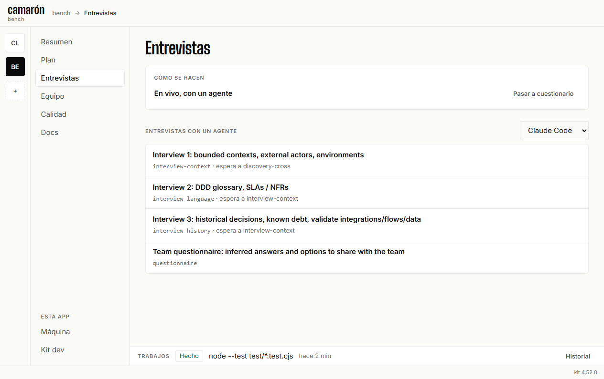
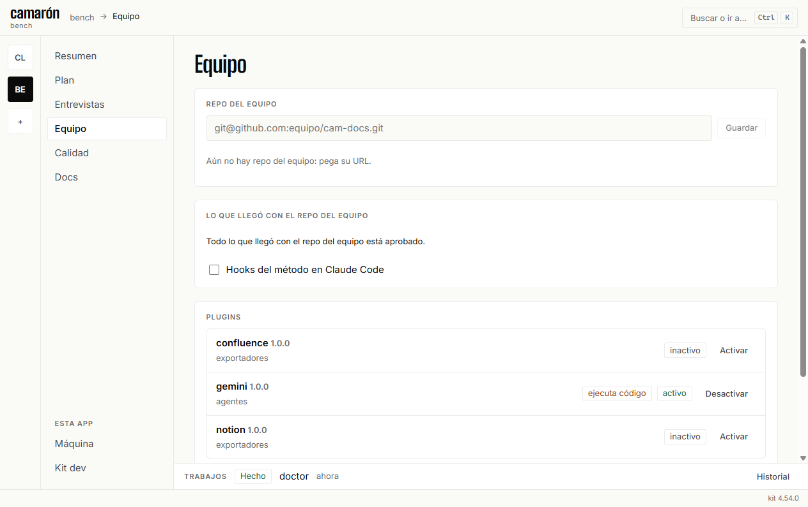
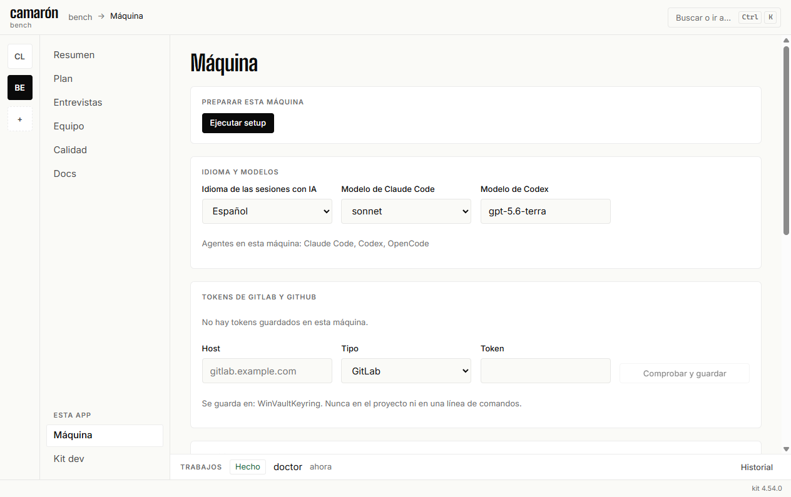
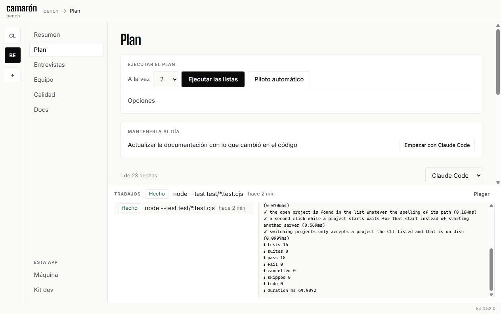
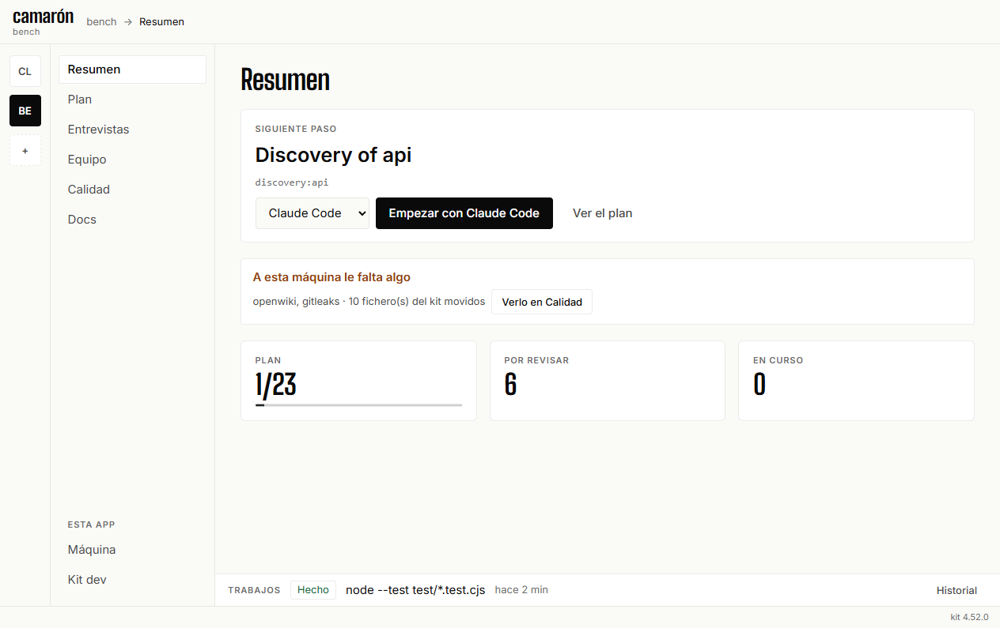
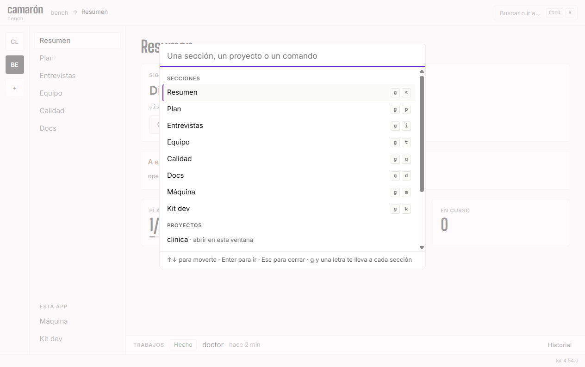

<p align="center">
  
</p>

<p align="center">
  <strong>Convierte un proyecto multi-repo en documentación que puedes explorar, revisar y mantener.</strong><br>
  Tu agente de IA lee el código. Camarón organiza el trabajo. Tú validas el resultado.
</p>

<p align="center">
  
  
  
  
  <a href="https://github.com/iandelu/camarones-documenter/actions/workflows/tests.yml"></a>
</p>

<p align="center">
  <a href="#empieza-aquí">Empezar</a> ·
  <a href="#app-de-escritorio">App de escritorio</a> ·
  <a href="#del-código-al-mapa-del-proyecto">Cómo funciona</a> ·
  <a href="#una-sesión-una-unidad-de-trabajo">Sesiones</a> ·
  <a href=".camarones/TUTORIAL.md">Tutorial ES / EN</a>
</p>

---

## El código está repartido. La explicación no debería estarlo.

Un servicio recibe la petición, otro publica un evento y un tercero guarda el resultado. Entender el sistema exige cruzar repositorios, conversaciones y decisiones que quizá nadie escribió.

**Camarón** es un wizard local con CLI que coordina ese trabajo con Claude Code o Codex. Divide la documentación en unidades manejables, guarda el progreso entre sesiones y reúne el resultado en un portal web.

Está pensado para equipos que necesitan incorporar personas, entender sistemas heredados o documentar la arquitectura y los flujos de un proyecto con varios repositorios.

### Un cerebro de proyecto, primero sin IA

El objetivo de Camarón es **mejorar, automatizar y estandarizar cómo la IA documenta un proyecto**. El resultado es un cerebro del proyecto: un único sitio versionado donde el código, la arquitectura, el dominio y las decisiones quedan explicados para personas y agentes.

1. **Instalar ya da valor, casi sin IA.** La instalación deja las herramientas de documentación listas y genera una base lógica solo con análisis estático: repos detectados, grafo de código, la página de inicio del proyecto y una página por repo, borrador C4, plan de trabajo y portal. Sin llamar a ningún modelo ni necesitar una cuenta de pago.
2. **Después, la IA la completa.** Entrevistas, redacción, depuración del modelo, mejoras de arquitectura y mantenimiento cuando cambia el código.
3. **Todo lo que añade la IA se puede revisar y rastrear**: borrador → confirmado, con las fuentes (`x-sources`) de cada afirmación.

Camarón te habla como tu becario gamba al que has mandado a documentar: con ganas, con chispa y consciente de que es pequeño. Las bromas se quedan en las esperas y los éxitos; los errores y las decisiones van al grano.

### Qué hace, en seis puntos

1. **Instala e integra las herramientas de IA** (Claude Code, Codex, graphify, LikeC4, OpenWiki, MCP, mermaid-cli, gitleaks) con un asistente.
2. **Estandariza la documentación** con un plan de unidades, un playbook, convenciones y skills para los agentes.
3. **Las personas consultan, editan y verifican** la documentación en el portal vivo (`camaron up`) o con la CLI.
4. **La IA tiene la documentación a mano al implementar**: servidor MCP `camarones` (`ask` con citas, `search_docs` con ranking, que dice en qué sección está cada resultado; `read_doc` de una página entera o solo de una sección, con su TL;DR; `repo_graph`…), servidor MCP `likec4` para preguntar al modelo de arquitectura, ambos en Claude Code y en Codex, y skills `cam-docs-lookup` / `cam-docs-update`. Funciona también con Claude Code abierto dentro de un solo repo: `setup` registra el MCP `camarones` en el ámbito local de Claude Code para la carpeta de cada repo (en tu `~/.claude.json`, nunca en el repo), `doctor` avisa si falta, `repair` lo vuelve a poner y `uninstall` lo quita.
5. **Documentación viva y revisada**: el código y la doc cambian juntos; `changes`, `check` y la trazabilidad `x-sources` señalan lo que quedó atrás, y `check` además detecta enlaces rotos, diagramas que no se dibujan, secretos copiados y términos que el glosario pide evitar.
6. **Todo vive en `cam-docs/`**, una carpeta junto a tus repos que es su propio repo Git: docs, `.camarones`, `.claude`, `.codex`, `.agents`, `.mcp.json`. Los repos de servicio no reciben archivos del kit, y la configuración de agentes que llega del equipo solo se carga cuando la apruebas en tu máquina.

## Mira cómo funciona

<p align="center">
  
</p>

<p align="center"><em>Navega, busca y abre documentación sin salir del portal.</em></p>

<p align="center">
  
</p>

<p align="center"><em>Revisa borradores, confirma páginas y deja correcciones para la siguiente sesión.</em></p>

<p align="center">
  
</p>

<p align="center"><em>Y en la app de escritorio, lo que corre en tu máquina, por tareas: el siguiente paso con un clic, el plan, las entrevistas, el equipo y la calidad, también solo con el teclado. <a href="#app-de-escritorio">Cómo instalarla y abrirla →</a></em></p>

<details>
<summary><strong>Más capturas del portal</strong></summary>

| Documentación | Arquitectura C4 | Revisión |
|---|---|---|
|  |  |  |

</details>

## Del código al mapa del proyecto

1. **Conecta tus repositorios.** Detecta carpetas Git locales o configura repositorios de GitHub y GitLab.
2. **Descubre el sistema.** El agente examina código, contratos, configuración e integraciones; las entrevistas recogen el contexto que falta. Las entrevistas no frenan la redacción: las fichas de repo, el dominio, los datos, las decisiones y el catálogo de flujos empiezan desde el código como borradores (`✎ draft` en `camaron plan`), dejan sus preguntas en `docs/interview/open-questions.md` y se reabren para afinarlas cuando termina la entrevista. Las traducciones y la confirmación sí esperan a las entrevistas.
3. **Documenta por sesiones.** Wikis por repositorio, arquitectura C4, dominio, modelos de datos, flujos de negocio y decisiones.
4. **Revisa y publica.** Valida los borradores y construye un portal con navegación, diagramas y traducciones.
5. **Vuelve cuando cambie el código.** Compara commits desde la última documentación y usa las fuentes para orientar la actualización.

### Lo que lo hace útil

- **Una visión de todo el proyecto.** Une la documentación de cada repositorio con sus relaciones, actores y flujos de negocio.
- **Sesiones que puedes retomar.** Plan, notas de progreso y contexto de relevo guardados en archivos del proyecto.
- **Documentación con fuentes.** Referencias `x-sources` al código y detección de fuentes que ya no existen.
- **Revisión humana visible.** Distingue borradores, páginas confirmadas y páginas que necesitan otra revisión.
- **Arquitectura navegable.** LikeC4 para las vistas del sistema y Mermaid para secuencias, estados y modelos de datos. El modelo C4 se reparte en ficheros: cada repo en `repos/<repo>.c4` y cada flujo en `flows/<slug>.c4`, de modo que las unidades que trabajan a la vez no editan el mismo fichero.
- **Documentación para personas y agentes.** Portal para leer; `AGENTS.md`, `CLAUDE.md`, `llms.txt` (índice) y `llms-full.txt` (todas las páginas en un fichero) para orientar el trabajo con IA.
- **Inglés y español.** Documentación canónica en inglés, traducciones al español y seguimiento de traducciones pendientes o desactualizadas.
- **Un primer mapa sin IA.** `arch-draft` realiza un análisis estático y propone un borrador C4 que después hay que verificar. Entiende proyectos Firebase: una sola Firestore y un solo Storage por proyecto (el de `.firebaserc`), compartidos por las apps que los usan, la carpeta `functions/` como un contenedor «Cloud Functions» al que llaman las apps (`httpsCallable`, `cloud_functions`) y Firebase Auth como sistema externo.
- **Páginas del código, sin IA.** La instalación (y `camaron pages [--json]`, que las pone al día; `camaron diagrams` es su alias) escribe `docs/index.md`: qué es el proyecto (su nombre y un resumen sacado de los hechos), una tarjeta por repo y el mapa de contexto, con enlaces a stack y herramientas, librerías y, si hay topics, mensajería. Por cada repo de la máquina escribe `docs/repos/<repo>/index.md`: qué expone (el mapa de endpoints, con la tabla de endpoints plegada), qué datos guarda (diagrama ER), sus ciclos de vida (diagramas de estados), sus mensajes y qué necesita para arrancar (variables de entorno y comandos, plegados: placeholders `${VAR:valor}` de Spring, `.env.example`, `environment.ts` de Angular; Maven, Gradle, `package.json`, Makefile, Docker Compose; OpenAPI o anotaciones de Spring), cada fila con el fichero y la línea de donde sale. Los valores por defecto que parecen secretos se ocultan. Con topics hay además `docs/architecture/messaging.md`. Un proyecto nuevo ya no escribe `first-look.md`, `system-map.md`, `reference.md`, `diagrams.md` ni `data/<repo>.md`; `blocks`, `schemas` y `arch-draft --save` siguen este diseño. Son bloques `<!-- generated:… -->` que se pueden poner en cualquier página; `camaron pages`, `camaron blocks` y `camaron sync` los actualizan. Si alguien edita uno a mano, se conserva y `check` lo avisa (`blocks --force` toma la versión del código).
- **Proyectos anteriores a la 4.52.** Conservan sus páginas hasta que ejecutes `camaron pages --adopt`: mueve los bloques, con sus confirmaciones, a las páginas nuevas (rellenando la página de inicio o de repo que escribió un agente), borra solo las páginas del kit que deja vacías, no escribe ni borra nunca una página de una persona (`x-owner: human` o `x-confirmed`; una página sin `x-owner` es de un agente), apunta los enlaces de las páginas de agente a las páginas nuevas y lista lo que no pudo tocar (páginas, enlaces, traducciones).
- **Historial de git, sin IA.** `camaron history [--months 12]` escribe `docs/overview/history.md` (y su traducción): los ficheros con más commits, quién tiene más commits en cada repo y en qué carpeta trabaja (solo nombres, sin correos), los ficheros que cambian juntos, los tickets que aparecen en commits de varios repos y qué parte de los commits sigue Conventional Commits. Deja fuera bots y lockfiles. Sirve para saber a quién entrevistar y por dónde empezar.
- **Aprovecha lo que ya usáis.** `radar` detecta el stack de cada repo y sus herramientas (Backstage, Sonar, librería de componentes, linters, contratos, CI) y lo deja en `docs/overview/tooling.md`; `stack` corrige un stack mal detectado. `inventory` (que también corre con el escaneo inicial) lista las dependencias directas de cada repo desde sus manifiestos y lockfiles (Maven, Gradle, npm, Python, Go, .NET, Composer, Cargo y Flutter/Dart), con su versión, su ámbito (runtime, test, dev) y su categoría (framework, datos, caché, seguridad, mensajería, observabilidad, API, HTTP, SDK de nube, UI, tests, build), y marca la misma librería con versiones distintas entre repos; lo deja en `docs/overview/libraries.md` sin IA. Las categorías salen de `.camarones/lib/dep_categories.yaml`. Con `inventory --cves` añade las **vulnerabilidades conocidas** de cada librería (CVE, gravedad y versión que la corrige) con OSV-Scanner, un binario fijado y comprobado por SHA-256 que se descarga una vez en `~/.camarones/bin`. Usa su base de datos **offline** (se descarga una vez en `~/.camarones/osv-db`, unos 220 MB para Maven y npm), y sin resolver dependencias transitivas (eso pediría a Maven Central los poms padre, también los internos), así que ningún nombre de paquete sale de tu máquina; la API online solo se usa si pones `"osv": {"online": true}` en `~/.camarones.json`. Encontrar vulnerabilidades no es un fallo: sale con 0; en CI, `--fail-on high` (o `critical`) sale con 1 si hay alguna así de grave. El escaneo cuenta los repos a medida que entra en cada uno (`[2/5] <repo>: …`); con `--json` la salida estándar es solo el JSON y ese progreso va a stderr. Cada aviso se guarda entero (texto, versiones afectadas, fechas, CWE y referencias), así que se lee sin conexión en la app. `camaron bump <repo> <librería> <versión>` actualiza una librería en **una rama nueva** de ese repo (`camaron/bump-<nombre>-<versión>`) con su propio gestor de paquetes (npm, pnpm, yarn, uv, poetry, go) o, sin él, reescribiendo la versión en el manifiesto (Maven, Gradle, requirements): sin `--yes` solo dice lo que haría, no toca un repo con cambios sin commit, no hace commit ni push, y si falla deja el repo como estaba. Es lo único con lo que el kit escribe en un repo de servicio, y solo cuando se lo pides.
- **Diagramas del código, sin IA.** `camaron pages` (alias `camaron diagrams`, que también corre con el escaneo inicial y el primer vistazo) dibuja en Mermaid lo que el código afirma, sin inventar nada. `docs/index.md` trae el mapa de contexto (repos, almacenes de datos, brokers y proveedores de identidad con sus conexiones); `docs/repos/<repo>/index.md`, el mapa de endpoints con lo que usan y un diagrama de estados por cada enum de estado, solo con los estados: las transiciones no se adivinan; y `docs/architecture/messaging.md`, una secuencia por topic con quién publica y quién consume. Son bloques generados como los de `blocks`: el kit los mantiene al día; una persona puede confirmar uno a mano, copiando el `sha=` del bloque en `confirmed=` y poniendo su nombre en `by=` (una palabra, o entre comillas si lleva espacios: `by="Ana López"`), p. ej. `<!-- generated:states repo=api id=OrderStatus confirmed=3fa1c2d4e5f6 by=ana sha=3fa1c2d4e5f6 -->`; entonces un refresco nunca lo toca, y `check` avisa «el código cambió desde que se confirmó» cuando el código se movió (y también si el código ya no tiene la fuente de un diagrama). Para quedarte con la versión del código y volver a confirmarlo: quita `confirmed=` y `by=` del marcador, ejecuta `camaron diagrams` (o `blocks`) y confírmalo de nuevo. El portal etiqueta cada diagrama como «Del código», «Editado a mano», «Confirmado por …» o «El código cambió». Para los agentes, la skill `cam-docs-diagrams` enseña qué diagrama elegir, cómo escribir Mermaid sin errores y que un bloque generado no se edita; `cam-docs-update` y `cam-docs-lookup` la citan.
- **Esquemas de datos sin IA.** `schemas` (que también corre con el escaneo inicial y el primer vistazo) lee las tablas y colecciones de cada repo desde el código: SQL de las migraciones (Flyway en orden de versión, Liquibase XML/YAML), ficheros `schema.sql` y clases de entidad (JPA, SQLAlchemy, Django, TypeORM, Prisma), y NoSQL de Mongo (`@Document`, Mongoose) y Firestore (las rutas de `firestore.rules`, las llamadas a `collection(…)` y las claves que se escriben en ellas, también en Dart/Flutter). Cada campo lleva su tipo, clave y referencia. Deja el diagrama ER y la lista de tablas en un bloque generado de la página del repo (`docs/repos/<repo>/index.md`; `docs/data/<repo>.md` solo en proyectos anteriores a la 4.52) que el kit mantiene al día con el código (si alguien lo edita a mano, se respeta y `check` lo dice); la unidad `data` de IA parte de ahí para explicar qué significa cada tabla y de quién es. En un proyecto nuevo, la página del repo se pone al día (se reescribe entera solo mientras no tenga más que texto del kit); en un proyecto anterior a la 4.52, un `data/<repo>.md` que ya existía nunca se sobrescribe.
- **Control de calidad en cada unidad.** Enlaces rotos y diagramas Mermaid inválidos son errores; un posible secreto bloquea el commit de checkpoint, la exportación del portal y la rama de CI, sin mostrar nunca su valor.
- **Nada se ejecuta a ciegas.** Los hooks, servidores MCP, ajustes y skills que llegan con el `cam-docs` del equipo y que no ha escrito el kit se te enseñan antes de que los carguen Claude Code o Codex; las aprobaciones son de tu máquina y ningún push puede darlas por ti.

## Empieza aquí

### Requisitos

- **Git** y **Node.js 22 o superior** para el conjunto de herramientas.
- **uv**, que gestiona Python 3.10+ y las dependencias del CLI. El lanzador puede instalarlo con WinGet en Windows o Homebrew en macOS; en otros casos indica cómo continuar.
- **Claude Code o Codex**, instalado y autenticado, para las sesiones de documentación con IA. También sirven OpenCode y Gemini CLI (ver [Agentes y modelos locales](#agentes-y-modelos-locales)). El asistente también permite copiar el prompt.
- **Docker es opcional**: el portal también se puede servir con Python.
- **La app de escritorio es opcional**: necesita Node.js 22 (el mismo de arriba) y la primera vez descarga Electron en `~/.camarones/desktop`.

El asistente comprueba los requisitos y permite elegir componentes. La primera instalación descarga herramientas y dependencias. El acceso a modelos de IA depende de la configuración y cuenta de tu agente.

### 1. Instala el kit

**Instalación global (recomendada).** Una sola copia del kit, compartida por todos tus proyectos: actualizarla una vez actualiza el comportamiento en todos a la vez, y cada proyecto solo guarda su propia configuración. Una línea, sin clonar nada antes:

```sh
# macOS / Linux
curl -fsSL https://raw.githubusercontent.com/iandelu/camarones-documenter/main/install-global.sh | sh
```

```powershell
# Windows · PowerShell
$f="$env:TEMP\camaron-install.cmd"; (irm https://raw.githubusercontent.com/iandelu/camarones-documenter/main/install-global.cmd) -replace "`r?`n","`r`n" | Set-Content -NoNewline -Encoding ascii $f; & $f
```

Si ya tienes el repo clonado, `sh install-global.sh` o `.\install-global.cmd` hacen lo mismo.

Esto clona el kit oficial de GitHub a una ruta fija (`%LOCALAPPDATA%\camarones-documenter\kit` en Windows, `~/.camarones/kit` en macOS/Linux) y deja el comando `camaron` en tu PATH. El antiguo `camarones` continúa como alias compatible durante la transición. Para instalar desde un fork o desde tu copia local mientras desarrollas el kit, define `CAMARONES_KIT_URL` antes de lanzar el instalador.

**Actualizar.** En el asistente, **⚙️ Ajustes › ⬆️ Actualizar Camarón** comprueba si hay versión nueva, te la ofrece y reinicia el asistente ya actualizado. Desde la terminal es `camaron self-update`. Las instalaciones anteriores a la 3.8, que seguían la carpeta desde la que se instalaron, pasan solas a seguir el kit oficial. Desde ahí:

```sh
cd ~/Documents/mi-proyecto   # la carpeta que agrupa (o agrupará) los repos
camaron                    # crea ./cam-docs/, lo registra y abre el asistente
camaron new enjoy          # alternativa: crea ./enjoy/cam-docs/
camaron join <url>         # únete al cam-docs de tu equipo: lo clona aquí o reutiliza el que ya tienes
camaron share              # trae lo último del equipo y publica tu trabajo (solo cuando lo pides)
camaron share --auto on    # o publica solo tras cada checkpoint (en este equipo)
camaron trust              # revisa y aprueba los hooks, MCP y skills del equipo antes de que los carguen tus agentes
camaron repair             # repara: vuelve a escribir los ficheros y enlaces del kit si alguien los editó o borró
camaron switch             # cambia entre tus proyectos
camaron projects --inspect ~/Documents/mi-proyecto [--json]   # qué es esa carpeta (proyecto, repo, varios repos, código, vacía); solo lee
camaron projects --adopt ~/Documents/mi-proyecto [--name X] [--json]   # la vuelve proyecto y la registra (su cam-docs/ queda junto a los repos); lo que usa la app
camaron projects --git-init ~/Documents/mi-codigo [--json]   # git init en el código que aún no está en git (solo cuando lo pides)
camaron self-update        # trae el kit oficial al día — actualiza todos los proyectos a la vez (en el asistente: ⚙️ Ajustes › ⬆️ Actualizar Camarón)
camaron migrate            # pasa un proyecto de la estructura anterior (≤2.5) a cam-docs/
camaron docs reset --redo   # documentación de un kit antiguo: reabre cada unidad terminada para revisarla (no borra nada)
camaron docs reset --wipe   # o bórrala y empieza de cero: conserva entrevistas y páginas confirmadas; antes, etiqueta en git
camaron uninstall           # lo deshace todo: borra cam-docs/ (con copia .zip) y los rastros en los repos
```

Cada proyecto guarda **todo lo que genera el kit en `cam-docs/`**, un repositorio Git propio (versionado aparte del kit y de los repos que documenta, pensado para compartirlo con el equipo). La carpeta del workspace enlaza a él la configuración de los agentes, así que al abrir Claude Code o Codex en ella ven todos los repos y la documentación:

```text
mi-proyecto/
├── cam-docs/             # Repo Git: la documentación viva y la config de la herramienta
│   ├── .camarones/       # workspace.yaml, PLAYBOOK.md, CONVENTIONS.md (y .cache/, ignorada)
│   ├── .claude/ .codex/ .agents/ .mcp.json   # skills, MCP y reglas para los agentes
│   ├── AGENTS.md CLAUDE.md
│   ├── docs/             # Arquitectura, dominio, flujos, fichas por repo, plan de trabajo…
│   ├── wikis/<repo>/     # Wikis de OpenWiki (el repo ve un enlace openwiki/ sin versionar)
│   └── graph/<repo>/     # Grafo de código de graphify (ignorado)
├── .claude → cam-docs/.claude   .mcp.json → cam-docs/.mcp.json   AGENTS.md → …   CLAUDE.md → …
├── orders-api/           # Repositorio Git, sin archivos del kit
├── payments-api/
└── storefront/
```

Si lo pides, el asistente añade al `CLAUDE.md` de cada repo un bloque corto que apunta a `../cam-docs` (se añade al final; nunca borra lo que había).

#### En equipo: un solo `cam-docs` para todos

Camarón está pensado para que lo use un equipo. Al crear un proyecto, el asistente pregunta si el equipo ya tiene un repo de `cam-docs` (GitHub, GitLab…), y la CLI hace lo mismo con `camaron join <url>` o `camaron new <nombre> --from <url>`. Nunca hace el trabajo dos veces:

- **Si el repo ya tiene un proyecto Camarón**, lo clona y el asistente solo prepara tu máquina (herramientas, repos de servicio y grafo local). Repos, stack, arquitectura y plan ya los decidió el equipo, y las sesiones siguen donde se quedaron.
- **Si ya lo tienes en esta máquina** (registrado o en `./cam-docs` con ese remoto), lo reutiliza y trae lo último, sin volver a clonar.
- **Si el repo está vacío**, crea el proyecto en local con esa URL como `origin`. Tu primer «Compartir con el equipo» lo publica.
- **Sin URL**, crea un repo Git local, igual que antes. Puedes añadir el remoto más tarde con `camaron remote <url>`.

En la app de escritorio es **Unirme a la documentación de mi equipo** en la pantalla de inicio (ver [Primer arranque](#primer-arranque-pantalla-de-inicio-y-asistente)): pega la URL del repo `cam-docs`, no la del código. Si git no tiene acceso, la app pide un token y lo guarda en el llavero del sistema, nunca en el proyecto.

Lo que trae el repo del equipo no se ejecuta a ciegas. Si `cam-docs` incluye hooks, servidores MCP, ajustes o skills que no ha escrito el kit, el asistente te enseña qué ejecutan al abrirlo y Claude Code / Codex solo los cargan cuando los apruebas en tu máquina (`camaron trust`). Las aprobaciones se guardan en `~/.camarones/trust/`, fuera del repo. Lo que el kit instaló en tu máquina (sus skills y los de graphify y OpenWiki, anotados en `~/.camarones/install/`) lo reconoce sin preguntar, así que un proyecto recién creado no pide aprobar nada. `camaron doctor` enseña si un fichero del kit se editó o falta un enlace, y `camaron repair` lo devuelve a su sitio sin tocar las páginas del equipo.

Por defecto los checkpoints se guardan solo en local y publicar es un paso explícito: «🤝 Compartir con el equipo» en el menú, **Plan › Sincronizar** en el portal o `camaron share`, que guarda un checkpoint, rebasa sobre el trabajo del equipo y hace push. Con `camaron share --auto on` (o diciendo que sí tras el primer share en el wizard) cada checkpoint hace ese share solo; es por máquina, así que no activa nada a tus compañeros, y si falla lo avisa sin perder el commit local. Si hay un conflicto, lo deshace y no toca nada; si hay algo que parece un secreto, no publica.

**Copia local por proyecto (modo clásico).** Descarga este repositorio desde **Code → Download ZIP** o clónalo. Copia **`.camarones/`**, **`camaron.cmd`** y **`camaron.command`** a la carpeta que agrupa el proyecto. Los launchers antiguos `camarones.*` son aliases compatibles. Activa la visualización de archivos ocultos para ver `.camarones/`. Si ya tienes un proyecto así y quieres pasarlo a instalación global sin perder su configuración, corre `camaron unlink` dentro de él.

Para actualizar una copia local, `camaron upgrade <carpeta-del-kit-nuevo>` (con `--dry-run` primero, si quieres ver la lista). Sustituye los ficheros del kit y borra los que la versión nueva ya no trae, por ejemplo assets viejos del portal, siempre que nadie los haya editado: los editados se quedan y se avisan, y de todo lo que cambia o se borra queda copia en `.camarones/.cache/install-backups/`. La limpieza la hace el kit 4.53 o posterior; si vienes de uno anterior, repite `camaron upgrade` con la misma carpeta y se quitan los que quedaron.

```text
mi-proyecto/
├── .camarones/           # El kit y su configuración
├── camaron.cmd          # Windows
├── camaron.command      # macOS / Linux
├── orders-api/          # Repositorio Git
├── payments-api/        # Repositorio Git
└── storefront/          # Repositorio Git
```

También puedes empezar con la carpeta vacía y añadir repositorios desde el asistente. La carpeta contenedora será el centro de documentación; los repositorios de servicio conservan su propio historial Git.

**Un proyecto nuevo, sin código aún.** Un `camaron new` en una carpeta vacía (o **Elegir carpeta** sobre una vacía en la app) es un proyecto *greenfield*: se documenta el diseño antes de programar. El asistente de primer arranque deja pasar con cero repos y se salta Stack y Arquitectura (aún no hay nada que leer); puedes sumar repos cuando existan.

**Para scripts y para la app.** Los tres flags de `camaron projects` no necesitan proyecto y aceptan `--json`:

- `--inspect` solo lee e imprime `case` (`project`, `repo`, `umbrella`, `code` o `empty`), `kind`, `workspace`, `docs_root`, `name`, `repos`, `siblings` y `warning` (`home`, `no-git` o vacío). Una carpeta dentro de un repo cuenta como ese repo, y `cam-docs` como el proyecto al que pertenece.
- `--adopt` crea el `cam-docs/` y lo registra; sobre un proyecto que ya existe solo lo registra. `--git-init` hace `git init` en la carpeta con código (o en cada subcarpeta con código), sin commits ni push.
- Cuando algo se rechaza sale con 1 y, con `--json`, una línea `{"error": código, "detail": …}` (`detail` es la línea para personas de la CLI y puede venir en español: tus scripts deben mirar `error`): `taken` (esa carpeta ya tiene un `cam-docs` que no es de Camarón), `home` (el workspace sería tu carpeta personal o la raíz de un disco), `no-git` (código sin repositorio: usa `--git-init`) y `git-init` (el `git init` falló).
- `camaron join URL --no-open` (y `new NOMBRE --no-open`) imprime `{"path": …}` y termina. Si no hay acceso, `{"error": …, "host", "detail"}` con `auth`, `denied`, `not-found`, `network` o `unknown` (`taken` si ya hay otro `cam-docs` en el destino). El token de un repo privado se pasa en la variable `CAMARONES_JOIN_TOKEN`, nunca en la línea de comandos.

### 2. Abre la app de escritorio

```sh
camaron app
```

Dentro de un proyecto abre ese proyecto; en cualquier otra carpeta, la pantalla de inicio: **¿Qué quieres documentar?** Eliges una carpeta o te unes a la documentación de tu equipo, y un asistente te acompaña la primera vez. La primera vez también descarga Electron (unos 100 MB). Todo el detalle, las capturas y qué hacer si algo falla, en [La app de escritorio](#app-de-escritorio).

### 3. …o el asistente en la terminal

**Instalación global** — desde la carpeta del workspace o cualquier carpeta dentro de ella (o corre `camaron switch` para elegir un proyecto):

```sh
camaron
```

**Copia local (modo clásico)**

**Windows · PowerShell**

```powershell
.\camaron.cmd
```

**macOS / Linux**

```sh
sh camaron.command
```

En Windows también puedes abrir `camaron.cmd` con doble clic. En macOS, si el sistema bloquea el lanzador descargado, ejecútalo una primera vez desde Terminal con el comando anterior.

### 4. Sigue el plan

Configura el proyecto, selecciona repositorios y componentes, prepara el entorno y elige el siguiente paso. Camarones prepara las instrucciones de cada unidad para el agente. Revisa los resultados antes de confirmarlos.

> **Si estás desarrollando el kit:** utiliza `uv run --script .camarones/camarones.py wizard` para abrir el asistente explícitamente. Al ejecutar sin argumentos desde una carpeta llamada `camarones-documenter*` o `camarones-kit*`, el lanzador contempla instalar el kit en la carpeta superior. Prueba los flujos de instalación en una carpeta de ejemplo separada.

## Una sesión, una unidad de trabajo

La documentación profunda de un sistema no suele caber en una sola conversación. Camarones mantiene un plan con dependencias y unidades como `discovery:orders-api`, `arch-system` o `flow:checkout`.

El asistente, la app de escritorio y el Pipeline del portal enseñan el título de cada unidad en tu idioma («Descubrimiento de orders-api» o «Discovery of orders-api»): la app y el asistente usan el idioma de esta máquina y el portal, el que elijas al leer. `plan.yaml` guarda siempre el título en inglés, así que ningún plan existente cambia; un título que hayas escrito tú (o con `plan add`) se enseña tal cual.

Cada sesión lee el contexto necesario, trabaja en una unidad y guarda notas. Si se interrumpe, el siguiente agente puede continuar desde el último checkpoint. Al cerrar o bloquear una unidad, el CLI intenta crear un commit local del progreso cuando la carpeta contenedora ya tiene Git configurado.

```powershell
# Ver el trabajo disponible
.\camaron.cmd plan next

# Empezar una unidad existente y guardar una nota
.\camaron.cmd plan start discovery:orders-api
.\camaron.cmd plan note discovery:orders-api "Revisados endpoints; falta mensajería"

# Obtener instrucciones para una sesión de actualización
.\camaron.cmd prompt update --lang es
```

En macOS / Linux, sustituye `.\camaron.cmd` por `sh camaron.command` en los ejemplos.

## La IA propone. Tú confirmas.

La revisión se aplica al contenido exacto de cada página:

- **`draft`**: todavía no tiene validación humana.
- **`confirmed`**: una persona confirmó ese contenido; la confirmación queda asociada a su hash.
- **`needs-reconfirm`**: la página fue confirmada, pero su contenido cambió después.

Las convenciones instruyen a los agentes para conservar los bloques `<!-- human -->` y respetar los archivos con `x-owner: human`. Son reglas de trabajo para el agente; la calidad final sigue requiriendo revisión.

**Mejor sin información que con información equivocada.** Cuando se escribe una página, el kit guarda una huella del código que cita en sus `x-sources` (las líneas, sin espacios ni comentarios). Si ese código cambia, la página pasa a **sospechosa**; si desaparece, a **obsoleta**. Si el código solo se movió dentro del fichero, sigue siendo **fresca**. Una fuente puede nombrar un símbolo en lugar de líneas (`orders:src/…/OrderService.java#OrderService.place`, en Java, Kotlin, TypeScript, Go, C#, Python…): el kit lo vuelve a encontrar aunque se mueva y solo cuenta un cambio en su cuerpo. Una página que se apoya en otras páginas o en elementos C4 los cita (`docs/flows/checkout.md`, `c4:shop.orders`) y pasa a sospechosa cuando alguno de ellos lo es. Los agentes no reciben las páginas sospechosas ni obsoletas: el MCP y `llms.txt` las retienen y les indican qué código leer en su lugar. Tampoco reciben las páginas sin fuentes que nadie ha revisado. Las personas siguen viéndolas en el portal, con un aviso.

```sh
camaron fresh                          # qué páginas citan código que cambió o ya no existe
camaron fresh --plan                   # añade una unidad para que un agente las actualice
camaron fresh --ack <página> --by ana  # la página sigue siendo válida con el código de hoy
```

Si el equipo prefiere avisar en lugar de bloquear, `freshness: {ai_policy: warn}` en `workspace.yaml` entrega esas páginas a los agentes con una advertencia. `check` avisa de las páginas desactualizadas.

```powershell
.\camaron.cmd status
.\camaron.cmd check
.\camaron.cmd confirm docs/overview/system.md --by "Tu nombre"
.\camaron.cmd feedback docs/overview/system.md "Falta describir los reintentos" --by "Tu nombre"
```

`check` es la puerta de calidad que se pasa al cerrar cada unidad y en CI:

| Comprobación | Gravedad | Herramienta |
|---|---|---|
| Frontmatter ausente, fuentes `x-sources` que ya no existen | ERROR | — |
| Enlace roto a otra página, resuelto igual que en el portal | ERROR | Python (sin dependencias) |
| `#ancla` que no corresponde a ningún título de la página de destino | aviso (ERROR con `--strict`) | Python (sin dependencias) |
| Diagrama Mermaid que no se dibuja | ERROR | mermaid-cli |
| Posible secreto en `docs/` o en una wiki | ERROR; bloquea checkpoint y `portal` | gitleaks |
| Palabra de la columna **Avoid** del glosario | aviso (ERROR con `--strict`) | Python (sin dependencias) |
| Página confirmada que cambió · traducción pendiente | aviso | — |
| Bloque generado editado a mano o desfasado respecto al código | aviso (ERROR con `--strict`) | Python (sin dependencias) |
| Estructura de la página: tipo, título y descripción, un solo H1, TL;DR, las secciones de su plantilla, tamaño máximo, referencias vagas («ver arriba») | aviso (ERROR con `--strict`) | Python (sin dependencias) |

mermaid-cli y gitleaks forman el componente `quality` del perfil completo; si faltan, `check` lo avisa una vez y sigue con el resto. `check --secrets` ejecuta solo el escaneo de secretos.

## Todo termina en archivos que puedes versionar

```text
mi-proyecto/cam-docs/
├── docs/
│   ├── overview/        # Visión general del sistema
│   ├── architecture/    # Modelo C4 y vistas
│   ├── domain/          # Contextos, actores y glosario
│   ├── flows/           # Flujos de negocio y secuencias
│   ├── data/            # Modelos y propiedad de los datos
│   ├── deployment/      # Entornos y despliegue
│   ├── decisions/       # Decisiones de arquitectura
│   ├── quality/         # SLAs y deuda técnica
│   ├── interview/       # Respuestas y preguntas abiertas
│   ├── i18n/es/         # Traducciones al español
│   ├── .work/           # Plan, checkpoints y relevo entre sesiones
│   ├── llms.txt         # Índice para agentes
│   └── llms-full.txt    # Todas las páginas que pueden leer, en un fichero
├── wikis/orders-api/    # Wiki del repositorio, si se eligió OpenWiki
├── AGENTS.md
└── CLAUDE.md
```

<a id="app-de-escritorio"></a>

### 🖥️ La app de escritorio

<p align="center">
  
  
</p>

<p align="center"><em>Todo lo que corre en tu máquina, por tareas, en una ventana; para leer, el portal.</em></p>

La app es donde se opera un proyecto y el **portal** es donde se lee. Cada proyecto se abre en su ventana: a la izquierda el raíl con tus proyectos y las secciones, en medio la tarea y, abajo, el panel de **trabajos** con lo que corre y los últimos, su salida y **Parar**. Cada botón ejecuta el mismo comando que escribirías en la terminal, con su salida en vivo, así que nada de lo que ves es magia aparte. Para leer, **Ver portal** (en la cabecera) y la sección **Docs** abren el portal del mismo proyecto en tu navegador.

Todo se hace también con el teclado: <kbd>⌘K</kbd>/<kbd>Ctrl K</kbd> (o **Buscar o ir a…**, arriba) va a una sección, a otro proyecto o a cualquier comando, que se abre en su sección con el formulario listo; y <kbd>g</kbd> seguido de una letra salta de sección (`g s` Resumen, `g b` Tablero, `g p` Plan, `g i` Entrevistas, `g t` Equipo, `g q` Calidad, `g d` Docs, `g m` Máquina). Las letras aparecen en el menú lateral al pasar por él.

| | 🌐 Portal en el navegador (`camaron up`) | 🖥️ App de escritorio (`camaron app`) |
|---|---|---|
| **Para quién** | Todo el equipo, también desplegado como web | Quien documenta en su máquina |
| **Leer, buscar, preguntar** | ✅ | En tu navegador: **Ver portal** y Docs lo abren |
| **Editar, confirmar, revisar, comentar** | ✅ | En tu navegador: Docs lo abre |
| **Pipeline: estado en vivo, reintentar, aprobar** | ✅ | ✅ |
| **Responder la entrevista del equipo** | ✅ | ✅ |
| **Sincronizar con el equipo (pull y push)** | ✅ | ✅ |
| **Ver el tablero y mover tarjetas o añadir historias y tareas** | ✅ Tablero (con el token del portal) | ✅ Tablero |
| **Ejecutar el plan, piloto automático, sesión con un agente** | — | ✅ Plan |
| **Ver la salud del proyecto: máquina, documentación y código** | ✅ Salud (solo lectura) | ✅ Calidad |
| **Requisitos, contexto, preguntas de control, vulnerabilidades** | — | ✅ Calidad |
| **Fijar el repo del equipo, aprobar su configuración de agentes, hooks y plugins** | — | ✅ Equipo |
| **Tokens, idioma y modelos, repos, actualizar el kit, desinstalar** | — | ✅ Máquina |
| **Construir el explorador C4, generar la wiki de cada repo y su grafo, preguntar con IA** | — | ✅ Docs |
| **Reconstruir el grafo de código** | — | ✅ Calidad › Todos los comandos (`graph`) |

El portal del navegador no tiene el token de la app y no enseña lo que no puede hacer: esos botones solo están en la app.

#### La app, sección a sección

| Sección | Qué haces ahí |
|---|---|
| 🏠 **Resumen** | El **siguiente paso** con un solo botón (el mismo que propone el asistente), el aviso si a la máquina le falta algo y cómo van el plan, la revisión y los trabajos. Es donde caes al terminar el asistente de primer arranque |
| 📋 **Tablero** | El tablero del proyecto en sus seis columnas, de Backlog a Hecho, con una tarjeta por elemento (id, tipo, prioridad, título y, en una tarea, `↳ WI-n` con su historia). **Mueves** una tarjeta arrastrándola o con el teclado (Tab hasta la tarjeta, Espacio la coge, las flechas la mueven, Intro la suelta y Escape la devuelve), y se escribe con el token de la app. Al pulsar una tarjeta se abre a un lado su descripción, sus criterios de aceptación y la definición de hecho; una **historia** lista además sus tareas, cada una con su estado, y **Añadir tarea** crea una ya dentro de ella; **Eliminar**, en ese panel, la quita del tablero tras preguntar (su fichero pasa a `backlog/archive/tasks`, como `camaron board archive`). Ocupa todo el ancho de la ventana. **Añadir**, en la cabecera, abre un formulario (tipo, título, dentro de qué y prioridad): una tarea puede ir bajo una historia o una épica, y una historia, un bug o un spike, bajo una épica. Si el tablero no está activado, ofrece **Activar el tablero**. El portal sigue siendo el lector; ver [El Tablero](#el-tablero) |
| 🗺️ **Plan** | Ejecutar las unidades listas en paralelo (sesiones por agente, máximo de unidades, incluir entrevistas) o con el **piloto automático**, y pararlo; todas las unidades en un **tablero por estado** o **por fases**, con un color por estado (amarillo en curso, ámbar apagado en pausa, verde hecha, blanco por hacer, rojo bloqueada, violeta si espera tu aprobación, gris si espera a otras); al pulsar una se abre su detalle con la acción que la mueve (aprobar, reintentar, seguir, empezar con el agente que elijas). Una unidad empezada cuya terminal ya no está abierta pasa a **en pausa**, en «Te necesitan», y «Seguir» retoma su conversación; si la terminal sigue abierta, el detalle dice qué está haciendo el agente (con Claude Code: la herramienta y el archivo de su último paso, o que te está esperando); la sesión que **actualiza la documentación** con lo que cambió en el código. El grafo del plan está en el portal |
| 🎙️ **Entrevistas** | Cuestionario del equipo o en vivo (si nadie lo ha elegido, la app lo pregunta antes de empezar ninguna entrevista), **exportar** el formulario sin conexión y abrir su carpeta, **importar** respuestas con un selector de ficheros, cerrar la ronda y cada entrevista con su agente |
| 🤝 **Equipo** | El **repo del equipo** y **compartir** (lo que hay por enviar y por traer, compartir cada checkpoint), lo que llegó con ese repo y falta **aprobar** en esta máquina, los **hooks** del método y los **plugins** (si vienen con el kit o con el repo del equipo, qué aportan, si ejecutan código o envían la doc fuera, y activarlos o desactivarlos en esta máquina, también los del kit como Gemini) |
| ✅ **Calidad** | La **salud del proyecto** de un vistazo, sin IA: una frase de veredicto («2 vulnerabilidades altas · 3 páginas desactualizadas») y tres áreas, **Máquina**, **Documentación** y **Código**, cada una con su estado (Lista / Al día / Sano, Revisar o Riesgo), dos cifras y su siguiente acción; debajo, la **tabla por repo**: si usa SonarQube (con la **puerta de calidad** en palabras, Aprobado, Aviso o Suspendido, y «Conectar SonarQube» cuando falta el token: abre Máquina › Tokens con el servidor ya escrito), la cobertura (la de SonarQube cuando lo lee, con «Sonar» como origen, y si no la de sus informes locales, JaCoCo, lcov o Cobertura, con su fecha), las vulnerabilidades por gravedad y la deuda técnica que registra `docs/quality/`. Un dato que falta sale como «—», nunca como 0. «Comprobar todo» la recalcula, y cada fila abre con «Abrir» los controles de siempre: **requisitos y herramientas** (se guardan entre visitas, con «Volver a comprobar» y el botón que instala o repone), el **contexto** que carga cada sesión de agente frente al presupuesto, **preguntas de control** («Proponer preguntas» abre al agente en la unidad que las redacta), **con y sin cam-docs** y, sin IA, las **librerías** (cuántas y sus vulnerabilidades, con el paso a Librerías), **páginas desactualizadas** («Sigue valiendo» o una unidad que las actualice) y **bloques generados** |
| 📦 **Librerías** | Las dependencias de cada repo, sin IA, como tabla librería × servicio con filtros (categoría, servicio, ámbito, solo vulnerables), **releerlas** del código y **buscar vulnerabilidades**: el escaneo enseña el repo que está leyendo, los que ya terminó y una barra, se puede **parar**, y al acabar marca un tick con lo que encontró (repos revisados y librerías con avisos); si sales de Librerías y vuelves mientras corre, retoma su progreso. Cada librería se abre en **por qué está** (qué repo la declara, en qué manifiesto, con qué rango y para qué ámbito), **por qué está marcada** (cada aviso con su gravedad, las versiones afectadas, el texto completo, CWE, fechas y referencias) y **Actualizar**: propone la versión que corrige todos sus avisos, pregunta una vez y crea la rama con `bump` en ese repo, sin commit ni push |
| 📖 **Docs** | **Leer la documentación**, **Revisar borradores** y **Buscar o preguntar** abren el portal del proyecto en tu navegador. Debajo, **Construir el explorador C4**; un bloque por repo con **Generar la wiki** (elige el repo y escribe un brief inicial sin IA si aún no tiene; una wiki a la vez: mientras se genera la de un repo, el botón de los demás espera) y, con wiki, **Grafo del wiki**; y **Preguntar con IA**, que responde con lo que dice la documentación y enlaza sus fuentes en el portal. Cada trabajo enseña su salida, **Ver** lo abre en el portal y, si falla, **Reintentar** |
| 🧰 **Máquina** | **Preparar la máquina** (`setup`) con su progreso, **idioma y modelos** de Claude Code y Codex (el de Codex, de la lista que ofrece el propio Codex, u otro a mano), **tokens de GitLab, GitHub y SonarQube** (SonarQube solo por https; se comprueban con el servidor y se guardan en el llavero del sistema, nunca en una línea de comandos), **repos** (clonados o no, su stack editable, clonar o actualizar, detectar) y el **plan** rápido o completo, **actualizar el kit** y reiniciar la app con la versión nueva, **reparar los archivos del kit** (`repair`) y, aparte, **desinstalar**: primero «Ver qué borraría» y después un diálogo que repite la lista |
| 🛠️ **Kit dev** | Solo en un checkout del kit: el sandbox, `pytest`, los builds del portal y de la app y los tests de escritorio (ver [Desarrollo](#desarrollo)) |

Al final de cada sección, **Todos los comandos** (plegado) tiene el resto de comandos de su zona, con un formulario que sale del propio parser (`camaron catalog`) y sin repetir los que ya tienen panel. Lo que borra o mueve datos va al final y pide confirmación en un diálogo que dice qué va a pasar.

<details>
<summary><strong>📸 Más capturas de la app</strong></summary>

| Entrevistas | Equipo |
|---|---|
|  |  |

| Máquina | Un trabajo en vivo | Resumen |
|---|---|---|
|  |  |  |

| La paleta (<kbd>Ctrl K</kbd> / <kbd>⌘K</kbd>) |
|---|
|  |

</details>

#### Primer arranque: pantalla de inicio y asistente

Fuera de un proyecto, la app enseña una sola pregunta, **¿Qué quieres documentar?**, con dos caminos y la lista de **Recientes**:

- **Elegir carpeta.** Vale cualquier carpeta; antes de tocar nada, la app te cuenta qué ha encontrado:
  - varios repos: los documenta, con `cam-docs` en esa carpeta;
  - un repo suelto, o una carpeta dentro de uno: crea `cam-docs` junto al repo, en su carpeta padre, y te deja sumar los repos hermanos;
  - una carpeta **vacía**: un proyecto nuevo, sin código aún;
  - un proyecto que **ya tiene `cam-docs`**: se abre tal cual;
  - código que no está en git: **no** deja continuar y ofrece **Inicializar git aquí**, que hace `git init` (sin commits ni push) y vuelve a mirar la carpeta;
  - tu carpeta personal o la raíz de un disco: la rechaza y lo explica, porque `cam-docs` y el análisis de repos acabarían ahí. Elige la carpeta de un proyecto.

  Confirmas el nombre y pulsas **Continuar**.
- **Unirme a la documentación de mi equipo.** Pegas la URL del repo `cam-docs` (la de la documentación, no la del código) y eliges dónde clonarlo. Si git no tiene acceso, la app te pide un token, lo guarda en el llavero del sistema y lo reintenta; si el motivo es otro (sin permisos, no existe, sin red) te lo dice con esas palabras.

«Crear proyecto», «Unirse» y «Añadir carpeta» ya no están en la app: **Elegir carpeta** y **Unirme…** lo cubren. La CLI conserva `camaron new` y `camaron projects --add`.

Un proyecto sin preparar abre en su ventana el **asistente de primer arranque**, en `#/start` y a pantalla completa: **Repos** (los que encontró; añade uno de código con su URL, nombre y rama) → **Herramientas** (qué falta en esta máquina) → **Instalar** (con progreso, salida en vivo y **Cancelar**) → **Stack** (lo leído de los manifiestos, editable) → **Arquitectura** (un borrador C4 hecho sin IA que guardas, miras con **Ver diagrama** o mejoras con IA) → **Listo**. Es el mismo estado que usa el asistente de la terminal: puedes cerrar la app a medias y, al reabrir, sigue donde lo dejaste, o continuar en el otro. Si te vas a otra sección antes de terminar, el **Resumen** te ofrece **Seguir con la preparación**. Un proyecto al que te uniste solo pasa por Herramientas, Instalar y Listo, porque lo demás ya lo decidió el equipo. Al terminar, la ventana aterriza en el **Resumen**, con el siguiente paso.

#### 📦 Instala y abre la app

> **En una línea:** con el kit instalado y Node.js 22 o superior, `camaron app`. La primera vez descarga Electron (unos 100 MB) en `~/.camarones/desktop` y abre la ventana. Las siguientes, se abre al momento.

**1. Ten el kit instalado.** Si aún no lo tienes, sigue [Instala el kit](#1-instala-el-kit): una línea en macOS/Linux o en PowerShell, y el comando `camaron` queda en tu PATH.

**2. Comprueba que tienes Node.js 22 o superior.** Es lo único extra que necesita la app; la CLI, el asistente y el portal funcionan sin ella.

```sh
node --version             # v22 o superior
camaron doctor --install node   # si no lo tienes: winget en Windows, Homebrew en macOS
```

**3. Ábrela.** Tres formas, la que te venga mejor:

```sh
cd ~/Documents/mi-proyecto   # dentro de un proyecto: abre ese proyecto directamente
camaron app

camaron app                  # en cualquier otra carpeta: abre la pantalla de inicio
```

- **Desde el asistente:** `camaron` y en el menú principal **🖥️ App de escritorio**.
- **Desde la pantalla de inicio:** abre un proyecto de **Recientes**, **elige una carpeta** (cualquiera: la app mira qué es antes de tocarla) o **únete a la documentación de tu equipo** con la URL de su `cam-docs`. El detalle, justo debajo en [Primer arranque](#primer-arranque-pantalla-de-inicio-y-asistente).
- **Dentro de la app:** la cabecera es la barra de la ventana (arrástrala para moverla; los botones de minimizar, maximizar y cerrar van en ella, con su mismo color en claro y en oscuro). Tus proyectos están en el raíl de la izquierda; otro se abre en la misma ventana, que vuelve a salir con el tamaño y en el sitio donde la dejaste. <kbd>Ctrl</kbd>/<kbd>⌘</kbd> + <kbd>Shift</kbd> + <kbd>O</kbd> o el **+** del raíl vuelven a la pantalla de inicio, **Ver portal** abre el portal en tu navegador, y el botón **⋯** de la barra abre el menú de la app, con **Abrir en el navegador** para ver el mismo portal, compartir la pantalla o un enlace local.

**4. Empieza por el Resumen.** Si el proyecto aún no está preparado, la app abre primero el asistente de primer arranque; al terminarlo (o en un proyecto ya preparado) abre en el **Resumen**: el siguiente paso con un solo botón. Un buen primer paso: **Calidad › Requisitos y herramientas** para ver qué le falta a la máquina, y **Plan** para la primera unidad. Lo que hay en cada sección, en [La app, sección a sección](#la-app-sección-a-sección).

<details>
<summary><strong>🪟 🍎 🐧 Notas por sistema operativo</strong></summary>

| Sistema | Qué tener en cuenta |
|---|---|
| **Windows** | Nada extra. `camaron app` abre la ventana sin consola. Si Node no está, `camaron doctor --install node` lo instala con winget. |
| **macOS** | El Electron que descarga npm viene firmado por el proyecto Electron. Si tienes Homebrew, `camaron doctor --install node` instala Node 22. |
| **Linux** | En Ubuntu 24.04 o posterior el sistema limita los *user namespaces* y el sandbox de Chromium no arranca desde la copia de npm. Camarón lo detecta y abre la app con `--no-sandbox`: sus ventanas solo cargan el servidor local de tu proyecto. |

</details>

<details>
<summary><strong>🛟 Si algo no va</strong></summary>

| Lo que ves | Qué hacer |
|---|---|
| `the desktop app needs Node.js >= 22` | Instala Node 22 (`camaron doctor --install node`) y vuelve a lanzar `camaron app`. |
| Se abre la pantalla de inicio en vez de tu proyecto | Estabas fuera de la carpeta del proyecto: ábrelo desde **Recientes** o elige su carpeta con **Elegir carpeta**. |
| «Este código no está en un repositorio git» | La app necesita el historial. **Inicializar git aquí** crea el repositorio (sin commits ni push) y vuelve a mirar la carpeta. |
| «Aquí no puedo crear el proyecto» | La carpeta elegida es tu carpeta personal o la raíz de un disco. Elige la carpeta que contiene tus repos, o una vacía. |
| «No he podido arrancar el servidor del proyecto» | El cuadro trae el error del servidor. `camaron doctor` en esa carpeta suele decir qué falta. |
| En el portal del navegador no está el botón que esperabas | Es a propósito: el portal del navegador no lanza procesos. Hazlo desde la app (Plan, Calidad, Máquina…). |
| Quieres reinstalar Electron | Borra `~/.camarones/desktop` y lanza `camaron app`: lo descarga otra vez. |

</details>

#### 🔧 Por dentro

- **Electron fijado** (`VERSIONS["electron"]`, hoy 44.7.0) en `~/.camarones/desktop`, instalado con npm y sin permisos de administrador. Nada de la app vive en tus proyectos. Al actualizar el kit (`camaron self-update`), si la versión fijada cambia, la siguiente `camaron app` descarga la nueva.
- **Cada ventana es el servidor de su proyecto** (la app en `/desktop/`, el portal en `/`), arrancado por la app con un **token de un solo uso**. Sin ese token el servidor no lanza procesos ni llama a modelos, y con él rechaza peticiones de otro `Host` (protección contra *DNS rebinding*). Las ventanas no pueden navegar fuera de su servidor: los enlaces externos y el propio portal (en el mismo servidor, fuera de `/desktop/`) se abren en tu navegador, y la ventana se queda donde estaba. El portal del navegador no lleva el token de la app, sino uno propio de la sesión con el que solo puede escribir en el Tablero: lo que él no puede hacer, como construir el C4, generar una wiki o su grafo, lo hace la app.
- **La CLI es la API de la app.** Sus secciones ejecutan `camaron <comando>` con los argumentos validados contra el parser, sin shell de por medio. Parar un comando para también lo que arrancó (agentes, npm, git).
- `camaron uninstall --global` borra también `~/.camarones/desktop`.

### Explora y edita en el portal

```sh
camaron up          # portal local: leer, editar, confirmar, pedir cambios y hacer commit en cam-docs
camaron app         # app de escritorio: las secciones donde se lanza lo que corre en tu máquina; para leer, el portal
camaron wiki orders-api   # generar o actualizar la wiki OpenWiki de un repo (en la app: Docs › Generar la wiki)
camaron down
```

El portal usa el lenguaje visual del sistema de diseño de Cofundo con la marca Camarón: lienzo cálido, titulares en Big Shoulders y texto en Inter, botones en píldora, modo claro y oscuro. El color se reserva al estado (confirmada, pendiente, error) y siempre va con su palabra; las animaciones son discretas y solo cuando algo cambia (la página que entra, las tarjetas). Quien tenga activado «reducir movimiento» en el sistema no ve ninguna. Las fuentes se sirven desde el propio portal: no pide nada a terceros.

**Pipeline** (zona Plan) muestra el plan en vivo:

- **Grafo:** las unidades por fase, con sus dependencias y su estado.
- **Tablero:** columnas por hacer, en curso, bloqueadas, hechas y descartadas.
- **Panel de cada unidad:** agente, resultado, tiempo, tokens, coste, si trabaja en su propia copia y el log de lo que hace el agente, línea a línea.

Si lanzas `camaron run` con el portal abierto, lo detecta solo y sigue la ejecución en directo. La sección **Plan** de la app de escritorio es donde se **lanza** una ejecución (cuántas unidades a la vez y, en «Opciones», sesiones por agente, un máximo de unidades e incluir las entrevistas), arrancar el **piloto automático** (una unidad tras otra, sin vigilancia; se para desde el mismo botón), abrir una unidad en una **sesión interactiva** con el agente que elijas (en su propia ventana de terminal, en el workspace; si estaba a medias, seguir su conversación o empezarla de cero; mientras esa ventana siga abierta, la app no abre otra para la misma unidad) y **cancelar** la ejecución (se paran los agentes y sus unidades vuelven a la cola, sin perder lo que haya en su copia); en el portal ves el estado y puedes **reintentar** una unidad bloqueada o **aprobar** la que espera a una persona (dentro de la app, la vista lleva a su Plan). Solo puede haber una ejecución a la vez, se lance desde la app o desde la terminal.

Abre **http://localhost:8080**. Es un único portal 🦐, en español o inglés (el mismo selector cambia la interfaz y las traducciones de la documentación). No hay barra de pestañas: el menú lateral tiene siempre las cinco zonas (Docs, Arquitectura, Plan, Calidad y Revisión; la que estás viendo se abre en sus vistas y, en Docs, con el árbol de páginas debajo), la barra de arriba enseña el proyecto bajo la marca y dónde estás (`Arquitectura → Modelo C4`), y <kbd>⌘K</kbd>/<kbd>Ctrl K</kbd> busca páginas, salta a cualquier zona o vista y, con el portal en vivo, lleva la pregunta a Preguntar. Las direcciones de siempre (`#/c4`, `#/docs/…`, `#/review`…) siguen funcionando.

- **Inicio**: primero la pregunta (en el portal local la lleva a Preguntar; en el exportado, al buscador), luego el estado del proyecto según el índice de la doc (confirmadas, por reconfirmar, borradores y feedback pendiente) y un mosaico por zona. Arquitectura, Plan y Calidad tienen su portada con un mosaico por vista; Docs tiene la suya en `#/docs`.

- **Docs** (zona Docs): lee `cam-docs/docs` en el momento (sin build, sin Docker). Portada con una tarjeta por sección y el contexto C4, menú lateral por secciones, índice de la página, anterior/siguiente y búsqueda con <kbd>⌘K</kbd>/<kbd>Ctrl K</kbd>. Las páginas de flujo muestran arriba su vista dinámica C4 interactiva. Las notas de discovery y entrevistas quedan plegadas en «Notas de trabajo». Cada página muestra su estado (`draft`, `confirmed`, `needs-reconfirm`) y su frescura con un icono (código al día, cambiado o desaparecido) y, junto al índice, de qué ficheros sale (`x-sources`), agrupados por repo y con un icono de frescura cada uno. Un clic abre las líneas citadas: en el portal de tu máquina, en tu editor (VS Code, Cursor, Windsurf, VSCodium, IntelliJ IDEA, WebStorm o PyCharm; se elige en la propia tarjeta) y, en el portal desplegado, en el repositorio de GitHub, GitLab o Bitbucket (la `url` y la `branch` de `workspace.yaml`). Al pasar el ratón por una fuente que cambió verás los commits que la tocaron desde que se escribió la página, con su PR/MR y las claves de ticket que mencionan (`ABC-123`). Desde ahí puedes editarla, confirmarla, crear páginas o dejar un comentario para la siguiente sesión de IA.
- **Modelo C4** (zona Arquitectura): galería de las vistas C4 (sistema, contenedores, flujos, despliegue) interactivas y el explorador LikeC4 completo, que se construye desde Docs en la app. Bajo cada vista están sus elementos, con su tipo, tecnología, descripción, relaciones y si son borrador de IA o están confirmados (y por quién y cuándo). Desde ahí se corrige un elemento, se añade o quita una relación, se **elimina** un elemento (con sus hijos, sus relaciones y las menciones en las vistas; uno que es el ámbito de una vista, `view x of él`, no se elimina) y se confirma un elemento o la vista entera: confirmar cambia `#ai-draft` por `#confirmed` y anota `confirmed-by` y `confirmed-at` en su `metadata`. Lo que falta por revisar queda arriba; lo confirmado pasa a una sección **Confirmados** plegada. Cada cambio toca solo esos bloques del fichero `.c4`, se comprueba con LikeC4 (si rompe el modelo, no se guarda) y, en la app, el diagrama se regenera solo (una vez por tanda de cambios) y la página vuelve a donde estabas.
- **Código** (zona Arquitectura): el grafo de graphify convertido en un mapa legible: los módulos de cada repo y sus dependencias, los ficheros más usados, sus paquetes y, por fichero, qué usa y quién lo usa, con buscador. El grafo completo de graphify sigue a un clic.
- **Wikis** (zona Docs): cada repo se abre en el visor de OpenWiki (grafo de páginas conectadas y lector; se regenera solo si la wiki cambió). «Leer las páginas» la muestra dentro del portal, con menú propio y «Enlazada desde». Cada wiki aspira a ser completa (arquitectura del repo, una página por API y área de lógica, configuración, tests, operación y deuda); si una se escribió con el alcance antiguo, más escueto, el asistente, el portal y `check` avisan, y actualizarla la amplía. Se genera o actualiza desde la app, en **Docs › Generar la wiki** (con el log en vivo, en cada repo): si el repo aún no estaba elegido, lo elige, y si todavía no tiene brief (`wikis/<repo>/INSTRUCTIONS.md`), escribe antes uno inicial sin IA con el análisis estático (stack, herramientas, con quién habla y qué páginas debe cubrir), marcado para que la unidad repo-brief lo sustituya. El botón queda cerrado, con el motivo, si el repo no está clonado o no hay ningún motor de wiki instalado. Desde una terminal, `camaron wiki <repo>` hace solo la generación: no elige el repo ni escribe ese brief, así que pide el repo clonado, un motor y, en la primera wiki, su brief (o `--force`); si no puede, el aviso dice exactamente qué falta (OpenWiki fuera de los componentes, sin instalar o sin clave). Sin clave de proveedor de OpenWiki, la genera Claude Code o Codex a través del MCP de OpenWiki; si el proyecto aún no tiene ese MCP conectado al agente, la propia generación lo conecta antes, igual que `camaron setup`.
- **Revisión**: lo pendiente de revisar, filtrado en borradores o por reconfirmar, con de dónde sale cada página (`x-sources`); marca varias y confírmalas de una vez (<kbd>j</kbd>/<kbd>k</kbd> para moverte, <kbd>x</kbd> para marcar). Debajo, las revisiones que espera un agente (aprobar o pedir cambios), las peticiones de cambio, los repos cuyo código cambió y las comprobaciones.
- **Preguntar** (desde Inicio): escribe una pregunta y te devuelve las secciones que mejor la responden, con su cita y su confianza, igual que se las daría a un agente (sin IA). Busca por sentido, no solo por palabras exactas: «base de datos» o «database» encuentran las páginas que nombran PostgreSQL, MySQL o Firestore, las preguntas en español encuentran páginas en inglés (los equivalentes están en `.camarones/lib/search_terms.yaml`) y las guías del propio kit solo aparecen antes que las del proyecto si la pregunta es sobre Camarón. Si hay un agente configurado, el botón «Answer with AI» le pide una respuesta redactada solo con esas secciones (las que los agentes pueden leer), con citas que enlazan a ellas; usa el agente del trabajo acotado (`bounded`), que puede ser un modelo local, sin herramientas y en una carpeta vacía (no carga los hooks ni los MCP del proyecto), con el modelo barato del agente (Haiku en Claude Code) salvo que `ask: {model: …}` diga otro; si no responde en 90 s, lo dice. Bajo la respuesta se ve el modelo, el tiempo y el coste, y `ask: {ai: false}` en `workspace.yaml` lo quita.
- **Inicio**: debajo de la caja de Preguntar muestra la página de inicio del proyecto (`docs/index.md`): qué es, una tarjeta por repo y el mapa de contexto; los nodos del mapa abren la página del repo.
- **Proyecto vacío**: un proyecto recién instalado no enseña vistas en blanco. Inicio, Docs y Arquitectura ofrecen el **primer vistazo desde el código (sin IA)**: el borrador C4 con su página, el stack y las herramientas y `llms.txt`, con el explorador C4 si LikeC4 está instalado; Código ofrece construir el grafo (o dice cómo instalar graphify); Preguntar avisa de que aún no hay nada que buscar. Las guías del propio kit no cuentan como documentación del proyecto.
- **Librerías** (zona Arquitectura): las dependencias directas de cada repo como una matriz librería × servicio, con su versión en cada uno, filtros por categoría (framework, datos, caché, seguridad, mensajería, tests…), lenguaje, repo y ámbito, y un buscador. Las que tienen **vulnerabilidades conocidas** van primero y en rojo (ámbar si solo son medias), con la gravedad escrita; al pulsarlas se ven las CVE, su nota y la versión que las corrige. Los botones releen los manifiestos o buscan vulnerabilidades (OSV-Scanner con su base de datos offline).
- **Diagramas** (páginas normales de Docs: `index.md`, `repos/<repo>/index.md` y `architecture/messaging.md`): cada diagrama dice de dónde viene con una etiqueta, «Del código», «Confirmado por <nombre>» o «El código cambió». La etiqueta nunca bloquea la página: si no se puede calcular, no sale.
- **Datos** (zona Arquitectura): las tablas y colecciones de cada repo, leídas del código sin IA, con su diagrama ER (claves y referencias) y la lista de campos y de dónde sale cada tabla; enlaza a la página del repo o la escribe si aún no existe.
- **Salud** (zona Calidad, primera vista; `#/health`; solo en el portal en vivo): el mismo veredicto, las tres áreas (Máquina, Documentación, Código) y la tabla por repo (SonarQube: puerta de calidad o sí/no, cobertura, vulnerabilidades y deuda técnica) que la app muestra en Calidad. Es de solo lectura: lee la última comprobación guardada, no ejecuta nada, y cada fila enlaza a Revisión, Librerías, KPIs o CI. Si aún no se comprobó, dice que lo hagas desde la app o con `camaron health`.
  - **Página de cada repo** (`#/health/<repo>`, desde «Ver completo →» de la tabla): su estado con palabra y color, el panel de Sonar (si lo usa) con su puerta de calidad y las nueve cifras que lee del servidor (cobertura, bugs, vulnerabilidades, puntos críticos de seguridad, code smells, deuda en días y horas y las notas A–E de mantenibilidad, fiabilidad y seguridad; si la última lectura falló, enseña las últimas cifras con su antigüedad y el motivo), la cobertura y los informes que la dan, sus librerías vulnerables de peor a menos grave (con enlace a osv.dev y la versión que las corrige), su deuda técnica agrupada por la página de donde sale (cada evidencia `repo:ruta` abre el fichero en Código) y las páginas de documentación desactualizadas o sospechosas que citan su código. Cada bloque vacío dice qué hacer. **Librerías** también se abre filtrada a un repo con `#/libs/<repo>`; `#/libs` sigue igual.
- **KPIs** (zona Calidad): ¿funciona la documentación? Las cifras de `camaron kpis` y `camaron stats` en una pantalla: páginas y elementos C4 confirmados, páginas desactualizadas, búsquedas sin respuesta, avance del plan, coste de IA del mes y la nota de las preguntas de control; la confianza por repo (confirmadas, borrador, por reconfirmar); las ejecuciones de IA por mes y las páginas más leídas. También lista las **preguntas que nadie encontró** (en el portal o desde los agentes): se guardan solo en tu máquina, sin correos ni números largos, y con un clic pasan a `docs/interview/open-questions.md` para la próxima entrevista o se descartan.
- **Pipeline** (zona Plan): el plan en vivo (arriba).
- **Sincronizar** (zona Plan): este `cam-docs` frente al repo del equipo: commits tuyos sin compartir, commits del equipo que no tienes (según la última comprobación; «Comprobar si hay novedades» pregunta al remoto), cuándo se compartió por última vez desde esta máquina y los ficheros aún sin checkpoint. «Sincronizar con el equipo» hace lo mismo que `camaron share`: checkpoint, trae el trabajo del equipo y sube el tuyo. Si chocan, lo deshace y no toca nada; si hay algo que parece un secreto, no publica.
- **Entrevista** (zona Plan): cuando las entrevistas van como cuestionario del equipo, cada persona lo responde aquí: lo que se dedujo del código con su evidencia, las opciones, «Otra» y un comentario. Guarda el mismo fichero que el formulario sin conexión (`docs/interview/questionnaire/responses/<nombre>.yaml`), así que las dos vías se mezclan sin problema, y quien vuelve ve sus respuestas para cambiarlas. Arriba se ve quién ha respondido, qué preguntas siguen sin respuesta y dónde no hay acuerdo.

Las páginas también son más interactivas: las tablas se ordenan pulsando una columna (y las largas se filtran), los bloques `:::tabs`, `:::steps`, `:::details` y `:::cards` se ven como pestañas, pasos numerados, desplegables y tarjetas, un interruptor «Todo / Negocio» (en cada página y arriba del menú) oculta los detalles técnicos (`:::tech`) y, en Negocio, deja en el menú y en la portada solo las páginas de qué hace el sistema y por qué (visión general, dominio, glosario, flujos y decisiones), y en los diagramas Mermaid los nombres que coinciden con una página o un repo se pueden pulsar para ir a ella. Los agentes leen esos bloques como Markdown normal.

**Reglas de negocio comprobables.** Un bloque `:::rule ORD-1 Pedidos no vacíos` explica la regla y la ancla al código con líneas `enforced:` y `test:` (`repo:ruta#Símbolo`). `camaron check` busca cada símbolo aunque se haya movido dentro del fichero: falla si ya no existe, avisa si nadie aplica la regla o si un ID se repite. El portal la muestra como una tarjeta con su ID y los agentes la leen como texto (`**Rule ORD-1 — …**`, `Enforced by: …`).

Para publicarlo (CI / hosting), `camaron portal` exporta la misma aplicación en modo solo lectura (HTML + JSON, sin npm) a `.camarones/.cache/site`. Se sirve con `camaron up --static`, con `camaron up --docker` o desde cualquier hosting estático; los enlaces «Editar» llevan al fichero en GitLab/GitHub.

### El Tablero

Un tablero Kanban en `cam-docs/backlog/`, versionado con la documentación y **compatible con [Backlog.md](https://github.com/MrLesk/Backlog.md)**: cada tarjeta es un fichero Markdown (`backlog/tasks/wi-42 - Título.md`) que Backlog.md (probado con la versión 1.55.3) lee y edita sin romper nada, y el estado propio del kit (orden y columna de cada tarjeta) vive en `backlog/board.yaml`, una línea por tarjeta para que git fusione por tarjeta. Las columnas son Backlog, Ready, In Progress, In Review, Done y Blocked. Los tipos son epic, story, bug, spike y task, con prioridad P0–P3, repos, etiquetas, criterios de aceptación y una definición de hecho.

```sh
camaron board init                                   # activa el tablero (un proyecto sin backlog/ sigue igual)
camaron board add story "Reintentos idempotentes" --epic WI-3 --repo payments --doc FLOW-k3f9#retries
camaron board list --status Ready --repo payments    # también --epic, --label y --docs suspect|unconfirmed
camaron board show WI-42                             # la tarjeta y el estado de confianza de sus páginas
camaron board move WI-42 "In Progress" --before WI-40
camaron board assign WI-42 ana
camaron board link WI-42 flows/payments.md#retries   # enlaza una página (le da un x-id si no lo tenía)
camaron board archive WI-42
camaron board repair                                 # deja los ficheros y board.yaml de acuerdo
```

Todos los comandos aceptan `--json`. Una tarjeta enlaza páginas por su `x-id` (sobrevive a mover o renombrar la página) y guarda el hash de la sección a la que apunta, así que el tablero sabe si lo enlazado **cambió desde que se enlazó**, está sin confirmar o es sospechoso. `init` registra además un *merge driver* de git para `board.yaml` (y la línea de `.gitattributes`), de modo que dos personas que mueven tarjetas distintas no chocan. `repair` también corre solo antes de cada checkpoint y de «Sincronizar»: adopta ficheros nuevos, arregla ids repetidos y archiva lo terminado hace tiempo (`board: {archive_after_days}` en `workspace.yaml`).

En el portal, la zona **Tablero** (`#/kanban`) enseña la vista Kanban (arrastrar y soltar, o con teclado: flechas para elegir, espacio para agarrar, flechas para mover, Enter para soltar), con filtros por repo, epic, etiqueta y estado de la documentación, y el detalle de cada tarjeta (criterios, páginas enlazadas con su confianza e historial). La app de escritorio tiene su propia sección **Tablero** (`g b`) y escribe con el token de la app. **Escribir** desde el portal pide el token de la máquina: el portal que la app de escritorio abre en tu navegador lo lleva (un token de esa sesión, que vale mientras la app está abierta), y `camaron up` imprime una dirección del tipo `http://localhost:8080/#cam-token=…`; en los dos casos la página lo guarda para esa pestaña. Sin él el tablero se ve en solo lectura y dice por qué.

Al desinstalar, `camaron uninstall` (CLI) pregunta si conservas o borras `backlog/`; `--keep-board` / `--drop-board` lo deciden sin preguntar, y el asistente y la app de escritorio lo conservan siempre. La desinstalación siempre retira el *merge driver* y la línea de `.gitattributes` que puso. Los proyectos que ya existían no cambian: el tablero llega con `camaron board init`, y su copia de la guía `tutorial.md` es la que tenían (las plantillas se copian una sola vez).

### Historias

Escribir bien una historia y partirla en tareas es donde más fallan los tableros: roles vagos, dos objetivos en un «quiero», subtareas que ignoran cómo está hecho el código y, con agentes, dos de ellos editando los mismos ficheros a la vez. La zona **Historias** (`#/stories`) del portal es un solo sitio para escribirla, revisarla y convertirla en subtareas que no chocan. **El veredicto, las subtareas y las oleadas son deterministas y sin IA**: reglas, plantillas, el mapa del código y un índice SQLite; el mismo tablero da siempre el mismo veredicto, las mismas subtareas y las mismas oleadas. La IA solo propone, y solo cuando la pides: el botón **✨ Sugerir con IA** está en los tres sitios donde ayuda (reescribir el *Como / quiero / para*, los criterios y las subtareas) y solo gasta cuando lo pulsas. Si no puede usarse (no hay ningún agente instalado, el portal no se abrió con `camaron up` o la apagaste en `workspace.yaml`) sale desactivado y dice por qué.

1. **Escribe** *Como / quiero / para* (o *As / I want / so that*), con el título sacado del «quiero» y, opcionalmente, una épica. Mientras escribes salen avisos al instante, sin IA (rol genérico, dos objetivos en uno, un «para» que repite el «quiero», demasiado largo, una solución dentro del «quiero», sin huella). Los avisos nunca bloquean.
2. **Revisa** el veredicto INVEST (*Bien*, *Mejorable* o *Mal*) calculado por reglas, con un chip y su motivo por letra. En **Toca** eliges los ficheros y grupos de código y las páginas de la documentación que cambia la historia (su *huella*); si la historia enlaza páginas, parte de las fuentes (`x-sources`) de ellas. Para un fichero que aún no existe (lo creará una tarea) o de un repo sin mapa del código, escribe `repo:ruta` y elige *Añadir «…» (nuevo)*; al guardar se comprueba que su carpeta exista. Verás también los choques con otras historias abiertas.
3. **Subtareas** propuestas por plantilla: una tarea por grupo de código y otra por página de documentación afectada, cada una con sus ficheros, sus dependencias (quien da servicio va antes que quien lo usa) y con qué choca. Las agrupa en **oleadas**: las tareas de una ola pueden hacerse a la vez sin tocar los mismos ficheros. Puedes editar títulos, quitar, añadir o fusionar tareas, y las oleadas se recalculan al momento.
4. **Aprueba y guarda**: hasta ese botón no se escribe nada en `backlog/`. Entonces la historia y sus subtareas pasan a ser tarjetas normales, en Backlog. En una historia que ya existía solo se escribe lo que tú cambiaste: si otra persona cambió el título o la huella mientras la editabas, se conserva; si los dos cambiasteis lo mismo, te pide recargarla. Una subtarea sin ficheros cuenta, para los agentes, como si tocara los repos de su historia.

En git solo se guardan dos campos de la tarjeta: `dependencies` (el de Backlog.md) y `x-touches` (la huella, `<repo>:<ruta>` o `cam-docs:<página>`); Backlog.md sigue abriéndolas. Los conflictos, las oleadas y los veredictos se calculan siempre y no se guardan, así que no provocan fusiones.

```sh
camaron board story lint WI-14                    # los avisos de la redacción
camaron board story invest WI-14                  # el veredicto INVEST y el motivo de cada letra
camaron board story split WI-14                   # subtareas propuestas, con dependencias, choques y oleadas
camaron board story split WI-14 --touch api:src/pay.py --accept   # añade ficheros a la huella y crea las tareas
camaron board next --n 3 [--story WI-14|--epic WI-1]   # lo que puede empezar ya, y por qué se quedó fuera el resto
camaron board waves [--story WI-14|--epic WI-1]        # el trabajo abierto en oleadas
```

Todos aceptan `--json`. `board next` solo da tareas en Backlog o Ready cuyas dependencias están hechas y cuya huella no choca con nada en curso **ni entre sí**: una sola oleada, como mucho `--n`; las que chocarían con una de ellas esperan a una oleada posterior (en `--json`, `{"kind": "wave", "wave": k}`). Una tarjeta sin `x-touches` cuenta como si tocara todo lo de sus repos, así que una tarjeta antigua nunca se cuela por no tener huella. Con un ciclo de dependencias, `board waves --json` sale con 0 y `{"cycle": [...]}` (sin `--json`, lo dice y sale con 2). `split --accept` no vuelve a dividir una historia que ya tiene subtareas. `--touch` y `--accept` solo valen con `story`, `--story` y `--n` con `next` y `waves`, y `--force` con `move`; en otra acción son un error. En el Tablero del portal, la insignia *Ola N* solo sale en las tarjetas que declaran ficheros, así que un tablero antiguo no muestra oleadas.

**La puerta de salida.** Mover una tarjeta a *In Progress* (`camaron board move WI-15 "In Progress"`, o arrastrándola en el portal o en la app) comprueba que sus dependencias estén hechas y que su huella no choque con lo que ya está en curso. Una **persona** (CLI, portal, app) recibe el motivo y puede seguir con `--force` o con *Mover igualmente*; el movimiento forzado se cuenta en las estadísticas de uso. Un **agente** (las herramientas MCP `board_next` y `board_waves` solo leen, y el *harness* mueve con su propia superficie) es rechazado siempre, sin forzar. Una tarjeta con hijas es un contenedor y nunca bloquea a sus propias tareas. Sin colisión, `board move` se comporta exactamente como antes.

**Ajustes** (todos opcionales, en `workspace.yaml`):

```yaml
stories:
  ai: false                         # encendido por defecto: «✨ Sugerir con IA» solo gasta al pulsarlo; false lo apaga
  model: haiku                      # opcional: el modelo que se pide (por defecto, uno barato del ejecutor)
  small:                            # umbrales de la «S» de INVEST
    groups: 3
    files: 15
    repos: 2
```

La IA, si la activas, solo sugiere (reescribir las frases, criterios, ideas de subtareas) y cada sugerencia queda aparte, marcada, sin hacer nada hasta que la aceptas; nunca decide la huella, las dependencias, las oleadas ni el veredicto. Para responder deprisa, el kit mantiene un índice derivado en `.camarones/.cache/board.db`: se reconstruye solo cuando cambia el tablero o el mapa del código y puedes borrarlo sin perder nada. Los proyectos que ya existían no cambian: sus tarjetas sin huella se abren como siempre y su copia de la guía `tutorial.md` es la que tenían. La próxima `camaron board repair` añade a las épicas antiguas los ids de subtareas que les falten.

### Revisión en vivo

Un agente que necesita la respuesta de una persona sobre una página ejecuta `camaron review request <página>` y después `camaron review wait <id>`: espera hasta que alguien la aprueba o pide cambios en la zona Revisión del portal y recibe la decisión en JSON. Los comentarios de revisión pueden apuntar a una sección (guardan su slug y una cita corta), así que siguen encontrándola aunque cambie el título.

**Lo que se quitó a propósito.** `camaron removed add "endpoint SOAP de facturación" --why "lo sustituye la API REST" --decision decisions/0007-drop-soap.md` añade una fila a `docs/overview/removed.md` (qué, cuándo, por qué y la decisión). El `AGENTS.md` del proyecto manda leer esa página antes de volver a crear algo, junto con una tabla de dónde mirar para cada tarea (brief y `index.md` del repo (`reference.md` antes de la 4.52), flujos, glosario, decisiones, C4). Al terminar cada sesión, el agente deja en `docs/.work/handoff.md` qué comprobó con pruebas, qué no comprobó, los comandos que ejecutó y la siguiente acción, separados, para que la siguiente sesión sepa de qué fiarse.

### Exporta la documentación

`camaron export pdf` junta en una sola página lista para imprimir todo lo que pueden leer los agentes y la convierte en PDF con Chrome, Chromium o Edge sin ventana si hay alguno. `camaron export tour flows/<flujo>.md` hace un recorrido guiado de un flujo de negocio, una diapositiva por paso, y `camaron export codetour flows/<flujo>.md` lo convierte en un [CodeTour](https://marketplace.visualstudio.com/items?itemName=vsls-contrib.codetour) de VS Code (`.tours/<flujo>.tour`, enlazado en la carpeta del proyecto): cada paso abre el código de su columna Evidencia en la línea o el método que cita. `camaron export confluence` y `export notion` publican en esas herramientas; como sacan la documentación de tu máquina, no funcionan hasta `camaron plugins enable confluence` (o `notion`) y su URL y token. Nunca se exporta una página retenida por la puerta de frescura.

### Mide si le sirve al equipo

```sh
camaron health             # la salud del proyecto: veredicto, máquina, documentación y código, y la tabla por repo
camaron health --refresh   # la recalcula antes de enseñarla (sin IA; solo usa la red para preguntar a SonarQube si hay token guardado)
camaron health --json      # la misma foto como JSON (cam-docs/.cache/health.json)
```

Si un repo usa SonarQube y hay un token guardado en Máquina › Tokens, la comprobación lee de su servidor (dos consultas por repo, 10 s como máximo cada una) la cobertura, los bugs, vulnerabilidades, puntos críticos de seguridad, code smells, la deuda y las notas A–E, y el estado de la **puerta de calidad**; la cobertura de Sonar prevalece sobre la de los informes locales y una puerta fallida pone Código en «Riesgo». Si la lectura falla (token no válido, proyecto no encontrado, sin conexión), el repo conserva los últimos valores con su fecha y el motivo. El servidor sale del `sonar.host.url` del propio repo, de SonarCloud si solo hay `organization` o, para todo el equipo, de la clave opcional `sonar: {host: https://sonar.empresa.com}` en `workspace.yaml`; sin ella nada cambia. El token vive en el llavero del sistema y solo viaja por https. Un repo con Sonar y sin token enseña «Conectar SonarQube» en la app (el portal solo avisa de que falta); `camaron health` pone en su columna Sonar la puerta (`passed`, `warning`, `failed`, con `(stale)` si son valores conservados tras un fallo) o `yes`/`no`.

**👥 Equipo › 📊 Estadísticas de uso del equipo** en el menú (o `camaron stats`, con `--json` o `--months N`) resume, mes a mes, cuántas personas lo usan, las consultas de agentes (MCP) y de personas (portal), las búsquedas sin resultado, los cambios en la documentación y sus autores, las páginas más leídas y las que nadie lee, las funciones más usadas y la salud de los docs. Solo guarda contadores, nunca el texto de las búsquedas, con el usuario cifrado, en `docs/.work/usage/` (un fichero por persona y máquina, así que no hay conflictos). Viajan con `cam-docs` al compartir, así que el informe junta a todo el equipo. El setup pregunta si activarlas. En proyectos que ya existían quedan activadas al actualizar y se avisa una vez. Cada máquina decide con `camaron stats --record on|off`.

### Mantenlo al día

```powershell
.\camaron.cmd changes
.\camaron.cmd prompt update --lang es
.\camaron.cmd check
```

`changes` compara los commits con el estado registrado en la última documentación. `prompt update` **imprime instrucciones**: entrégaselas a tu agente o inicia la actualización desde el asistente. Después del trabajo y la revisión, `mark-documented` registra el nuevo punto de referencia.

Se incluyen [plantillas de CI para GitHub y GitLab](.camarones/ci/) para automatizar actualizaciones y construir el portal. Además, `camaron ci` genera un job para cada repo de servicio que, en cada PR/MR y **sin IA**, comenta qué páginas deja desactualizadas el cambio y cuáles ya lo estaban: un solo comentario por PR, que se actualiza con cada push y nunca bloquea el merge. En local es `camaron pr fresh <repo> --base main`. Los jobs de GitHub y GitLab salen de una misma definición, y `ci: {target: self-hosted, runner_labels: […], runner_tags: […]}` en `workspace.yaml` los lleva a vuestros runners. Las PR del propio `cam-docs` solo pasan `check`. La vista **CI** del portal (zona Calidad) lo reúne: qué ficheros de pipeline hay en `cam-docs` y si siguen igual que la definición del kit, un botón para generarlos (GitHub o GitLab; el commit y el push los haces tú), los errores de `check` y las páginas desactualizadas de ahora, los ficheros que se copian en cada repo de servicio y el último pipeline si tienes `gh` o `glab` instalado y con sesión (con tu propio login; si no, no se muestra).

**Propuesta con IA para una PR.** `camaron pr propose <url de la PR>` trae la PR sin tocar tu checkout, y un agente actualiza las páginas que deja desactualizadas en la rama `docs/pr-<repo>-<n>` de `cam-docs`, en su propio worktree. El kit hace el commit, la sube y abre la PR de documentación (`--comment` la enlaza en la PR del servicio, `--preview` exporta esa rama como portal estático para revisarla); `--dry-run` enseña antes qué haría. Con `ci.target: self-hosted`, `camaron ci` genera también el job `docs-propose`, que hace lo mismo en vuestro runner cuando alguien del proyecto etiqueta una PR con `docs:update` (otra etiqueta con `ci: {propose_label: …}` en `workspace.yaml`) y nunca corre para forks. La guía para montar el runner se instala en `docs/guides/self-hosted-runner.md` (es + en). Antes de abrir la PR/MR ejecutan `check --secrets`: si la IA copió un secreto en la documentación, el job falla y la rama no se publica. Requieren configurar accesos, secretos y despliegue según el proyecto; no se activan al descargar este repositorio.

### Rehacer o borrar la documentación de un proyecto antiguo

Un proyecto documentado con un kit anterior tiene páginas escritas con las reglas de entonces. `camaron docs reset` lo pone al día de dos formas, y las dos enseñan antes la lista con `--dry-run`:

- **`--redo` (rehacer)**: reabre todas las unidades terminadas del plan para que su agente revise y actualice sus páginas con el PLAYBOOK de hoy. No borra nada. Las entrevistas y la preparación siguen hechas. Para una sola unidad está `camaron plan redo UNIDAD`, y en la app de escritorio el botón **Rehacer** de cada unidad terminada.
- **`--wipe` (borrar y empezar de cero)**: antes de tocar nada hace commit de `cam-docs/` y lo etiqueta como `camaron/pre-reset-<fecha>` (sin git, o con cambios que git no guardaría, hace además una copia `.zip`). Después borra las páginas generadas, el modelo C4, las wikis y el estado de las ejecuciones, y el plan vuelve a empezar. Se quedan `workspace.yaml`, las entrevistas (`docs/interview/` y sus unidades, que siguen hechas), las páginas que una persona escribió o confirmó (`x-owner: human` o `x-confirmed`, con sus traducciones), las imágenes y demás ficheros que no son páginas, el tablero y los comentarios de revisión. Vuelve a escribir sin IA las páginas que salen del código y deja el reset en su propio commit. Para recuperar una página: `git checkout camaron/pre-reset-<fecha> -- docs/<página>`.
- **`--templates`** (con cualquiera de los dos): PLAYBOOK, CONVENTIONS y los esqueletos de página vuelven a los del kit aunque el equipo los editara; vuestra versión se guarda al lado como `<nombre>.before-reset-<fecha>`.

Pide confirmación (escribir el nombre del proyecto para `--wipe`) salvo con `--yes`, y no arranca mientras haya una ejecución del plan o de una wiki en marcha. En la app de escritorio está al final de **Plan**, en la tarjeta *Empezar la documentación otra vez*: eliges el modo, ves la lista y confirmas.

### Deshazlo todo

El menú del asistente tiene **⚙️ Ajustes › 🧹 Deshacer todo** (o `camaron uninstall`, con `--dry-run` para ver la lista sin tocar nada). Detiene el portal, guarda una copia `.zip` de `cam-docs/` en la carpeta temporal, quita de cada repo lo que añadió el kit (el enlace `openwiki`, su línea en `.git/info/exclude`, el bloque en `CLAUDE.md` y restos de versiones antiguas), elimina los enlaces de la carpeta del workspace y borra `cam-docs/`, su entrada del registro y las aprobaciones de su configuración de agentes en `~/.camarones/trust/`. Los repos quedan como en su último commit: un fichero versionado vuelve a su contenido de HEAD y nunca se toca el historial. Pide escribir el nombre del proyecto para confirmar. Con la casilla de usuario (o `--global`) limpia también `~/.camarones.json`, `~/.camarones/` y los tokens guardados; no desinstala herramientas globales ni el propio kit.

## Las piezas del kit

**Python + Rich + Questionary** construyen el asistente y la CLI. **uv** resuelve su entorno. **OpenWiki** se encarga de las wikis por repositorio, **graphify** del grafo de código y **LikeC4** del modelo de arquitectura (también como servidor MCP para los agentes). **mermaid-cli** valida los diagramas y **gitleaks** busca secretos antes de cada commit y de publicar; gitleaks se descarga de su release oficial con la suma SHA-256 verificada. El portal es una aplicación propia sin build (**marked**, **DOMPurify**, **Mermaid**, **highlight.js** y **vis-network**, servidos en local). El despliegue con contenedor utiliza **nginx**.

Las versiones de las herramientas están fijadas en [common.py](.camarones/lib/common.py) y las librerías del portal en [serve.py](.camarones/lib/serve.py). Puedes consultarlas con:

```powershell
.\camaron.cmd version
.\camaron.cmd doctor
```

## Herramientas que evaluamos y descartamos

Una herramienta solo entra si es un **quick win**, es decir, si cumple los cuatro criterios:

1. **Aporta valor real y no se pisa** con otra ya integrada: cubre un hueco que el kit tiene hoy.
2. **Se instala en macOS, Windows y Linux** con `uv`, npm o un binario con versión fija, sin permisos de administrador ni pasos manuales.
3. **Cuesta poco integrarla**: cabe en una sesión con sus tests, es opcional y, si falla, el kit sigue funcionando.
4. **Funciona en local y su licencia lo permite**: el código no sale de la máquina y la licencia permite el uso interno.

Además, no deja archivos en los repos de servicio y sirve igual con Claude Code y con Codex. Las que no pasan quedan anotadas con el motivo. El análisis completo, con un identificador por candidata, está en [tooling-candidates.md](docs/research/tooling-candidates.md).

**Sustituidas al implementar** (el hueco se cubrió de forma más ligera):

| Herramienta | Por qué no |
|---|---|
| lychee | La comprobación de enlaces está escrita en Python estándar: resuelve los enlaces igual que el portal y no añade ningún binario. |
| Vale | Su valor dependía de una lista de sinónimos prohibidos; con la columna **Avoid** del glosario basta una búsqueda en Python. Además no trae diccionario en español. |
| SQLite FTS5 | Un índice incremental tendría que leer todos los ficheros en cada consulta para saber qué cambió. La búsqueda BM25 en memoria da el mismo ranking sin caché ni problemas de concurrencia. |
| mermaid-cli 12 | Usa mermaid 12 y el portal dibuja con mermaid 11: se fija mermaid-cli 11.x para validar con el mismo motor. |
| `npx skills add` (skill de LikeC4) | Canal de distribución sin versión fija. El servidor MCP de LikeC4 sí está integrado; la skill queda pendiente hasta poder guardar una copia revisada. |

**Descartadas en el análisis:**

| Herramientas | Por qué no |
|---|---|
| DeepWiki, Google Code Wiki, Swimm, Mintlify, GitBook, DeepDocs, NotebookLM, Context7, DeepL, IcePanel | Servicios en la nube: el código o la documentación salen de la máquina. |
| Structurizr, D2, Kroki | Otra notación u otro motor de diagramas además de LikeC4 y Mermaid; cambiar tiene un coste alto. |
| Zensical, Astro Starlight, Docusaurus, VitePress, Quartz | El portal propio ya cubre esto sin paso de build ni npm; quien prefiera Obsidian puede abrir `cam-docs/docs` como vault sin integración del kit. |
| log4brains | Duplicaría el visor de ADR que ya tiene el portal. |
| CodeGraphContext, Zoekt, indexadores SCIP | Necesitan un servidor, una base de datos de grafos o que los repos compilen: demasiado para un kit local. |
| RepoWiki | Proyecto pequeño y de madurez desconocida. |
| jQAssistant, Spring Modulith Documenter, dependency-cruiser, Madge | Solo sirven para un lenguaje o framework concreto. |
| SchemaSpy, Atlas | tbls cubre lo mismo con salida en Markdown y Mermaid. |
| KubeDiagrams | Genera imágenes, no un modelo LikeC4. |
| Spectral, AsyncAPI CLI | Solo tienen sentido si antes se generan contratos OpenAPI/AsyncAPI desde el código. |
| sqlite-vec | Exige un modelo de embeddings para una mejora pequeña sobre la búsqueda actual. |
| Egon.io, OWASP Threat Dragon | Herramientas manuales de taller; un agente no puede conducirlas. |
| po4a, mdpo | Flujo de traducción pensado para traductores humanos; excesivo para dos idiomas. |
| mani, gita | `workspace.yaml` y `sync` ya gestionan los repos. |
| GitHub Spec Kit, Task Master | Otro objetivo: construir funcionalidades, no documentar. |

**Ideas de otros kits.** [ecc-comparison.md](docs/research/ecc-comparison.md) compara Camarón con [ECC](https://ecc.tools) (Everything Claude Code): en qué ya es mejor Camarón, doce ideas que merece la pena tomar (X1–X12) y lo que no conviene copiar. La primera, aprobar la configuración de agentes del equipo antes de enlazarla (`camaron trust`), ya está en el kit 3.13.0.

**Aplazadas, no descartadas:** codebase-memory-mcp o GitNexus (grafo de código con impacto entre repos), tbls (esquema real de las bases de datos), el service graph de OpenTelemetry (relaciones observadas en producción) y CodeWiki (wikis de repos muy grandes). Merecen una prueba en un proyecto real antes de decidir. El resto de candidatas marcadas como «worth a look» siguen en el análisis sin decisión.

## Documentación pensada primero para agentes

Las páginas que escriben las unidades del plan están pensadas primero para que las lea un agente de IA y después para las personas. Cada página empieza con un resumen breve (`> **TL;DR:** …`) bajo el título, tiene secciones que se entienden sin leer el resto, nombres exactos de endpoints, tablas y topics, la evidencia junto a cada afirmación y un tamaño máximo (unas 1500 palabras por página y 400 por sección). Las reglas están en `CONVENTIONS.md` §11.

Cada tipo de página tiene su plantilla en `cam-docs/.camarones/skeletons/` (flujo, modelo de datos, decisión, glosario, contextos, despliegue, deuda técnica, visión general y ficha de repo). El agente parte de ella, y `check` la usa para saber qué secciones `##` necesita la página. Si el equipo edita una plantilla, su copia se conserva al actualizar el kit. `check` avisa de lo que no cumpla, y con `--strict` es un error. Las entrevistas, las guías, las wikis y las páginas con `x-owner: human` no se revisan. Las páginas que el kit genera sin IA (`tooling.md`, el inicio y las páginas de repo; `first-look.md` solo en proyectos anteriores a la 4.52) ya cumplen, y citan en `x-sources` los ficheros de los que salen (manifiestos, configuración donde se vio cada base de datos, cola o llamada), así que los agentes y la respuesta con IA de Preguntar pueden usarlas desde la instalación, y se marcan como sospechosas si ese código cambia.

El MCP ya lee por secciones: cada resultado de `search_docs` dice en qué sección está y cuál es su confianza y frescura, y `read_doc(path, section)` devuelve el TL;DR y esa sección. El servidor también ofrece cada página como recurso (`camdocs://<ruta>`), dos prompts (`implement-feature` y `update-docs`) y la herramienta `ask`, que devuelve las secciones que mejor responden a una pregunta, cada una con su cita `[ruta#sección]`, sin llamar a ningún modelo. `llms.txt` sigue [llmstxt.org](https://llmstxt.org) (las entrevistas van en `## Optional`) y `llms-full.txt` reúne en un fichero todas las páginas que los agentes pueden leer. Todo pasa por la misma puerta de frescura: nada sospechoso, obsoleto o sin revisar.

El MCP también escribe, pero solo borradores: `propose_edit` cambia un borrador de IA y nunca toca una página que una persona confirmó o es suya (deja la propuesta en `docs/.work/proposals/` y en Revisión), `add_feedback` deja un comentario de revisión y `mark_suspect` retiene una página que ya no cuadra con el código. Nada de lo que hace confirma una página. `pipeline_status`, `run_events` y `kpis` informan del plan, y `run_node` lanza una unidad solo si `mcp: {pipeline_control: true}` está en `workspace.yaml`. `camaron mcp --http` sirve lo mismo en `http://127.0.0.1:8765/mcp` (Streamable HTTP) con el token de tu máquina (`~/.camarones/mcp-token`).

## Agentes y modelos locales

**Hooks del método (opcionales).** `camaron hooks on` añade tres hooks de Claude Code que son del kit, así que `trust` no pregunta por ellos: al empezar la sesión, el agente recibe el estado del plan, el último relevo y las revisiones pendientes; justo después de editar una página de la doc, esa página se revisa y los problemas vuelven al agente; antes de terminar, si los repos han cambiado desde la doc, se le recuerda una vez actualizarla. `camaron hooks off` los quita.

**¿Se cumple el método?** `camaron eval comply <unidad>` ejecuta de verdad una unidad y puntúa lo que ha escrito (estructura, enlaces, fuentes que existen), sin IA. Sirve para comparar un cambio del playbook o de un prompt antes y después; se usa en el sandbox, no en CI.

**Gemini y un servidor para todo el equipo.** Gemini CLI sigue con la plantilla de comando genérica: no ha hecho falta un adaptador propio. Un servidor MCP central para el equipo está propuesto en [team-server.md](docs/research/team-server.md), sin construir.

El asistente, el piloto automático (`camaron autopilot`) y la generación de wikis lanzan los agentes a través de un adaptador común, así que no dependen de uno concreto:

| Agente | Cómo entra |
|---|---|
| Claude Code, Codex | Como siempre; es el orden por defecto. |
| OpenCode | Aparece en el asistente si está instalado. Es la única vía para modelos locales (Ollama, LM Studio). |
| Gemini CLI | Aparece en el asistente si está instalado. |
| Cualquier otro CLI | Se declara con una plantilla de comando en `~/.camarones.json` (`runners`). Solo en tu máquina: el repo del equipo puede elegir agentes, pero nunca definir comandos. |

**Qué agente hace cada trabajo.** Hay tres tipos de trabajo: `agentic-heavy` (unidades largas como discovery o flujos), `bounded` (tareas acotadas como traducir o resumir) y `judge` (puntuar evaluaciones). Cada uno tiene una lista ordenada y se usa el primer agente instalado. `runner:modelo` elige además el modelo. El equipo lo fija en `workspace.yaml` y cada máquina puede cambiarlo en `~/.camarones.json`, que manda:

```yaml
# cam-docs/.camarones/workspace.yaml
agents:
  routing:
    agentic-heavy: [claude, codex:gpt-5.6-terra]
```

Los modelos locales solo se usan a través de OpenCode (`opencode:ollama/qwen3-coder:30b`) y nunca para trabajo `agentic-heavy`, donde un modelo pequeño falla más de lo que ahorra. El piloto automático y `camaron run` leen esta tabla unidad a unidad: las traducciones (`i18n`) son trabajo `bounded`, así que un modelo local puede hacerlas. `judge` se usará cuando lleguen las evaluaciones. Cada ejecución del piloto queda registrada (unidades, agente, duración, tokens y coste) en `.camarones/.cache/runs/`, y también cada wiki que escribe un agente (Claude Code, Codex…): sale en `camaron runs` como una ejecución `…-wiki-<repo>`. Con el motor propio de OpenWiki no hay tokens que registrar.

**Documentar en paralelo.** `camaron run` hace varias unidades a la vez. Cada descubrimiento, ficha de repo y flujo trabaja en su propia copia de `cam-docs` (un worktree de git en `.cw/<n>/`). Al terminar, el kit la integra solo: primero trae lo último de `cam-docs` a esa copia, comprueba que no aparezcan errores nuevos (`check`, `arch-validate`) y después la fusiona. Las demás unidades van de una en una, y una unidad no empieza hasta que se ha integrado lo que necesita. Si una copia choca con lo que escribió otra unidad, la unidad queda bloqueada, `cam-docs` no se toca y se crea una unidad `integrate:<unidad>` para resolverlo. Los cambios sin commitear en `cam-docs` nunca se sobrescriben. Por defecto van dos a la vez y una sesión por agente, porque el límite real suele ser la cuota de la suscripción:

```sh
camaron run --parallel 3 --per-runner claude=2,codex=1
camaron runs                 # qué hizo cada ejecución: unidades, fusiones, tiempo, tokens y coste
camaron pipeline show        # el plan como unidades: dónde trabaja cada una y con qué agente
```

`camaron autopilot` sigue igual, de una unidad en una y sin worktrees.

Mientras dura una ejecución (`run` o `autopilot`), el kit impide que el ordenador se suspenda: con `caffeinate` en macOS, con la API de energía en Windows y con `systemd-inhibit` en Linux. Un portátil que se duerme corta la sesión del agente. Si aun así una sesión se corta por algo pasajero (suspensión, red, API saturada), la unidad vuelve a la cola una vez. Si solo tienes un agente instalado, `run` te avisa de que hace una sesión a la vez y de cómo permitir más (`--per-runner claude=2`).

**¿Cuánto ha costado?** `camaron plan cost` suma lo que lleva el plan desde cero (desde que se creó, o desde el último `camaron docs reset --wipe`) para todo el equipo: las ejecuciones (`run`, `autopilot` y las wikis que escribe un agente) y las sesiones interactivas de cada unidad, entrevistas incluidas, leídas del historial de Claude Code. Da el tiempo desatendido, el tiempo con una persona delante y el de calendario, los tokens y los dólares, por fase y por unidad. Los dólares son el equivalente de la API: el coste que informa el agente cuando lo da (Claude Code), y si no, tokens × la tabla de precios del kit (`lib/pricing.yaml`, revisada el 2026-10-27), que el equipo puede cambiar con `pricing:` en `workspace.yaml` (un modelo nuevo lleva sus cinco precios: entrada, salida, lectura de caché y escritura de caché a 5 min y a 1 h; si falta alguno, `plan cost` lo dice y ese modelo queda sin precio). Con una suscripción no es lo que pagas, sino lo que costaría por API. Lo que no se puede medir (las sesiones interactivas de Codex, el motor propio de OpenWiki) o no tiene precio sale con su nombre, nunca como 0. Cada máquina guarda su parte en `docs/.work/kpis/`, con el mismo interruptor que las estadísticas de uso, y `share` la suma a la del equipo. `--json` da lo mismo para otras herramientas. La app de escritorio lo enseña en el «Plan», debajo del tablero de unidades (con «Actualizar», que recoge antes tus sesiones) y el portal en «Calidad › KPIs», de solo lectura.

**¿Está funcionando?** `camaron kpis` reúne cuatro familias de indicadores:

- **Coste y velocidad:** las ejecuciones de todo el equipo por mes, con tiempo, tokens, coste, coste por unidad, paralelismo conseguido, límites y fallos.
- **Cobertura y calidad:** repos con ficha, flujos, ficheros C4, errores y avisos de `check`.
- **Confianza y frescura:** páginas confirmadas, borradores, pendientes de reconfirmar y repos que cambiaron desde que se documentaron. También cuánto cambian las personas lo que escribió la IA antes de confirmarlo: al cerrar una unidad el kit guarda su versión de cada página, y al confirmarla mide qué parte de las palabras cambió (0 % significa que se confirmó tal cual). Es una señal barata y honesta de la calidad de los borradores.
- **Utilidad:** consultas de agentes y personas, y búsquedas sin resultado.

Cada máquina acumula sus ejecuciones en `docs/.work/kpis/` (se commitea y `share` suma las del equipo), con el mismo interruptor que las estadísticas de uso. `camaron kpis --compare <run-a> <run-b>` pone dos ejecuciones lado a lado para ver si un cambio de prompt, de modelo o de versión del kit ayudó.

**Preguntas de oro.** Son un examen con solucionario para la documentación. `evals/questions.yaml` lista preguntas reales sobre el sistema («¿cómo se procesa un reembolso?»), las páginas que deberían citarse y los identificadores exactos que una buena respuesta tiene que nombrar (`POST /refunds`).

- `camaron eval draft` añade una unidad para que un agente las proponga; es trabajo `bounded`, así que puede hacerlo un modelo local.
- `camaron eval confirm <id> --by <nombre>` las aprueba; solo cuentan las confirmadas.
- `camaron eval run` se las pregunta a un agente que solo puede leer la documentación (las herramientas MCP de `camarones`, sin editar nada) y puntúa sin IA: páginas citadas e identificadores mencionados. `--judge` añade la nota de un modelo, que también puede ser local.

**¿Ayuda cam-docs?** `camaron ab --qa "¿cómo se procesa un reembolso?"` hace la misma pregunta dos veces. La primera, con la documentación; la segunda, solo con el código, en una carpeta temporal fuera del proyecto que enlaza los repos y nada más (sin `cam-docs`, sin `AGENTS.md` y sin MCP). Compara el contexto leído (tokens de entrada más los que pasan por la caché, porque Claude no cuenta estos últimos como entrada), el tiempo, el coste, las herramientas usadas y los identificadores exactos que nombra cada respuesta. En el sandbox de PetClinic, una pregunta sobre puertos y URL se respondió leyendo un 55 % menos de contexto, en 18 s frente a 52 s y con 4 herramientas frente a 11; el coste fue parecido. `camaron ab --golden` hace lo mismo con las preguntas de oro. Los repos no se tocan y el resultado queda para el equipo; `kpis` muestra la última comparación. Si el equipo no quiere que se use, `ab: {enabled: false}` en `workspace.yaml` lo desactiva.

Con una tarea de código: `camaron ab --task "añade un endpoint de reembolsos" --check "./mvnw test"` la hace dos veces, cada una en worktrees desechables de los repos (con un worktree de `cam-docs` y la configuración de agentes, y sin ellos), y compara tokens, tiempo, herramientas, ficheros cambiados, el diff y si pasan los tests en cada una. Tus checkouts no se tocan. Para medir con trabajo real, `camaron ab sampling on` guarda en tu máquina una muestra de los prompts que das a Claude Code (solo si el proyecto también lo activa con `ab: {sampling: {enabled: true, rate: 0.05}}`; nunca va al repo) y `camaron ab --replay` los repite como tareas.

El resultado de las preguntas de oro se guarda para el equipo y `kpis` muestra la última nota. El kit trae su propio examen para el sandbox de PetClinic (`scripts/evals/petclinic.yaml`, `uv run pytest -m eval`).

**Tu propio plan.** El plan ya no está escrito en el código: sale de un pipeline en YAML (`full` o `quick`), y cada proyecto puede ajustarlo en `cam-docs/.camarones/pipeline.yaml` sin tocar el kit. Puede quitar unidades (`disable`), cambiar de qué dependen (`needs`), añadir otras o decidir qué agente o tipo de trabajo hace cada una (`set`). Con `approval: true`, una unidad espera a que una persona la apruebe (`camaron plan approve <unidad>` o el botón «Approve» en Pipeline) antes de que empiecen las que dependen de ella; su trabajo ya está en `cam-docs` para revisarlo. Tras editarlo, `camaron plan sync` lo aplica. Si el fichero tiene un error, el plan se queda como estaba y `camaron plan` dice exactamente dónde. Hay ejemplos en la guía de comandos.

**Plugins.** Lo que se enchufa al kit (agentes, checks, prompts, tipos de unidad) va en carpetas con un `plugin.yaml`. El propio kit trae así Gemini CLI, y cada proyecto puede añadir los suyos en `cam-docs/.camarones/plugins/`. El kit calcula si un plugin ejecuta código (comandos de agente, hooks, servidores MCP, scripts) en lugar de fiarse de lo que diga el manifiesto. Un plugin que ejecuta código, o que guía a los agentes con prompts o skills, no se carga hasta que se aprueba en tu máquina, porque llega a todo el equipo a través del repo: el asistente lo pregunta junto al resto de la configuración de agentes, o `camaron trust`. La aprobación cubre todos los ficheros de la carpeta, así que cualquier cambio vuelve a preguntar, y vive en `~/.camarones/trust/`, fuera del repo. `camaron plugins` muestra qué hay, de dónde viene, qué aporta cada uno y en qué estado está. Los del kit que no envían datos (Gemini) están activos hasta que los desactivas en tu máquina: `camaron plugins disable gemini` (o desde Equipo en la app), y `enable` los vuelve a activar. Los agentes que aporta un plugin aprobado ya se pueden usar en `routing`; el resto de lo que aportan (checks, hooks, prompts) se irá conectando.

Los plugins del equipo se copian en `cam-docs` y se fijan, sin registro ni descargas al ejecutar: `camaron plugins add <carpeta | git:<url>@<tag>>` lo copia en `.camarones/plugins/` y apunta versión, origen y huella en `.camarones/plugins.lock`. Si su rango `kit` no incluye tu kit, se rechaza. `plugins outdated` dice si hay versiones nuevas, `plugins update [nombre] [--to <tag>]` lo actualiza y lista los ficheros que cambian (si cambian, `trust` vuelve a preguntar) y `plugins remove` lo quita. `check` avisa si alguien edita a mano la carpeta de un plugin, y un nodo del pipeline puede seguir un plugin fijado a una versión mayor (`uses: adr-style@1`, también con `patch: set` en `pipeline.yaml`): el prompt de esa unidad lleva los prompts del plugin y le indica sus skills.

**Qué modelo local usar.** `camaron doctor --local` mira la memoria de tu equipo y propone un modelo libre y de pesos abiertos de la familia Qwen. Te dice qué falta (OpenCode, Ollama o el modelo) y qué línea de `routing` añadir. No instala nada.

**Cuánto contexto gasta cada sesión.** `camaron doctor --context` suma los tokens que cada sesión de un agente carga antes de leer una página: `AGENTS.md`, la descripción de cada skill y los esquemas de las herramientas MCP (el cuerpo de un skill solo cuenta cuando se usa). Avisa si pasa de 6000 (`context: {budget: N}` en `workspace.yaml` lo cambia); `--json` da el detalle. La parte del kit ronda los 2000 tokens y un test impide que crezca. `llms.txt` indica también cuántos tokens cuesta leer cada página.

## Un harness enchufable (4.0)

Desde la versión 4.0 el kit es un *harness*: un pipeline declarativo en YAML que el proyecto puede ampliar. Cada paso usa un adaptador intercambiable (Claude Code, Codex, OpenCode o cualquier comando, motores de diagramas, wikis, checks y publicadores). Las unidades independientes corren en paralelo, cada una en su propio worktree, y luego se consolidan. Los modelos locales se encargan de las tareas acotadas. Además mide KPIs de coste, calidad, frescura y utilidad, con una comparación «con cam-docs frente a sin cam-docs», y trae un portal nuevo con vista de pipeline en vivo. La decisión y el diseño están en [harness-refactor.md](docs/research/harness-refactor.md), y el orden de trabajo, PR a PR, en [roadmap.md](docs/research/roadmap.md). **Ya están** los agentes intercambiables, los modelos locales, el plan en YAML, los plugins, la documentación en paralelo, los KPIs, las evaluaciones, la comparación A/B, el portal único con Pipeline y Preguntar, la frescura y las páginas pensadas para agentes. Lo que falta del roadmap está en [roadmap.md](docs/research/roadmap.md).

**Dónde vive cada comando.** El portal es el visor del equipo: leer, editar, revisar, ver la pipeline, entrevistas y sincronizar. Lo que lanza procesos, llama a un modelo o cambia tu máquina va a la app de escritorio, y la CLI conserva todos los comandos. `camaron catalog` lo lista comando a comando con sus argumentos (`--json` para scripts) y `camaron catalog --check` falla si un comando nuevo no tiene sitio. El reparto completo está en [cli-triage.md](docs/research/cli-triage.md).

## Desarrollo

Cada cambio en el kit sigue estas reglas (la versión completa para agentes está en [AGENTS.md](AGENTS.md), que también lee `CLAUDE.md`):

- **macOS, Windows y Linux, siempre.** La [CI](.github/workflows/tests.yml) pasa los tests en los tres sistemas; si uno falla, falla el cambio. Los lanzadores van por parejas (`.cmd` ↔ `.command`, `install-global.cmd` ↔ `.sh`) y se cambian juntos.
- **TDD.** Primero el test que falla y después el código. Un bug se corrige con un test que lo reproduce, y el comportamiento sin tests se fija antes de tocarlo.
- **Retrocompatible desde 3.0.** Un proyecto creado con cualquier versión 3.x o 4.x sigue abriendo sin pasos manuales. Si cambia un formato, el kit lee el antiguo, lo convierte solo y hay un test que parte de él. Los nombres antiguos se quedan como alias y nunca se reescribe lo que ha escrito o confirmado una persona. Lo anterior a 3.0 pasa por `camaron migrate`.
- **README y tutorial al día.** Todo cambio que note el usuario actualiza en el mismo commit este README y el tutorial en español e inglés: las páginas del asistente (`lib/tutorial.py`, de donde sale `TUTORIAL.md`) y la guía de comandos que se instala en cada proyecto.
- **Herramientas nuevas, solo si son un quick win** (ver [los criterios](#herramientas-que-evaluamos-y-descartamos)).
- **Fácil y con la voz del becario gamba.** Un paso claro por pantalla, valores por defecto sensatos y cada texto en español e inglés. Humor blanco y natural, como mucho una broma por pantalla y ninguna en errores, decisiones, `uninstall` o salida para CI.

Los tests fijan el comportamiento del kit sobre un workspace sintético de tres repos, con un `HOME` temporal (nunca tocan tu `~/.camarones`):

```sh
uv run pytest -n auto    # suite rápida, sin red, un worker por núcleo (sin -n: en serie)
uv run pytest -m e2e     # ciclo completo sobre Spring PetClinic (REST + Angular) fijado a un commit
```

Para probar a mano, [scripts/sandbox.py](scripts/sandbox.py) mantiene un proyecto de pruebas con esos dos repos reales en `~/projects/camarones-sandbox` y lanza el kit de este checkout sobre él:

```sh
uv run scripts/sandbox.py reset      # deshace la documentación y vuelve a clonar los repos
uv run scripts/sandbox.py open       # abre el asistente sobre el sandbox
uv run scripts/sandbox.py traces     # lista lo que el kit dejó (también aprobaciones en ~/.camarones/trust/); 0 si no queda nada
```

**Desde la app de escritorio.** Abierta desde un checkout del kit (`uv run --script .camarones/camarones.py app`), la app tiene una sección más, **🛠️ Kit dev**: el sandbox (traces, reiniciar con confirmación, cualquier comando del kit sobre él y el asistente en su propia terminal), `pytest` con `-k` y rutas bajo `tests/` y su resumen, `npm ci`, `npm test` y `npm run build` del portal y de la app, la comprobación de que `app-build/` y `renderer-build/` coinciden con los del repo y los tests del proceso principal (`node --test`). Cada tarea es una lista de argumentos fija, sin shell. No aparece en la instalación global, que también es un clon completo pero la usan los usuarios.

## Sigue explorando

- [Tutorial en español e inglés](.camarones/TUTORIAL.md): qué hace cada herramienta y cómo encajan.
- [Guía de comandos en español](.camarones/templates/docs/i18n/es/guides/tutorial.md): referencia de uso que el kit instala en cada proyecto.
- [Playbook de los agentes](.camarones/PLAYBOOK.md): trabajo y entregables de cada sesión.
- [Convenciones de documentación](.camarones/CONVENTIONS.md): fuentes, revisión, diagramas y traducciones.
- [CLI principal](.camarones/camarones.py): comandos disponibles y punto de entrada.

¿Has encontrado un problema o tienes una idea? Abre un issue con el contexto, tu sistema operativo, la salida de `version` y los pasos para reproducirlo, sin incluir tokens ni datos privados.

---

<p align="center"><em>🦐 Camarón que se duerme, se lo lleva la corriente.<br>Guarda el contexto. Retoma el trabajo. Entiende el sistema.</em></p>
