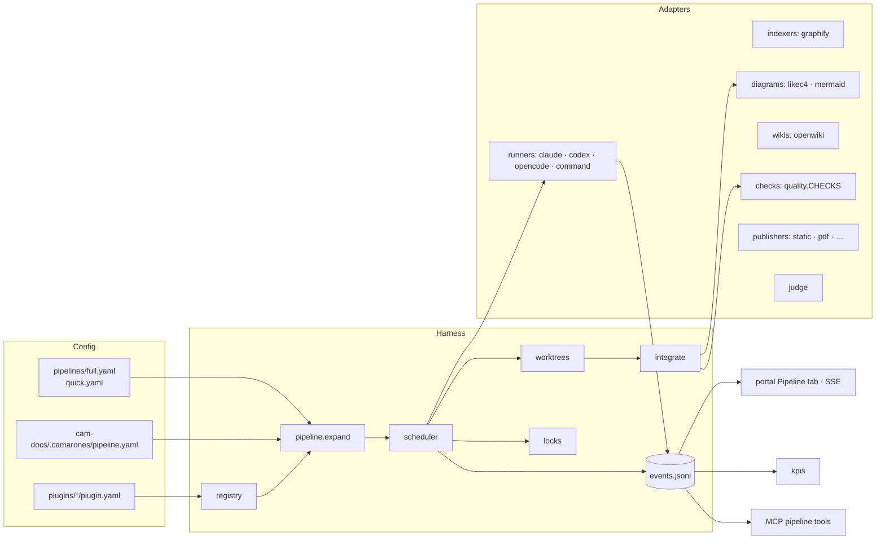
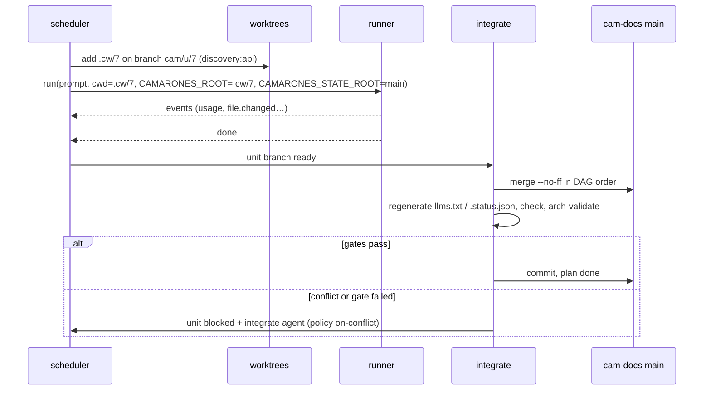

# Harness refactor: pluggable pipeline, parallel units, KPIs

RFC, 2026-10-09. **Status: accepted direction, not implemented.** The work order is in [roadmap.md](roadmap.md)
(items `R1`–`R37`). This RFC turns the kit from a set of hardcoded integrations into a **harness**: a declarative
pipeline of nodes, each backed by a pluggable adapter (agent runner, code indexer, diagram engine, wiki engine, check,
publisher, judge), with parallel execution, a run event log, and KPIs that tell whether Camarón actually helps.

**How to read it**

- Decisions have IDs `H1`–`H28` and can be challenged one by one. Roadmap items have IDs `R1`–`R37`.
- Paths are relative to the kit repo; line numbers are from 2026-10-09.
- It builds on [ai-first-docs.md](ai-first-docs.md) (`P1`–`P10`), [ecc-comparison.md](ecc-comparison.md)
  (`X2`–`X12`) and [tooling-candidates.md](tooling-candidates.md) (new candidates in its section Q).

## 0. Why: the problem today

| Area | Today | Consequence |
|---|---|---|
| Agent invocation | Hardcoded in 5 places: `wizard.launch_agent` (`lib/wizard.py:1778`), autopilot `_run_agent` (`lib/plan.py:501`), `openwiki_generate` (`lib/env.py:986`), `ci/umbrella.*.yml`, prerequisite install (`lib/env.py:154-195`). Two stream parsers (`_render`, `plan.py:462`) and two limit regexes (`LIMIT_HINTS` `plan.py:444`, `ENGINE_DOWN` `env.py:981`) | Adding OpenCode, Gemini or a local model means editing five files. No local AI at all. |
| Pipeline | The plan is a DAG (`plan.available()`, `plan.py:213`) built by imperative code (`TYPES` `:32`, `blueprint()` `:91`) and matched by name to PLAYBOOK sections | A project cannot add, drop or retarget a step without forking the kit. |
| Execution | `run_autopilot()` (`plan.py:553`) runs one unit at a time | A 6-repo project runs 6 discoveries, 6 briefs and 6 wikis back to back. |
| Shared state | `plan.yaml` load/save without a lock (`plan.py:68-81`), one `handoff.md`, one `log.md`, `checkpoint_commit` adds everything (`env.py:1341`), `wiki_lock` allows one wiki at a time (`env.py:963`) | Running units in parallel today would corrupt state. |
| God-module | `lib/env.py` (1458 lines): templates, prerequisites, tools, agent config, graphify, LikeC4, OpenWiki, export, Docker, CI, checkpoints, share | Every integration change touches the same file. |
| Freshness | HEAD per repo in `.state.json` (`docs.changes()`, `docs.py:171`); `x-sources` are paths without hashes; mapping diff → pages is left to the agent | `check` cannot say *which* page is stale. |
| Metrics | `usage.py` counts events; no tokens, cost, time, or evaluation | Nobody can tell whether a kit change, a model or Camarón itself helps. |
| Portal | Vanilla JS with ordered script tags (`portal/live/`); the only plan board is a Rich table in the terminal (`wizard.py:1891`) | Kanban, live DAG, whiteboard and live tables would not fit this structure. |
| MCP | stdio, five read-only tools, no resources or prompts (`lib/mcp.py`) | Agents read whole pages and cannot report what they changed. |

## 1. Decisions

| ID | Decision | Notes |
|---|---|---|
| H1 | **Primary user stays the dev / tech lead.** Product and non-technical people get portal UX (H17), not a second product. | Keeps the CLI and agents as the engine. |
| H2 | **Harness = ports/adapters + a declarative pipeline DAG.** Nodes are plug-and-play; the tool each node uses is configurable. | §2 |
| H3 | **Strangler-fig refactor inside 3.x.** No 4.0. Every PR keeps the suite green and every 3.x project opening. | AGENTS.md §2.3 |
| H4 | **Kit pipelines in YAML (`full`, `quick`) + project override** in `cam-docs/.camarones/pipeline.yaml` with `extends` and `patch`. | §2.3 |
| H5 | **Plugins are folders with a `plugin.yaml` manifest.** Built-ins use the same format. The loader computes `runs_code`; those plugins go through `trust.py` before they are ever loaded. | §2.4 |
| H6 | **Parallel fan-out units run in their own cam-docs git worktree.** Non-fan-out units keep running in place (`isolation: none`). | §3 |
| H7 | **LikeC4 as per-unit fragments** (`docs/architecture/fragments/<unit>.c4`, using `extend`). A lock is taken only for the shared `model.c4` / `spec.c4`. | §3.3 |
| H8 | **Deterministic consolidation first.** Merge unit branches in DAG order, regenerate derived files, run `check` + `arch-validate`. An `integrate` agent runs only on conflict or failed gates. Policy `on-conflict` (default) or `never`. | §3.4 |
| H9 | **Runners built in: Claude Code, Codex, OpenCode, and a generic `command` adapter.** Gemini CLI later, as a `command` template first. | §2.2 |
| H10 | **Local AI through routing by tier**: every node declares `agentic-heavy`, `bounded` or `judge`; the project maps tiers to runners and models. Local models are refused for `agentic-heavy` unless explicitly overridden. | §4 |
| H11 | **Run event log** (JSONL) is the single source for the live portal, KPIs and cost. | §2.5 |
| H12 | **KPIs in four families**: cost and speed, coverage and quality, trust and freshness, usefulness. | §5 |
| H13 | **A/B "with vs without cam-docs"** in three modes (Q&A, explicit task, opt-in sampling hook). All are off by default and can be turned off per project. | §5.3 |
| H14 | **Layered freshness**: L1 content hash per `x-source` (all pages), L2 symbol anchors (pages citing code), L3 impact through the code/doc graph (derived pages). | §6 |
| H15 | **PR pipeline**: no-AI freshness comment, opt-in AI proposal as a linked cam-docs PR, preview portal. GitHub and GitLab from one definition. | §7 |
| H16 | **MCP**: section retrieval, resources, prompts, `ask` with citations; draft-only write tools; pipeline control; Streamable HTTP on localhost. A central team server is a separate spike. | §8 |
| H17 | **Portal rewritten in React + Vite**, compiled in the kit's CI and shipped prebuilt: users never run npm for it. Minimalist black and white, with motion. Pipeline tab first. | §9 |
| H18 | **Rich docs**: live tables, `:::` directives, Excalidraw whiteboards, clickable C4/Mermaid. Plain Markdown fallback everywhere. | §9.2 |
| H19 | **Non-technical UX**: business/tech view toggle, "ask the docs" with citations, anchored review in the portal, PDF/tour export; Confluence/Notion as opt-in plugins. | §9.3 |
| H20 | **Generation skills**: AI-first + skeletons (P1–P5), skills/prompts as versioned plugins with compliance evals (X7), no-AI generated blocks (X3), opt-in method hooks (X2). | §10 |
| H21 | **Every local-model feature goes through OpenCode.** The kit never calls Ollama, LM Studio or an OpenAI-compatible endpoint itself; those are OpenCode providers. The `command` runner stays for other CLIs. | §4 |
| H22 | **Golden questions are drafted by an agent and approved by a person.** An `eval-questions` node (tier `bounded`) proposes them from the docs; the tech lead reviews them like any draft page. Missed searches can be added as candidates (opt-in). | §5.2 |
| H23 | **AI in CI runs on infrastructure you control.** `ci.target` is `local` (the developer's machine), `self-hosted` (a company GitHub/GitLab runner) or, later, `hosted` (cloud runner + API key). The generated YAML only calls `camaron`; where it runs is config. | §7 |
| H24 | **Whiteboard: free-form and C4 sketch, interface first.** A UX prototype of both modes comes before the implementation; iterate after real use. | §9.2 |
| H25 | **Plugins are versioned with semver, vendored in cam-docs and pinned in `plugins.lock`.** Updates are explicit and code plugins are re-approved when their hash changes. | §2.4 |
| H26 | **Default local models are free, open-weight models** (Qwen family first), chosen by the machine's memory and confirmed by the golden set, never hardcoded in code. | §4.1 |
| H27 | **Stale docs are blocked for AI and flagged for humans.** Agents never get a suspect or stale page or section, nor an unreviewed page that has no `x-sources` to check it against: the MCP, `llms.txt` and `llms-full.txt` withhold it deterministically and point to the code instead. Humans see it with a warning; the PR check warns and never blocks merging code. Better no information than wrong information. | §6.1 |
| H28 | **Gemini CLI uses the generic `command` runner.** A native adapter only if real use shows the template is not enough. | §2.2 |

## 2. Target architecture



### 2.1 Layout

```
.camarones/lib/harness/   ctx · ports · registry · pipeline · scheduler · worktrees · integrate · locks · events · kpis
.camarones/lib/adapters/  runners/{claude,codex,opencode,command} · indexers/graphify · diagrams/{likec4,mermaid}
                          wikis/openwiki · publishers/static · checks/builtin
.camarones/lib/pipelines/ units.yaml · full.yaml · quick.yaml · schema.json   (inside lib/ so install copies it)
.camarones/plugins/       built-in plugin.yaml manifests pointing at adapters/*
.camarones/portal/app/    React source
.camarones/portal/app-build/   compiled bundle, committed
```

`env.py` is not rewritten in one go. Each integration moves to its adapter when a roadmap item needs it; `env.py`
keeps thin wrappers so existing callers and tests do not change.

The bundle goes in `app-build/`, not `dist/`: `install.py:18` lists `dist` in `SKIP`, so `install` and `upgrade` would
silently drop it.

### 2.2 Ports

`typing.Protocol` only, no new dependencies.

```python
@dataclass
class RunRequest:
    unit: str
    prompt_file: Path
    cwd: Path
    env: dict
    model: str | None
    tier: Literal["agentic-heavy", "bounded", "judge"]
    interactive: bool = False
    resume: bool = False
    allow_tools: list[str] | None = None
    mcp: bool = True            # False → A/B control variant

class Runner(Protocol):
    id: str
    def available(self) -> bool: ...
    def capabilities(self) -> set[str]: ...              # agentic, mcp, stream-json, resume, usage, headless, local
    def build(self, req: RunRequest) -> Invocation: ...  # pure: argv, env, cwd
    def parse(self, line: str) -> list[Event]: ...       # log, tool.call, file.changed, usage, result, error
    def classify(self, rc: int, tail: str) -> Outcome: ...  # ok | limited(retry_at) | auth | failed

class Node(Protocol):
    kind: Literal["agent", "builtin", "human", "gate"]
    def expand(self, spec: NodeSpec, ctx: Ctx) -> list[UnitSpec]: ...
    def prompt(self, unit: UnitSpec, ctx: Ctx, unattended: bool) -> str: ...   # default: plan.prompt
    def run(self, unit: UnitSpec, ctx: Ctx, emit: Emit) -> Result: ...         # builtin / gate nodes
    def outputs(self, unit: UnitSpec) -> list[str]: ...                        # path globs the unit owns

class CodeIndexer(Protocol):
    def build(self, repo: str) -> Path: ...
    def query(self, question: str, repo: str | None) -> str: ...
    def symbols(self, repo: str, path: str) -> list[Symbol]: ...     # for freshness L2

class DiagramEngine(Protocol):
    def validate(self, root: Path) -> Issues: ...
    def export(self, root: Path, out: Path) -> Path: ...

class WikiEngine(Protocol):
    def generate(self, repo: str, mode: str, runner: Runner, emit: Emit) -> bool: ...

class Publisher(Protocol):
    def publish(self, site: Path, target: dict, emit: Emit) -> str: ...

class Check(Protocol):          # same shape as quality.CHECKS (quality.py:270)
    id: str
    def __call__(self, rows: list[dict], strict: bool = False) -> Issues: ...

class Judge(Protocol):
    def score(self, question: str, answer: str, refs: list[str]) -> Score: ...
```

`Runner.build()` is pure, so each adapter gets characterization tests that pin today's argv exactly.
`classify()` merges `LIMIT_HINTS` and `ENGINE_DOWN` into one place per runner.

### 2.3 Pipeline YAML

```yaml
version: 1
name: full
extends: kit:full                  # project override only
defaults: {runner: auto, tier: agentic-heavy, isolation: none, timeout: 90m}
concurrency: {max: 3, per_runner: {claude: 1, codex: 1, opencode: 1}}
integrate: {policy: on-conflict}   # on-conflict | never
routing:
  agentic-heavy: [claude, codex]
  bounded: [opencode:ollama/qwen2.5-coder, codex]
  judge: [opencode:ollama/qwen2.5-coder]
nodes:
  - {id: setup, uses: builtin/setup, kind: human, phase: 0}
  - {id: discovery, for_each: repos, id_tpl: "discovery:{repo}", uses: kit/agent-unit,
     with: {playbook: discovery}, needs: [setup], phase: 1, isolation: worktree,
     outputs: ["docs/repos/{repo}/**"]}
  - {id: questionnaire, when: [team-interviews], needs: [discovery-cross]}
  - {id: repo-wiki, for_each: wiki-repos, when: [component:openwiki], uses: builtin/openwiki, isolation: worktree}
  - {id: flow, dynamic: true, needs: [flows-catalog], isolation: worktree, outputs: ["docs/flows/{slug}.md"]}
  - {id: i18n, tier: bounded}
patch:                             # override only
  - {op: disable, node: security-review}
  - {op: set, node: i18n, with: {runner: opencode}}
```

- `when` takes **named predicates** implemented in Python (`team-interviews`, `profile:quick`, `component:openwiki`).
  There is no expression language.
- Validation is a small hand-written validator that reports the YAML path of each error (`nodes[3].needs`).
  `schema.json` only helps editors; the kit adds no `jsonschema` dependency (AGENTS.md §2.4).
- The rules in `plan.sync()` (`plan.py:131-190`) stay in Python as named policies applied after expansion.

### 2.4 Plugins

```yaml
name: adr-lint
version: 0.2.0
kit: ">=3.15,<4"
provides:
  checks:  [{id: adr-lint, entry: "plugin.py:check"}]
  nodes:   [{id: adr-review, kind: agent, prompt: prompts/adr-review.md, tier: bounded}]
  runners: [{id: aider, uses: runner/command,
             with: {argv: ["aider", "--yes", "--message-file", "{prompt_file}"]}}]
  skills:  [skills/cam-docs-adr]
```

- Plugins live in `cam-docs/.camarones/plugins/<name>/` (team) and `.camarones/plugins/` (built-in).

**Versioning and updates (H25):**

- `version` is semver; `kit` is the range of kit versions it works with. The loader refuses an incompatible plugin
  with a clear message instead of half-loading it.
- Built-in plugins are versioned with the kit (`VERSIONS["kit"]`) and update with `kitupdate`.
- Team plugins are **vendored**: the files live in cam-docs, so every teammate gets the same version through git, with
  no download at run time.
- `cam-docs/.camarones/plugins.lock` records name, version, source (`path:` or `git:<url>@<tag>`) and the sha256 of
  the folder. `check` warns when a folder no longer matches the lock (someone edited it by hand).
- Commands: `plugins add <source>`, `plugins update [name]` (shows the diff, rewrites the folder and the lock),
  `plugins outdated`, `plugins remove`. No registry or marketplace.
- A `runs_code` plugin whose hash changed is asked about again in `trust`, so an update cannot slip in new code.
- A node can pin a major version (`uses: adr-lint@0`); without a pin it uses whatever is vendored.
- The loader computes `runs_code`. It is true for any Python entry point, `command` runner, hook or MCP server;
  the manifest cannot claim otherwise.
- `runs_code` plugins are hashed into a new **plugins** group in `trust.items()` (`trust.py`). They are never
  imported or executed before approval. Built-ins are recognised through `trust.owned()`, like kit skills today.
- Prompt-only plugins (nodes, skills, prompts) still reach agents, so they show up in `trust` as "steers an agent",
  the same category as skills today.

### 2.5 Event log

```json
{"v":1,"ts":"2026-10-09T14:12:03Z","run":"r-1009-1412","unit":"repo-brief:api","node":"repo-brief","attempt":1,
 "type":"usage","runner":"claude","model":"sonnet","data":{"in":1234,"out":456,"cache_read":0,"cost_usd":0.12}}
```

- Types: `run.started`, `unit.started`, `log`, `tool.call`, `file.changed`, `usage`, `limited`, `lock.wait`,
  `merge.ok`, `merge.conflict`, `gate.failed`, `gate.waiting`, `unit.finished`, `run.finished`.
- Raw events go to `.camarones/.cache/runs/<run>/events.jsonl` (git-ignored). The scheduler is the only writer:
  child output is parsed in-process and each event is one `write()` under a thread lock.
- Monthly roll-ups go to `docs/.work/kpis/<YYYY-MM>.json`, committed and shared like `usage.py` data.
- The portal reads it with SSE, `GET /api/runs/<id>/events`, resuming with `Last-Event-ID` = byte offset.

## 3. Parallel execution



### 3.1 Where parallelism is real

Fan-out nodes only: `discovery:<repo>`, `repo-brief:<repo>`, `repo-wiki:<repo>`, `flow:<slug>` and the phase-4
`arch-*` nodes once their inputs exist. Interviews are human and sequential. With a single subscription the real
limit is the quota, not the CPU: the default is `per_runner: {claude: 1, codex: 1}`. That is the same load as today,
but two units run at once. When a runner reports `limited`, the scheduler stops dispatching to it and re-queues its
units. In-flight units that fail with a limit go back to `todo`, never `failed`.

### 3.2 Worktrees and state

- Directory: `WORKSPACE/.cw/<n>`. Unit ids contain `:`, which is invalid in Windows paths (`plan.note_file()` already
  works around it), and short names avoid long-path problems. Set `core.longpaths=true` on Windows.
- `docs.detect_repos()` (`docs.py:93`) and graphify must ignore `.cw/`: a worktree has a `.git` file and would
  otherwise look like a service repo.
- The agent runs with `CAMARONES_ROOT=<worktree>`, so `check` and doc paths point at its branch, and
  `CAMARONES_STATE_ROOT=<main cam-docs>`, so `plan.yaml`, unit notes and run data stay in one place.
- `plan.yaml` writes take `FileLock("plan")`. `docs/.work/**` and derived files (`llms.txt`, `.status.json`) are
  kept out of unit branches. Each unit writes `docs/.work/units/<id>.handoff.md`, and `integrate` rebuilds
  `handoff.md` deterministically.
- New per-unit data (branch, attempts, tokens) never goes inside `plan.yaml` units. `plan.sync()` (`plan.py:142`)
  only keeps `status/notes/updated/redo`, so a teammate on 3.13 would wipe any other field. It goes in
  `docs/.work/runs.json` and the event log.
- Auto-share (push) is disabled until a unit is integrated.
- Removal retries with backoff (antivirus, editors and the LikeC4 watcher lock files on Windows), then `--force`.
  Anything left over is pruned on the next run.

### 3.3 LikeC4 fragments

> **As built (R14):** no file lock. Agents edit files directly, so a lock cannot stop them; instead the shared files are
> left to in-place units, which the scheduler runs one at a time, and integration emits `c4.shared` when a parallel
> unit touched one anyway. `arch-validate` catches duplicate elements across fragments.

LikeC4 merges every `.c4` file under the model folder and supports `extend`. Each unit writes its own fragment
(`docs/architecture/fragments/<unit-slug>.c4`) and extends shared elements. Only `model.c4` and `spec.c4` (actors,
systems, kinds) need `FileLock("c4-model")`, so most architecture units never wait. Duplicate element ids across
fragments are caught by `arch-validate` after merge.

### 3.4 Consolidation

`integrate` merges with `--no-ff` in topological order. It regenerates derived files and runs `check` and
`arch-validate` as subprocesses (`CAMARONES_ROOT` set to the integration tree). If everything passes, the unit is
done, with no tokens spent. On a conflict or failed gate, with policy `on-conflict`, an `integrate` agent unit is
queued with the conflict and the gate output as its brief. With policy `never`, the unit is marked `blocked` with the
note "integrate" and main is left untouched.

## 4. Local AI and routing

| Tier | Nodes | Good local candidates |
|---|---|---|
| `agentic-heavy` | discovery, discovery-cross, arch-*, flow, repo-brief, update | None by default. Allowed only with `allow_local: true` on the node. |
| `bounded` | i18n, TL;DR / `description` writing, glossary extraction, X3 block captions, summaries of a single page, drafting golden questions | OpenCode with an Ollama or LM Studio provider |
| `judge` | eval scoring, A/B judging, claim audit (H6 in tooling-candidates) | Same as bounded; a blind judge is fine locally |

**OpenCode is the only gateway to local models (H21).** In routing a local model is written
`opencode:<provider>/<model>` (`opencode:ollama/qwen2.5-coder`). The kit checks that OpenCode is installed and that
the provider answers, and leaves model downloads and provider config to OpenCode. This keeps one adapter to maintain,
gives local models real tool use (reading files, running `check`), and lets the same node switch between a cloud and
a local model by changing one routing line.

### 4.1 Default local models (H26)

Free, open-weight models, Qwen family first. `camaron doctor --local` reads the machine's memory and proposes one:

| Machine | Proposed model (Ollama tag) | Why |
|---|---|---|
| 32 GB Mac / 24 GB GPU or more | `qwen3-coder:30b` | Mixture of experts (about 3B active parameters, about 19 GB at Q4), long context, trained for tool calling |
| 16 GB | a smaller Qwen 3 coder or instruct model; `devstral` (Mistral, Apache-2.0) or `gpt-oss:20b` as alternatives | Fits in memory with room for context |
| Less than 16 GB | No local default; bounded and judge stay on the cloud runner | Quality too low to be worth it |

DeepSeek, GLM and Kimi flagships are too large for a laptop. They can be used through OpenCode if the company hosts
them on its own GPU server. The list lives in a data file next to `VERSIONS`, not in code. Each entry is re-checked at
implementation time (Ollama tag, licence, tool-calling template). The default is kept only if the golden set on the
sandbox (R17) shows it does the bounded and judge work well enough.

Sources (third-party, mid-2026, not verified): [morphllm: best Ollama models](https://www.morphllm.com/best-ollama-models) · [Faros: open-weight models for coding](https://www.faros.ai/blog/open-weight-models) · [haimaker: Ollama models for coding agents](https://haimaker.ai/blog/best-ollama-models-for-coding-agents.md).

Routing is a list per tier. The first available runner wins, and per-node `runner:` overrides it. Machine-specific
choices (which model is installed) go in `~/.camarones.json`; team choices go in `workspace.yaml` (`agents:`), so
`workspace.yaml` never names a model only one machine has.

## 5. KPIs and evaluation

### 5.1 Families

| Family | Metrics | Source |
|---|---|---|
| Cost and speed | Wall time per unit and per run, tokens in/out/cache, estimated cost, retries, limit hits, achieved parallelism | Event log |
| Coverage and quality | % repos / C4 elements / endpoints / topics with a page; `check` errors and warnings, structure warnings (P5); % claims with a valid `x-source` | `docs.collect()`, `quality.CHECKS`, `quickarch.scan` |
| Trust and freshness | % confirmed, needs-reconfirm, fresh / suspect / stale pages, median age of suspect pages, code change → doc update lag | `docs.summary()`, `.fresh.json` (§6) |
| Usefulness | Golden Q&A score, search hit rate (agent vs human), most read / never read pages, **edit distance between the AI draft and the confirmed page** | `evals/`, `usage.py`, draft snapshots |

`camaron kpis [--json] [--compare <run-a> <run-b>]` prints them. The portal shows them on the Pipeline and Review
tabs. Comparing runs is how a prompt, model or kit change is judged.

### 5.2 Golden Q&A

A golden question is a question someone would really ask about the system, together with where the answer is.
It works like an exam with an answer key for the docs:

```yaml
- q: How is a refund processed?
  expect: [docs/flows/refund.md]        # the page that should be cited
  mention: ["POST /refunds", "refund-requested"]
  x-confirmed: {by: ana, at: 2026-10-20}
```

`camaron eval` asks each question through the MCP tools with a chosen runner and checks the answer. The base score is
deterministic: did it cite the expected page, and does it mention the exact identifiers? A `Judge` (optionally local)
adds a graded score. Run before and after a change (new prompt, model, kit version), it says whether the docs got
better at answering, and the same set drives the A/B in §5.3.

Who writes them (H22):

1. An `eval-questions` node (tier `bounded`, local allowed) drafts 15–30 questions from the confirmed pages: one or two
   per flow, per repo brief and per key decision.
2. The tech lead reviews them in the portal or the file, about 10 minutes. They are drafts until confirmed, like pages.
3. Optional: searches that found nothing (`usage.py` already counts misses, without the text) can be stored as
   candidate questions when the team turns on `evals.capture_misses`. Off by default for privacy.

The kit ships a fixed PetClinic set for the sandbox. It runs under the `eval` pytest marker, outside the default suite
because it calls a real agent, and serves as the benchmark between kit versions.

### 5.3 A/B with vs without cam-docs

| Mode | Trigger | What runs | Cost |
|---|---|---|---|
| Q&A | `camaron ab --qa "<question>"` or the golden set | The same question, with cam-docs (MCP + skills + AGENTS.md) and without, read-only | Low |
| Task | `camaron ab "<task>"` | The same task in two throwaway worktrees of the service repo; the control has no cam-docs MCP, skills or AGENTS.md. Never touches the real checkout. | 2× the task |
| Sampling | Opt-in Claude Code hook, `ab.sample: 0.05` | A shadow of a real task, started in the background as in Task mode | Variable |

Compared: tokens, time, tool calls, files read, tests passing (if the repo has them) and a blind judge. Results go to
`docs/.work/evals/ab/<date>-<id>.json`. All three modes are off by default; `ab.enabled: false` in `workspace.yaml`
turns them off for the whole team.

## 6. Freshness

| Layer | Applies to | How | Needs |
|---|---|---|---|
| L1 | Every page with `x-sources` | Hash of the cited range (or file) stored in the `docs/.fresh.json` sidecar at `plan done` / `confirm` / `mark-documented`. `camaron fresh` recomputes: **fresh** (hash equal), **suspect** (changed), **stale** (file or range gone), plus age in commits and days. | Nothing new |
| L2 | Pages that cite code | `x-sources` may name a symbol (`orders:src/…/OrderService.java#place`); `CodeIndexer.symbols()` resolves it to the current range, so moved lines are not false positives | CodeIndexer (graphify / tree-sitter) |
| L3 | Derived pages that cite other pages or C4 elements, not code (flows, domain, C4 views) | Propagation: a page becomes suspect when a page or C4 element it depends on becomes suspect | L1 + doc graph |

The choice is automatic per source: code paths use L2 when a symbol is given and L1 otherwise; doc and C4 references
use L3. Frontmatter is never rewritten by `fresh` (human-confirmed pages stay untouched); everything goes in the
sidecar. A `refresh-suspect` pipeline node re-documents only suspect pages.

### 6.1 Reading policy: blocked for AI, flagged for humans (H27)

| Reader | Fresh | Suspect or stale | No `x-sources` (unverifiable) |
|---|---|---|---|
| Agent (MCP `search_docs` / `read_doc` / `ask`, `llms.txt`, `llms-full.txt`) | Served | **Withheld.** The hit is replaced by a fixed notice: what changed, since which commit, and the cited code paths to read instead. | Served only if a person confirmed it (`x-confirmed` and body unchanged since). Drafts and `needs-reconfirm` pages are **withheld** with a notice that they await review |
| Human (portal, CLI) | Shown | Shown with a banner (what changed, since when) and a "refresh" action | Shown with its trust pill |

- The rule is deterministic: no model decides whether a page is still right. Same sidecar, same answer.
- **Decided 2026-10-16:** strict for every page without sources, OpenWiki wiki pages included. Agents do not get a
  wiki page until a person confirms it. Safer than useful by design; revisit only with real usage data.
- **Granularity is the section** when sources are cited inline per section (W5 in ai-first-docs.md): only the
  affected H2 is withheld and the rest of the page is served. Otherwise it is the page.
- A person can re-validate without rewriting: `camaron fresh --ack <page>` records the new hashes when the change did
  not affect what the page says, with who acknowledged it and when.
- To avoid blocking half the docs on a cosmetic change, L1 hashes ignore whitespace-only and comment-only changes, and
  L2 symbol anchors ignore moved lines.
- `freshness.ai_policy: block` is the default; `warn` exists for teams that prefer it, and the choice is shown in
  `doc_status` so an agent knows which policy applies.

## 7. PR pipeline

| Job | When | AI | Output |
|---|---|---|---|
| `docs:fresh` | Every PR/MR in a service repo | No | Comment with the table of pages this PR makes suspect. **Warns, never blocks merging code** (H27): once merged, those pages are withheld from agents until they are refreshed or acknowledged |
| `docs:propose` | Label `docs:update` (opt-in) | Yes, `update` node with the configured runner | Linked PR/MR in cam-docs, referenced in the service PR |
| `docs:preview` | When `docs:propose` opened a PR | No | Static portal of the proposal (Pages or artifact) |

GitHub and GitLab YAML are generated from one definition, replacing the hand-maintained `ci/*.yml` over time. The
umbrella `github.yml` gains a `pull_request` trigger (it has none today). The CI runners get `--allowedTools` /
permission modes per tier instead of `--dangerously-skip-permissions` (`plan.py:509`, `ci/umbrella.*.yml`).

### 7.1 Where the AI job runs (H23)

The AI step is always the same command, `camaron pr propose <pr-url>`. Only where it runs changes:

| `ci.target` | Where | Who pays | Infra needed | When |
|---|---|---|---|---|
| `local` | The developer's machine: the PR job only posts a "run `camaron pr propose <url>`" hint; or the wizard lists open PRs with suspect pages | The developer's own subscription or local model | None | Default, from day one |
| `self-hosted` | A company machine registered as a GitHub Actions self-hosted runner or a GitLab runner with a tag (`docs-ai`), with the agent CLI logged in or OpenCode + a local model | The company's account or hardware | One machine and a runner registration | When the team wants it automatic |
| `hosted` | GitHub-hosted / GitLab shared runners with an API key secret | Per-token API billing | A secret | Later, only if wanted |

- The no-AI jobs (`docs:fresh`, `docs:preview` build) run on any runner, hosted included: they need no token.
- The generator takes `ci.target`, `ci.runner_labels` (GitHub `runs-on`) and `ci.runner_tags` (GitLab `tags`), so
  moving from `local` to `self-hosted` is a config change plus `camaron ci` again.
- Self-hosted runners only pick AI jobs for PRs labelled by a project member, never from forks: a self-hosted runner
  executes the PR's code on a company machine.
- The portal preview and deploy go through the `Publisher` port: `artifact` (download), `pages` (GitHub/GitLab
  Pages) and `docker-host` (today's `portal:deploy` with a `docs-host` runner, `env.py`/`ci/umbrella.*`).
- A step-by-step guide (es + en) for registering a self-hosted runner on GitHub and GitLab ships with R31.

## 8. MCP

| Area | Additions |
|---|---|
| Retrieval | `read_doc(path, section)`; `search_docs` hits carry section slug, trust and freshness; suspect or stale content is withheld (H27, §6.1); `ask(question)` returns an answer with citations; resources `camdocs://page/<path>`; prompts (`document-flow`, `explain-repo`) |
| Write (draft only) | `propose_edit`, `add_feedback`, `mark_suspect`. Never `confirm`. Writes land as drafts or feedback the human reviews. |
| Pipeline control | `pipeline_status`, `run_node`, `run_events`, `kpis`, so any client can drive the harness |
| Transport | Streamable HTTP on `127.0.0.1` next to stdio, with the same CSRF/token rule as the portal. A central, multi-user team server is a separate spike with its own RFC. |

## 9. Portal

### 9.1 Stack and rollout

React + Vite. TanStack Table for live tables, React Flow for the pipeline DAG, Motion for animations, Excalidraw
lazy-loaded. The source is in `portal/app/` and the build is committed in `portal/app-build/`. An ubuntu-only CI job
runs the build and vitest and fails when a rebuild differs from the commit. The pytest matrix stays Node-free.

Rollout: the new app is served at `/next` while the current UI stays the default. Each tab is rebuilt behind `/next`.
`/next` becomes the default once it has parity (R29), and the old UI is then removed. Heavy chunks are lazy so that
`self-update` (`git pull`, `upgrade.py:86`) does not grow much per release.

Design: black and white, one accent for status only (trust and run state), generous whitespace, mono for
identifiers, motion only for state changes (node started, card moved, panel opened). Respect
`prefers-reduced-motion`.

### 9.2 Views and rich docs

- **Pipeline** (first): DAG with nodes coloured by status, active worktrees and held locks; kanban by column; a
  drawer per unit with live log, duration, tokens/cost, files touched; buttons for run, retry, cancel and approve
  through the existing job queue (`serve.start_job`, `serve.py:115`) and the `X-Camarones` header.
- **Live tables**: Markdown tables become sortable and filterable; tables can also come from data
  (a `table` code fence with a `src` attribute pointing at YAML/CSV in cam-docs, frontmatter, X3 blocks).
- **Directives**: `:::tabs`, `:::cards`, `:::steps`, `:::details`, callouts, badges. They read as plain Markdown on
  GitHub, and a Python renderer flattens them for `llms-full.txt` and MCP.
- **Whiteboard** (H24): `.excalidraw` files in cam-docs, embedded and editable in live mode, versioned in git. Two
  modes: free-form boards, and a sketch generated from a C4 view that people annotate. Whether annotations ever flow
  back into the C4 model is decided after real use. A clickable UX prototype of both modes comes first.
- **Clickable diagrams**: C4 and Mermaid nodes link to pages, code and wikis, with a tooltip showing description and
  trust.

### 9.3 Non-technical UX

- **Business / tech toggle**: business shows domain, flows, glossary, decisions and the C4 context view; tech adds
  repos, code map, wikis and graphs. Home starts with "How does X work?"
- **Ask the docs**: a chat panel over MCP `ask`, with citations, using the configured runner (local allowed). Live
  mode only.
- **Anchored review** (X6): comment on a heading or passage, approve or request changes; the agent picks it up.
- **Export**: PDF and a guided "tour" built from flows as built-ins; Confluence and Notion as opt-in plugins, because
  they send content to a third party.

## 10. Generation skills

- **AI-first + skeletons** (P1–P5 in [ai-first-docs.md](ai-first-docs.md)): skeletons become the node's output
  contract, and `check_structure` is the gate.
- **Skills and prompts as versioned plugins**: a node references `skill@version`, so a team can swap a prompt
  without forking the kit, and KPIs compare versions.
- **Compliance evals** (X7): run one node on the sandbox with two prompt versions and compare structure warnings,
  sources and golden Q&A.
- **Generated blocks without AI** (X3): env vars, commands, endpoints and topics from sources of truth; refreshed by
  `sync`; `check` flags hand edits.
- **Method hooks** (X2), opt-in: SessionStart injects plan and handoff, PostToolUse runs `check` on the edited page,
  Stop reminds to update docs.

From ECC's catalogue the useful patterns are `eval-harness` / `skill-comply` (evals), `autonomous-loops` /
`dmux-workflows` (DAG of sessions, which is what H6 does natively) and `blueprint` (multi-session plans, which the
plan already is). Its volume of generic skills is still out of scope (see [ecc-comparison.md](ecc-comparison.md) §4).

## 11. Backward compatibility (3.x)

| Today | Target | Rule |
|---|---|---|
| `TYPES` (`plan.py:32`) | Node entries in `pipelines/full.yaml` | `plan.TYPES` stays as a derived dict; callers unchanged |
| `blueprint()` (`plan.py:91`) | `pipeline.expand()` | Golden test: identical unit ids for every profile × interview mode × component combination |
| `plan.yaml` | Same file and shape, plus an optional top-level `pipeline: full@<kit>` | Old kits ignore the new key; per-unit run data lives outside |
| `runner: agent/wizard` | `kind: agent/human` | `runner` is still written |
| `handoff.md`, `log.md` | Per-unit handoffs, rebuilt by `integrate` | Unchanged in `isolation: none` |
| `.state.json` | Unchanged | Freshness uses the `.fresh.json` sidecar |
| Frontmatter | Optional symbol form in `x-sources` | Path form keeps working |
| `autopilot`, `prompt`, `plan *`, `wiki` | Kept | `autopilot` becomes `run --concurrency 1 --isolation none` |
| `plan._run_agent`, `_render`, `AGENTS` | Shims over the registry | `tests/test_autopilot.py` stays green unmodified |

## 12. Risks

| Risk | Mitigation |
|---|---|
| Import-time globals (`common.py:58-60`) tie a process to one project | Don't migrate everything to `Ctx` up front. Per-worktree work (`check`, `llms`, `arch-validate`) runs as a subprocess with `CAMARONES_ROOT`; only the scheduler and `integrate` take a `Ctx`. |
| Windows worktrees: long paths, locked files, junctions | Short `.cw/<n>` names, `core.longpaths`, removal with retries then `--force`, prune on next run. Workspace junctions point at main, so MCP reads the integrated snapshot (documented). |
| Lock correctness across OSes | `O_EXCL` lock files with pid, host and timestamp; stale when the pid is dead or older than a TTL. Tested on all three OSes. |
| Freshness gate withholds too much after a refactor, so agents lose the docs | Whitespace/comment-insensitive hashes, L2 symbol anchors, section granularity, `fresh --ack`, and a `refresh-suspect` node; the PR comment lists what will be withheld before merge |
| Quota exhaustion from parallel sessions | `per_runner` defaults of 1; pause dispatch on `limited`; re-queue, never fail |
| Mixed kit versions on one cam-docs | Additive data only, outside `plan.yaml` units |
| React bundle in a Python kit | `app-build/` not `dist/`; rebuild check in CI; lazy chunks; old UI as fallback until parity |
| Plugins running code on teammates' machines | `runs_code` computed, hashed into `trust`, never loaded before approval |
| Clean merges that are semantically inconsistent | Gates after every merge (`arch-validate`, `check --strict`, duplicate-id check) |
| Agents with full permissions in parallel | Per-tier permission mode / `--allowedTools`, scoped to the worktree |

## 13. Critique: what this RFC cuts or defers

1. **The wave 1 the user asked for is three projects.** Wave 1 ships the harness, parallelism, KPIs/evals and only
   the Pipeline tab of the new portal. Live tables, directives, the view toggle and clickable diagrams are wave 2;
   Excalidraw, the chat and exports are wave 3.
2. **Parallel width is small.** Worktrees only for fan-out nodes. Do not expect 10× faster runs: expect about 2× on
   multi-repo phases with one subscription per agent.
3. **`integrate: always` is dropped.** It spends tokens when the gates already pass.
4. **The A/B sampling hook touches real sessions** (privacy and cost). It comes last, opt-in, and the cheap golden Q&A
   answers "does cam-docs help?" first.
5. **Local models will mostly fail on agentic-heavy nodes.** They are refused there unless explicitly overridden.
6. **No expression language and no `jsonschema` dependency.**
7. **Confluence and Notion send content out.** Opt-in plugins, never core.
8. **The central MCP/team server, freshness L3 and the AI PR proposal** each deserve their own design pass; this RFC
   fixes only the ports they need.

## 14. Questions

Resolved on 2026-10-09:

| Question | Answer |
|---|---|
| Reference local stack | OpenCode for every local-model feature (H21) |
| Who writes the golden questions | Drafted by an agent, approved by the tech lead (H22) |
| Who runs the AI PR proposal | Infrastructure the team controls: local first, a self-hosted runner later (H23) |
| Whiteboard scope | Both free-form and C4 sketch, interface prototype first (H24) |
| Plugin versioning | semver + kit range, vendored, `plugins.lock`, explicit updates (H25) |
| Default local model | Free open-weight models, Qwen first, chosen by memory (H26) |
| Should stale docs block? | Blocked for AI, warning for humans, PR check never blocks merging (H27) |
| Gemini adapter | Generic `command` runner until proven insufficient (H28) |

Still open:

- Label name for the AI proposal. Default `docs:update`, configurable.
- Whether the Qwen default (H26) holds up on the golden set. Measure on the sandbox (R17).
