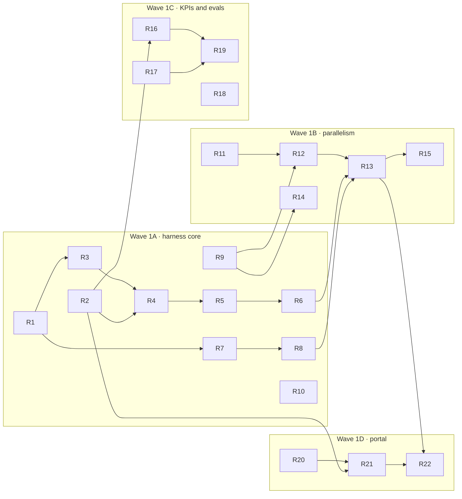

# Roadmap: harness refactor and improvements

Work order for [harness-refactor.md](harness-refactor.md), 2026-10-09. Each item is one small PR with the failing
test written first (AGENTS.md §2.2). IDs `R1`–`R37` are stable: discard or reorder by ID. Decisions (`H…`) refer to the
RFC; `P…` to [ai-first-docs.md](ai-first-docs.md); `X…` to [ecc-comparison.md](ecc-comparison.md).

Rules for every item: green on macOS, Windows and Linux; 3.x projects keep opening (§2.3); user-facing strings in
`es` + `en`; bump `VERSIONS["kit"]` when projects see a change.

## Overview

## Wave 1A: harness core (no visible change until R7)

Done: R1–R6 (2026-10-09, kit 3.14.0), R7 (2026-10-13), R8 (2026-10-14, kit 3.15.0), R9, R10 (2026-10-15, kit 3.16.0), R11–R13 (2026-10-15), R14 (2026-10-16, kit 3.17.0), R15 (kit 3.18.0: autopilot stays sequential; `run` is the parallel mode). R16 (kit 3.19.0), R17 (kit 3.20.0), R18 (kit 3.21.0), R19 (kit 3.22.0). Waves 1A–1C complete. R20 (kit 3.25.0), R21 (kit 3.26.0), R22 (kit 3.27.0). Wave 1 complete; approve waits for units with a human gate. R23 (kit 3.28.0). R24 part 1, AI-first P1–P5 (kit 3.29.0). Released as kit 4.0.0 (2026-10-16). R24 part 2, X3 generated blocks (kit 4.1.0): R24 done. R26 part 1, slugs, section reads and richer hits (kit 4.2.0). R26 part 2, llms-full.txt, resources, prompts and `ask` (kit 4.3.0): R26 done. R27 PR freshness comment from one CI definition (kit 4.6.0). R28 code plugins under per-machine trust (kit 4.7.0). R37 vendored plugins, plugins.lock, add/update/outdated/remove, major pins; prompt plugins approved as steering agents per §2.4 (kit 4.8.0). R25 plugin prompts and skills reach the units that `use` them (kit 4.9.0). R30 freshness L2 symbols and L3 pages/C4 (kit 4.10.0). R32 MCP draft-only writes, pipeline control, HTTP (kit 4.11.0). R31 `pr propose` + self-hosted `docs-propose` job + `--preview` static portal (artifact publisher) + runner guide (kit 4.12.0). R33 `ab --task` on throwaway worktrees, opt-in sampling hook and `--replay` (kit 4.13.0). R36 method hooks (X2), `eval comply` (X7), Gemini stays a command template (H28: no gap found), team server spike RFC in [team-server.md](team-server.md) (kit 4.14.0). R35 exporters: PDF/print, guided tour, Confluence and Notion as `sends_data` kit plugins enabled per machine (kit 4.15.0). R34 server side: boards (`docs/boards/*.excalidraw`, C4 sketch), `/api/ask`, anchored comments and `review request|wait` (kit 4.16.0); its portal views come with R29. R29 one portal at `/`: React views (Pipeline, Ask, Boards) + the docs views moved in unchanged, `:::` directives with a Python flattener, live tables, business/technical switch, clickable Mermaid (kit 4.17.0). Every roadmap item is done.

| ID | PR | Test first | Depends | Decisions |
|---|---|---|---|---|
| R1 | `lib/harness/ctx.py`: `Ctx.from_env()` (root, workspace, work, cache, state_root); `common` globals derive from it; `CAMARONES_STATE_ROOT` honoured | Two `Ctx` for two tmp workspaces in one process give different `work` paths | — | H3 |
| R2 | `lib/harness/events.py`: JSONL `emit()` under a lock, `read(offset)` | 4 threads × 500 events: every line parses; `read(offset)` resumes exactly (all 3 OSes) | — | H11 |
| R3 | `Runner` port + `adapters/runners/claude.py`, `codex.py`, extracted from `plan.py:462-550` (`build`, `parse`, `classify`) | Characterization: `build()` argv equals today's (`plan.py:509-511`); existing stream-rendering test runs against `parse`; usage read from Claude `result` and Codex `turn.completed` | R1 | H2, H9 |
| R4 | Autopilot goes through the registry and emits events; still sequential | `tests/test_autopilot.py` unchanged and green; `events.jsonl` has `unit.started` / `usage` / `unit.finished` | R2, R3 | H11 |
| R5 | `wizard.launch_agent` (`wizard.py:1778`) and `env.openwiki_generate` (`env.py:986`) go through the registry | Wizard argv with model prefs and both resume variants unchanged | R3 | H9 |
| R6 | `opencode` and `command` runners + tier routing (`workspace.yaml agents:`, `~/.camarones.json`); local models only as `opencode:<provider>/<model>`; `doctor --local` proposes a free open-weight model by memory from a data file; Gemini as a `command` template | Routing picks the first available runner per tier; `command` templates produce a list argv resolved through `common.which`, never a shell; local runner refused on `agentic-heavy` without `allow_local`; a local model without OpenCode installed is reported, not attempted | R3 | H9, H10, H21, H26, H28 |
| R7 | `lib/harness/pipeline.py` + `pipelines/full.yaml`, `quick.yaml`; `plan.blueprint()` delegates; `plan.TYPES` derived | Golden matrix: `expand()` equals today's `blueprint()` for every profile × interview mode × component set | R1 | H2, H4 |
| R8 | Project override (`extends`, `patch`) + validator with YAML error paths; `schema.json` for editors | A bad override reports `nodes[3].needs`; `disable` drops the unit the same way `sync` drops units | R7 | H4 |
| R9 | `lib/harness/locks.py` (`O_EXCL` file + pid/host/ts, stale takeover); wraps `plan.save` and `env.wiki_lock` | 2 processes × 50 `set_status` calls lose nothing; a lock with a dead pid is taken over | — | H6 |
| R10 | `plugin.yaml` loader for built-ins and config-only plugins; `runs_code` computed; `camaron plugins` | Manifest validation; `runs_code` true for any entry point / command runner / hook / MCP; a `runs_code` plugin is not loaded | R7 | H5 |

## Wave 1B: parallelism

| ID | PR | Test first | Depends | Decisions |
|---|---|---|---|---|
| R11 | `lib/harness/worktrees.py`: `WORKSPACE/.cw/<n>`, branch `cam/u/<n>`, `core.longpaths` on Windows, reattach and prune with retries; `detect_repos` and graphify ignore `.cw` | `discovery:api` gives a valid path; a killed run's worktree is reattached; `docs.detect_repos()` ignores `.cw` | R1 | H6 |
| R12 | `lib/harness/integrate.py`: `--no-ff` merge in DAG order, regenerate derived files, `check` + `arch-validate` gates, per-unit handoffs merged into `handoff.md`, policy `on-conflict \| never` | Disjoint edits merge clean; overlapping edits → `merge.conflict`, unit `blocked`, main untouched; gate failure queues an `integrate` unit | R9, R11 | H8 |
| R13 | Parallel scheduler: slots per runner (default 1 each), pause on `limited`, re-queue | Fake runner (`command` running a Python sleeper): 3 independent units overlap in time; a limit on one runner re-queues only its units | R6, R8, R12 | H6 |
| R14 | LikeC4 fragments `docs/architecture/fragments/<unit>.c4`; `FileLock("c4-model")` on `model.c4` / `spec.c4`; PLAYBOOK and CONVENTIONS updated | Two fragments validate together offline (pattern of `test_diagrams.py`); lock held only on shared files | R9 | H7 |
| R15 | CLI `run`, `runs`, `pipeline show \| validate`; `autopilot` becomes an alias of `run --concurrency 1 --isolation none` | `--json` output stable; `autopilot` behaviour unchanged | R13 | H3 |

## Wave 1C: KPIs, evals, local AI

| ID | PR | Test first | Depends | Decisions |
|---|---|---|---|---|
| R16 | `lib/harness/kpis.py` + `camaron kpis [--json] [--compare a b]`; monthly roll-up in `docs/.work/kpis/` | Expected totals from fixture events; compare shows deltas | R2 | H12 |
| R17 | `cam-docs/evals/questions.yaml` + `camaron eval` (deterministic scorer, optional `Judge` port, local allowed); `eval-questions` node drafts questions, a person confirms them; fixed PetClinic set under the `eval` marker | Scorer on canned answers: refs ∩ citations, required terms; unconfirmed questions are reported apart from confirmed ones | R6 | H12, H10, H22 |
| R18 | AI-draft snapshot at `plan done`; edit distance recorded at `confirm` (`docs.py:338`) | Confirm after a 10 % edit records ≈ 0.1 | — | H12 |
| R19 | `camaron ab --qa "<question>"` and golden-set A/B: with vs without cam-docs | Fake runner: both variants recorded with tokens, time, score; `ab.enabled: false` blocks it | R16, R17 | H13 |

## Wave 1D: portal (Pipeline tab only)

| ID | PR | Test first | Depends | Decisions |
|---|---|---|---|---|
| R20 | `portal/app` React + Vite; build committed in `portal/app-build/`; ubuntu-only CI job (build, vitest, rebuild-equals-commit); served at `/next`, old UI default | pytest: manifest exists, hashed assets exist, `install.payload` includes `app-build/` | — | H17 |
| R21 | SSE `GET /api/runs/<id>/events` + read-only Pipeline tab (React Flow DAG, kanban, unit drawer); black-and-white design system + Motion, `prefers-reduced-motion` | SSE resumes from `Last-Event-ID`; vitest on the board reducer | R2, R20 | H17 |
| R22 | run / retry / cancel / approve via `serve.start_job` (`serve.py:115`) and the `X-Camarones` header | 403 without the header; cancel kills the child and returns the unit to `todo` | R13, R21 | H17 |

## Wave 2

| ID | PR | Test first | Decisions |
|---|---|---|---|
| R23 | Freshness L1: whitespace/comment-insensitive hashes in `docs/.fresh.json`, `camaron fresh [--ack]`, portal banner, `refresh-suspect` node; **AI gate**: MCP and `llms*.txt` withhold suspect/stale pages or sections and point to the code (`freshness.ai_policy: block`) | Edit a cited range → suspect and withheld from `read_doc`/`search_docs`/`llms-full.txt`, still shown in the portal with a banner; whitespace-only edit → fresh; `--ack` → served again; a page without `x-sources` is served only when confirmed and withheld as draft or `needs-reconfirm`; `ai_policy: warn` serves with a notice | H14, H27 |
| R24 | AI-first P1–P5 (skeletons, `check_structure`) + X3 generated blocks (env, commands, OpenAPI, topics) | As listed in ai-first-docs.md §4; a hand edit inside a generated block is flagged | H20 |
| R25 | Skills and prompts as versioned plugins (`skill@version` on nodes) | Node resolves the pinned version; unknown version is a validation error | H20, H5 |
| R26 | MCP: `read_doc(section)`, resources `camdocs://`, prompts, `ask` with citations, freshness in hits (P6–P8) | Section read returns only that H2 + TL;DR; hits carry slug, trust, freshness | H16 |
| R27 | No-AI PR job `docs:fresh` + comment, GitHub and GitLab generated from one definition; `pull_request` trigger on the umbrella; generator reads `ci.target`, `ci.runner_labels`, `ci.runner_tags` | Generated YAML matches golden files for `local` and `self-hosted`; comment body from a fixture diff | H15, H23 |
| R28 | Code-running plugins under `trust.py` (new "plugins" group; built-ins via `owned()`) | Unapproved plugin is not imported; a changed hash asks again | H5 |
| R37 | Plugin versioning: semver + `kit` range, vendored team plugins, `plugins.lock` with sha256, `plugins add \| update \| outdated \| remove`, major pins on nodes | Incompatible `kit` range refused; hand-edited folder flagged by `check`; update rewrites the lock and re-asks `trust` for code plugins | H25 |
| R29 | Portal parity: live tables, `:::` directives (+ Python flattener for `llms-full`/MCP), business/tech toggle, clickable C4/Mermaid; `/next` becomes default, old UI removed | Directive flattener golden tests; vitest per component | H17, H18, H19 |

## Wave 3

| ID | PR | Test first | Decisions |
|---|---|---|---|
| R30 | Freshness L2 (symbol anchors via `CodeIndexer.symbols`) and L3 (propagation over doc/C4 graph) | Moved method stays fresh; a suspect page makes its dependants suspect | H14 |
| R31 | `camaron pr propose <url>` (runs locally first) → linked cam-docs PR; `docs:propose` job for `self-hosted` runners, member-labelled PRs only; `docs:preview` through the `Publisher` port; self-hosted runner guide (es + en) | Dry-run builds the right runner invocation and branch name; fork PRs never reach the AI job | H15, H23 |
| R32 | MCP draft-only write tools, pipeline control tools, Streamable HTTP on localhost | `propose_edit` never confirms; HTTP rejects requests without the token | H16 |
| R33 | `camaron ab "<task>"` on throwaway service-repo worktrees; opt-in sampling hook (off by default) | Control variant has no cam-docs config; real checkout untouched (`snapshot()` from `tests/fixtures/builder.py`) | H13 |
| R34 | Whiteboard UX prototype (free-form + C4 sketch), then Excalidraw boards; "ask the docs" chat; anchored review (X6) | `.excalidraw` round-trips through `/api/doc`; a C4 view produces a sketch; anchors survive a heading rename via slug | H18, H19, H24 |
| R35 | Exporters as plugins: PDF and guided tour built in; Confluence / Notion opt-in | Tour built from a fixture flow; third-party exporters disabled unless approved | H19 |
| R36 | X2 hooks, X7 compliance evals on the sandbox, Gemini adapter, central MCP / team server spike (own RFC) | Per item | H9, H16, H20 |

## Done means

- `uv run pytest` green on the three OSes; e2e on the sandbox (`uv run scripts/sandbox.py cli …`) for items that run
  agents or touch worktrees, and `traces` exit 0 after uninstall.
- The RFC decision table updated when an item changes a decision.
- README and tutorial (es + en: `lib/tutorial.py` → `TUTORIAL.md`, and the project command guide) updated in the same
  PR whenever the user sees something new (AGENTS.md §5.1).
