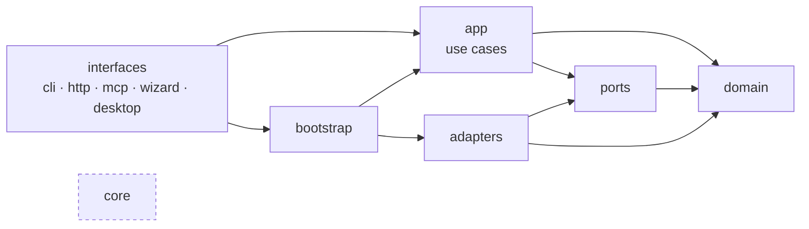

# The kit in layers: a codebase you can change in one place — design

The user's request (2026-11-12): make the kit more scalable, clean code, SOLID, design patterns; "a project we can
touch". Refactor.

## 1. Intent

"Scalable" here means **easy to change**, not "runs more" (decided with the user, §1.1). Today a change rarely stays
in one place:

| Symptom | Measured (2026-11-12, `.camarones/lib`, 112 modules, 33k lines) | Consequence |
|---|---|---|
| One import knot | 61 modules form a single strongly connected import component, hidden behind ~250 imports inside functions (`serve` 76, `camarones` 65, `env` 32) | No layers: touching `docs` can break `serve`; nobody can say what depends on what |
| God modules | `wizard.py` 2563 lines, `env.py` 1921 (templates, prerequisites, MCP wiring, LikeC4, OpenWiki, graphify, Docker, portal, CI, checkpoints, share), `serve.py` 1584, `camarones.py` 1592, `plan.py` 1135 | Every new integration edits the same file |
| if/elif dispatchers | `camarones.main` is 505 lines with ~85 `a.cmd == …` branches; `serve.do_POST` (123 lines) and `api_get` (112) route with `if p == "/api/…"` | Open/Closed broken: a new command or endpoint edits the centre |
| Access policy scattered | `APP_ONLY` regex (`serve.py:37`) plus `/api/app/` prefix plus three `if`s inside handlers (`serve.py:991`, `:1021`, `:1024`) | A route can be added without anyone deciding who may call it |
| Global state at import | `common.ROOT/DOCS/WORKSPACE/CACHE` computed at import; `tests/conftest.py` re-imports every `lib.*` module per test; `harness.ctx.Ctx` exists but 5 modules use it | Fragile tests; 566 `monkeypatch.setattr` calls patch module internals |

What already helps: 34k lines of tests on three OSes, the harness RFC (`docs/research/harness-refactor.md`, H2 chose
ports/adapters), `harness/ports.py` with the `Runner` protocol, `adapters/runners/`, and the ADR feature already split
into a CLI face (`adr_cli.add_parser` / `run`) and an HTTP face (`adr_api.get` / `post`) over one module.

**Done when:** a command that reuses an existing use case is added by touching only `interfaces/cli/`; an endpoint
only `interfaces/http/routes/`; a new external tool means one port (if new) and one adapter; the architecture test
reports 0 layer violations and 0 import cycles; `main()` is under 50 lines; no route is matched with `if p == …`;
`env.py`, `docs.py`, `plan.py`, `serve.py` and `wizard.py` are re-exporting facades only.

**Anti-goals — a failure even if it works:** any 3.x/4.x project that needs a manual step; any CLI command, flag,
alias, `workspace.yaml` key, frontmatter field, `plan.yaml`/`.state.json` field or file location that changes; a
test that keeps passing because it patches a function on a facade that no longer calls it; a long-lived branch that
other sessions cannot merge around; a new dependency or DI framework; a behaviour change hidden inside a move.

### 1.1 Decisions taken with the user (2026-11-12)

| ID | Decision |
|---|---|
| D1 | "Scalable" = easy to change. Running several projects in one process (team server) is out of scope. |
| D2 | Target structure: **hexagonal layers** (`core`, `domain`, `ports`, `adapters`, `app`, `interfaces`), chosen over feature packages and over a minimal flat split. |
| D3 | The rule `interfaces → app → domain ← ports ← adapters`, `core` usable from every layer, enforced by an `ast` test with an allowlist that only shrinks. |
| D4 | Manual dependency injection: a composition root (`bootstrap.py`) builds a `Services` value; no framework. |
| D5 | Static scanners (`inventory`, `schemas`, `radar`, `quickarch`, `genblocks` extractors, `diagrams`) are adapters: the repos are an external system. |
| D6 | CLI commands and use cases are classes (Command pattern); HTTP routes declare their access level; wizard screens are State classes with their strings beside them. |
| D7 | Phases F0–F7 in that order (§6). Old module paths stay as facades for all of 4.x. Frontends untouched. |

## 2. Target architecture

```
.camarones/lib/
  core/        ctx and paths, platform (IS_WIN, IS_MAC, HOME), process (run/out/which/kill_tree), fsutil (json, rmtree), locks
               → imports nothing from lib outside core
  domain/      pure rules and models, no subprocess, no network, no global paths: data in, data out
  ports/       typing.Protocol interfaces the app needs from the outside world → domain types only
  adapters/    implementations of ports: agent CLIs, LikeC4, OpenWiki, graphify, git, forges, Docker,
               OSV, registries, file stores, static analysis of the repos
  app/         one use case per user action; orchestrates domain through ports
  interfaces/  cli/, http/, mcp/, wizard/, desktop/: parse input, call app, render output
  bootstrap.py composition root: picks adapters, builds Services
```



Allowed imports, per layer (`core` is allowed everywhere and omitted):

| From \ to | domain | ports | adapters | app | interfaces | bootstrap |
|---|---|---|---|---|---|---|
| domain | ✓ | | | | | |
| ports | ✓ | ✓ | | | | |
| adapters | ✓ | ✓ | ✓ | | | |
| app | ✓ | ✓ | | ✓ | | |
| interfaces | ✓ (read-only views) | ✓ (types) | | ✓ | ✓ | ✓ |
| bootstrap | ✓ | ✓ | ✓ | ✓ | | |

Nothing imports `interfaces`. `app` never imports an adapter: it receives one through `Services`. `domain` may read
the kit's own shipped data files (such as `pricing.yaml`) through `core`; it never reads the project, the repos, the
machine or the network. Data files
(`pipelines/*.yaml`, `plugins/*/plugin.yaml`, `pricing.yaml`, `dep_categories.yaml`, `search_terms.yaml`,
`adapters/runners/local_models.yaml`) do not move.

`.camarones/lib/` keeps its name and location: `install.py` copies it as is (its `SKIP` set — `__pycache__`,
`node_modules`, `.astro`, `dist`, `.cache` — does not hide any new folder), and `upgrade.py` stages the whole kit.

## 3. Where today's modules go

`→` is the new home; a module with several targets is split. Every old path stays as a facade (§7).

| Today | Target |
|---|---|
| `common.py` | `core/paths.py` (`CTX`, `ROOT`, `CAM_LAYOUT`, `WORKSPACE`, `DOCS`, `WORK`, `WS_FILE`, `CACHE`, `GRAPHS`, `PREFS`; `repo_dir`, `ws_rel`, `rel_file`, `cli_cmd`), `core/process.py` (`which`, `run`, `out`, `kill_tree`, `leave_parent_session`, `PARENT_SESSION`, `ensure_path`, `extra_bin_dirs`, `sdkman_dir`, `uv`, `py`), `core/fsutil.py` (`retry_busy`, `load_json`, `save_json`, `rmtree`), `core/platform.py` (`IS_WIN`, `IS_MAC`, `HOME`). **`VERSIONS` stays in `common.py`**: `install.py:115`, `upgrade.py:76,94,149-162` and every older installed kit read the kit version by searching that file's text |
| `harness/ctx.py`, `harness/locks.py` | `core/ctx.py`, `core/locks.py` |
| `adr_doc.py` | `domain/adr/doc.py` |
| `adr.py` | `domain/adr/model.py` (numbering, states), `app/adr.py` (review and decision actions), `adapters/stores/adr_state.py` (`docs/.work/adr/*.yaml`) |
| `adr_pack.py` | `app/adr_pack.py` |
| `adr_cli.py`, `adr_api.py` | `interfaces/cli/commands/adr.py`, `interfaces/http/routes/adr.py` |
| `stories.py` | `domain/stories/text.py` |
| `stories_save.py`, `stories_ai.py` | `app/stories_save.py`, `app/stories_ai.py` |
| `kanban/{items,state,deps,merge,xid}.py` | `domain/board/` (same names) |
| `kanban/__init__.py`, `kanban/index.py` | `adapters/stores/board.py` (paths, files), `adapters/stores/board_index.py` (SQLite) |
| `kanban/ops.py`, `kanban/repair.py` | `app/board.py`, `app/board_repair.py` |
| `kanban/cli.py` | `interfaces/cli/commands/board.py` (includes the `merge-driver` entry) |
| `harness/pipeline.py`, `harness/routing.py` | `domain/plan/pipeline.py`, `domain/plan/routing.py` |
| `harness/pricing.py`, `harness/ledger.py` | `domain/cost/pricing.py`, `domain/cost/ledger.py` (reading of logs moves to `app/runs.py`) |
| `harness/events.py` | `domain/runs/events.py` (event shapes), `ports/event_log.py`, `adapters/stores/event_log.py` (JSONL) |
| `harness/freshness.py` | `domain/freshness.py` (fingerprint comparison, verdicts), `app/freshness.py` (stamping pages) |
| `harness/ports.py` | `ports/runner.py` |
| `harness/{scheduler,integrate,ab,evals,kpis,drafts,comply,runs,plugins,plugin_store}.py` | `app/` (same names) |
| `harness/worktrees.py` | `adapters/git/worktrees.py` |
| `harness/handoff.py` | `ports/handoff.py`, `adapters/stores/handoff.py` |
| `harness/symbols.py`, `harness/transcripts.py` | `adapters/analysis/symbols.py`, `adapters/claude_transcripts.py` |
| `harness/awake.py` | `adapters/system/awake.py` |
| `docs.py` | `domain/docs/frontmatter.py`, `domain/docs/trust.py`, `domain/docs/search.py` (BM25, synonyms), `adapters/stores/workspace.py` (`workspace.yaml`, legacy layout move), `adapters/stores/doc_state.py` (`.state.json`, `.status.json`), `adapters/git/repos.py` (repo sync), `app/llms.py` (`llms.txt`), `app/translations.py` |
| `plan.py` | `domain/plan/units.py` (types, DAG, `available`, `blueprint`), `domain/plan/prompt.py`, `adapters/stores/plan_yaml.py` (load/save under the lock), `app/autopilot.py` (`_autopilot`, `_run_agent`, limits) |
| `env.py` | adapters: `likec4.py` (`build_c4`, `c4_views`, `arch_validate`, `arch_start`), `openwiki.py` (`wiki_*`, `openwiki_*`, `_WikiRun`, `WikiAbort`), `graphify.py` (`graph`, `build_graphs`, `repo_graph`, `install_graphify_skill`), `docker.py` (`docker_*`, `compose_cmd`, `image_context`), `agent_config.py` (`camarones_mcp`, `likec4_mcp`, `codex_block`, `write_codex_mcp`, `write_agent_config`, `repo_mcp_*`, `claude_config`), `prereqs.py` (`prerequisites`, `install_prereq`, `tool_version`, `npm_global*`, `java_info`, `node_major`), `fs_links.py` (`link`, `_unlink`, `_linked`, `merged_links`, `git_exclude`), `system/os_open.py` (`open_url`, `open_new_terminal`), `git/checkpoint.py`; app: `setup.py` (`setup`, `wire_*`, `install_tools`, `set_profile`, `set_components`), `templates.py` (`fill`, `init_templates`, `kit_skill_files`, `sync_kit_docs`, `refresh_block`), `share.py` (`share`, `sync_status`, `auto_share`, `set_remote`), `export_site.py`, `portal.py` (`serve_local`, `serve_editor`, `stop_local`, `portal_url`, `portal_token`) |
| `inventory.py`, `schemas.py`, `radar.py`, `quickarch.py`, `diagrams.py`, `codemap.py` | `adapters/analysis/` (same names) |
| `genblocks.py` | `adapters/analysis/genblocks.py` (extractors), `app/genblocks.py` (refresh and check of blocks in pages) |
| `history.py` | `adapters/git/history.py` |
| `osv.py`, `binaries.py`, `latest.py` | `adapters/osv.py` (`VulnScanner`), `adapters/binaries.py`, `adapters/registries.py` (`PackageRegistry`) |
| `creds.py`, `sonar.py` | `adapters/forge/creds.py`, `adapters/sonar.py` (ends the `creds` ↔ `sonar` cycle) |
| `terminals.py` | `adapters/pty.py` |
| `machine.py` | `adapters/stores/machine.py` |
| `c4edit.py` | `domain/c4/blocks.py` (rewriting one element block of `.c4` text), `app/c4_edit.py` |
| `ci.py`, `pr.py`, `propose.py`, `sourcelinks.py` | `app/` (same names), forge calls through `ports/forge.py` |
| `agents.py`, `answers.py`, `bump.py`, `budget.py`, `doctor.py`, `exporters.py`, `guide.py`, `health.py`, `hooks.py`, `onboard.py`, `pages.py`, `projects.py`, `quality.py`, `questionnaire.py`, `removed.py`, `review.py`, `sessions.py`, `takeover.py`, `trust.py`, `usage.py` | `app/` (same names; `agents.py` → `app/agent_sessions.py`, `exporters.py` → `app/export.py`) |
| `install.py`, `install_state.py`, `upgrade.py`, `uninstall.py`, `migrate.py`, `reset.py` | `app/lifecycle/` (same names) |
| `adapters/runners/*` | stay |
| `camarones.py` | stays the `uv` inline script (its dependency header) and calls `interfaces/cli/main.py` |
| `catalog.py` | `interfaces/cli/catalog.py`, generated from the registry (§4.1) |
| `serve.py`, `appapi.py` | `interfaces/http/server.py`, `router.py`, `routes/<area>.py`; `appapi` → `routes/app_cmd.py` |
| `mcp.py` | `interfaces/mcp/server.py` |
| `wizard.py`, `tutorial.py` | `interfaces/wizard/app.py`, `screens/*.py`, `tutorial.py` |
| `desktop.py`, `kitdev.py`, `session_run.py` | `interfaces/desktop/` (same names) |

New ports, each added when its adapter moves: `DiagramEngine` (likec4), `WikiEngine` (openwiki), `CodeIndexer`
(graphify, symbols), `Vcs` (git), `Forge` (gh/glab/GitLab API), `VulnScanner` (osv), `PackageRegistry` (latest),
`DocStore` (workspace, pages, state), `EventLog`, `Handoff`.

## 4. Patterns

### 4.1 CLI: Command + registry

```python
# interfaces/cli/commands/adr.py
@command("adr", zone="analyze", verdict="both", es="Decisiones…", en="Decisions…", aliases=())
class Adr:
    def configure(self, parser: argparse.ArgumentParser) -> None: ...
    def run(self, args: argparse.Namespace, services: Services) -> int: ...
```

- `interfaces/cli/registry.py` discovers `interfaces/cli/commands/` with `pkgutil.iter_modules` (stdlib, every OS).
- The decorator carries today's `catalog.COMMANDS` entry (verdict, zone, es/en, ai, destructive, reads), so
  `catalog` is built from the registry and `catalog --check` keeps its contract.
- Cross-cutting behaviour of today's `main()` becomes decorator flags and a short middleware chain (Chain of
  Responsibility): `needs_workspace` (default true; `board merge-driver`, `help`, `catalog` set it false),
  `logs_usage`, JSON output and error-to-exit-code mapping.
- Aliases (`camarones` → `camaron`, any old command name) are declared in the decorator.
- `main()`: parse, run the chain, `registry[cmd].run(args, services)`.

### 4.2 HTTP: Router with access per route

```python
# interfaces/http/routes/adr.py
@route("GET", "/api/adr/{name}", access=PUBLIC)
def show(req: Request, services: Services) -> Response: ...

@route("POST", "/api/app/adr/{action}", access=APP)
def act(req: Request, services: Services) -> Response: ...
```

- Access levels: `PUBLIC` (portal reading), `PORTAL` (portal token: board writes, stories, AI suggestions), `APP`
  (the desktop app's token). The router refuses before the handler runs, with today's bodies (`APP_ONLY_MSG` and
  `"app": true`; `"token": true` for portal-token routes) and status codes.
- `Request` resolves once: host check, JSON body, path parameters, query, `by` (reviewer).
- Jobs and SSE stay a service of the server, injected through `Services`.
- `Handler.do_GET` / `do_POST` become `router.dispatch(request)`.

### 4.3 Wizard: State

Each screen is a class with `render(state) -> View` and `handle(key, state) -> Screen | None`; `wizard/app.py`
only runs the loop. A screen's es/en strings live in its module; a test checks every key exists in both languages.
Screens call `app/` use cases, never adapters.

### 4.4 Use cases and the composition root

```python
class GenerateWiki:
    def __init__(self, docs: DocStore, wiki: WikiEngine, vcs: Vcs, events: EventLog): ...
    def run(self, repo: str, mode: str) -> WikiResult: ...
```

`bootstrap.build(ctx: Ctx) -> Services` builds every adapter and use case once per process. CLI, HTTP, MCP and the
wizard all call the same use case. Tests call `bootstrap.build` with fakes for the ports they care about instead of
patching module attributes.

## 5. Guardrails (phase F0)

- `tests/test_architecture.py` parses every module with `ast`, counting imports at module level **and** inside
  functions. A table assigns a layer to every module, including today's flat ones (§3), so the rule applies from day
  one. Today's violations are listed in `tests/architecture/allowlist.yaml`; the test fails on a violation not in the
  list **and** on a listed one that no longer happens (the list must be trimmed in the same PR).
- The same test counts strongly connected import components: the largest may not grow beyond its recorded size
  (66, as measured by `tests/fixtures/archscan.py`), nor may the total of modules inside such components
  (`cycle_modules`), and each record is lowered whenever it shrinks. `core` is checked by folder as well as by
  layer: nothing in `lib/core` imports anything outside it, with no allowlist.
- File budget: a module over 600 lines must be in the allowlist.
- Facade guard: a facade sets `__facade__ = "<new module>"` and lists its re-exported names in `__all__`. The
  suite's `monkeypatch` fixture refuses to patch a name a facade re-exports, in both the object and the dotted-string
  forms, naming the module to patch instead. A facade holds only a docstring, imports and literal assignments (its
  own data, such as `VERSIONS`, stays out of `__all__` and can be patched).
- CLI snapshot: for every command and subcommand, its options (dest, flags, default, choices, nargs) and
  positionals, recorded once in `tests/snapshots/cli.json`; any difference fails.
- HTTP snapshot: every route as (method, path pattern, access level) in `tests/snapshots/routes.json`. F0 writes
  the list of today's paths by hand from `serve.py` (its `if p == …` branches, `APP_ONLY`, the `*_POST` regexes and
  `api_get` names) and records each path's status with no token, the portal token and the app token. After F3 the
  router produces the same table from its declarations, and the test compares the two.

## 6. Phases

One phase = one implementation plan = several small PRs. Every PR keeps `uv run pytest -n auto` green on macOS,
Windows and Linux, runs the sandbox (`scripts/sandbox.py`) for the flows it touches, and states how much the
allowlist shrank.

| Phase | Scope | Exit |
|---|---|---|
| F0 Guardrails | §5 | Tests in CI, recording today's state; no code moved |
| F1 Core | `core/` from `common.py`, `harness/ctx.py`, `harness/locks.py`; `common.py` a facade that keeps `VERSIONS` | `common` holds `VERSIONS` and re-exports only; nothing in `core/` imports outside it |
| F2 CLI | `interfaces/cli/` registry and middleware; commands moved one group per PR; catalog generated | `main()` < 50 lines; CLI snapshot unchanged |
| F3 HTTP | `interfaces/http/` server, router, `Request`; routes moved one area per PR; access centralised | No `if p == "/api…"`; routes snapshot unchanged; every route has a 3-token access test |
| F4 `env.py` | One adapter per PR with its port (likec4, openwiki, graphify, docker, agent_config, prereqs, fs_links, os_open, git checkpoint), then `app/setup`, `app/templates`, `app/share`, `app/export_site`, `app/portal` | `env.py` facade only |
| F5 Domain | `docs.py`, `plan.py`, `adr.py`, `kanban/`, `harness/` split per §3 | Those modules facades only; domain tests need no workspace on disk |
| F6 Wizard | `interfaces/wizard/` loop and screens; strings beside screens | `wizard.py` facade only; `test_wizard.py` and `TUTORIAL.md` regeneration unchanged |
| F7 Close-out | Remaining modules to their layer; imports inside functions removed where a layer allows the top-level import | Allowlist empty; 0 cycles; 0 files over 600 lines |

## 7. Compatibility (AGENTS.md §2.3)

- Every moved module leaves a facade at its old path with **explicit** re-exports (no `import *`), `__facade__` and
  `__all__` (§5). Facades stay for all of 4.x; removing them is a major-version decision. `lib/common.py` is also the
  permanent home of `VERSIONS` (§3).
  `tests/fixtures/index_worker.py` (`from lib.kanban import index`) and any project plugin that imports `lib.*`
  keep working.
- No data changes: commands, flags, aliases, `workspace.yaml` keys, frontmatter fields, `plan.yaml` and
  `.state.json` fields and file locations stay as they are. The F0 snapshots prove the CLI and HTTP surfaces.
- No `VERSIONS["kit"]` bump while nothing is visible to projects; each commit body says "nothing a user notices"
  (AGENTS.md §5.1).
- The PR that moves a module updates `AGENTS.md` §4 (repo map) and `templates/docs/guides/internals.md` with its
  twin `templates/docs/i18n/es/guides/internals.md` where they name the module.
- Moves use `git mv` so history follows the file. Module names never differ from an existing one only by case
  (case-insensitive filesystems on macOS and Windows).

## 8. Risks

| Risk | Mitigation |
|---|---|
| A test patches `env.foo` after `foo` moved and passes for the wrong reason | Facade guard (§5); the moving PR retargets the patches |
| Parallel sessions edit a module while it moves | Small PRs, merged fast; one module family per PR; rebase before merge |
| Imports inside functions keep hiding cycles | The architecture test counts them like top-level imports |
| A move changes behaviour silently | CLI and HTTP snapshots; characterization tests before touching untested code (AGENTS.md §2.2) |
| Windows: paths, symlinks and junctions in `fs_links` | That adapter keeps today's tests and runs on the Windows CI job before merge |
| `conftest.py` reloading `lib.*` per test misses new packages | `purge_kit_modules` already drops every `lib.*` module, `lib.core.*` included; F1 adds a test that importing `lib.common` alone still extends PATH |
| Moving `VERSIONS` would break upgrades from every installed 4.x kit | It stays in `common.py`; F1 tests that `upgrade._version_in` and `install.py`'s regex still find it there |

## 9. Out of scope

The portal and desktop frontends; several projects per process and `Ctx` threaded through every call (D1); new
features; any user-visible rename; a DI framework; new dependencies.
